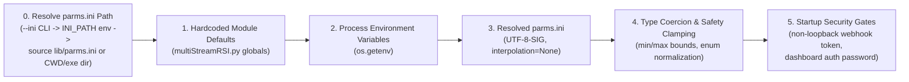

<div align="center">

# JBOA-RSI CONFIGURATION, API & TROUBLESHOOTING REFERENCE

### Exhaustive `lib/parms.ini` Schema, Environment Overrides, Port 5000 & 5001 HTTP APIs, and Diagnostic Runbook

**Document ID:** `JBOA-RSI-DOC-04`  
**Scope:** Every Configuration Parameter in `multiStreamRSI.py`, All Flask Endpoints (Ports `5000` & `5001`), Redacted `parms.ini` Template, & Code-Grounded Troubleshooting  
**Security Policy:** All credentials use `<PLACEHOLDER>` tokens — zero real secrets appear in this document  
**Audience:** Quantitative Engineers, System Administrators, & API Integrators

</div>

**Navigation:** [Overview (`README.md`)](../README.md) · [Changelog (`CHANGELOG.md`)](./CHANGELOG.md) · [Trading Algorithms & Risk](./TRADING_ALGORITHMS_AND_RISK.md) · [Option Buyer Guide](./OPTION_BUYER_GUIDE.md) · [Option Seller & Stop-Loss Guide](./OPTION_SELLER_AND_STOP_LOSS_GUIDE.md) · [Frontend Dashboard](./FRONTEND_DASHBOARD.md) · [Deployment & Operations](./DEPLOYMENT_AND_OPERATIONS.md) · **Configuration & API Reference**

---

## Table of Contents

1. [Configuration Precedence and Loading Order](#1-configuration-precedence-and-loading-order)
2. [Complete `lib/parms.ini` and Environment Variable Reference](#2-complete-libparmsini-and-environment-variable-reference)
   - [2.1 Section `general`: Timezone and Instance Ownership](#21-section-general-timezone-and-instance-ownership)
   - [2.2 Section `symbols`: Tracked Equity Universe](#22-section-symbols-tracked-equity-universe)
   - [2.3 Section `market_signal_providers`: Market Signal Feeds and Consensus Priority](#23-section-market_signal_providers-market-signal-feeds-and-consensus-priority)
   - [2.4 Sections `CREDENTIALS`, `alpaca_api`, `twelvedata_api`, `tastytrade_api`: Broker and Data Auth](#24-sections-credentials-alpaca_api-twelvedata_api-tastytrade_api-broker-and-data-auth)
   - [2.5 Section `option_trading`: Broker Routing, Chain Pacing, Option History and Position Polling](#25-section-option_trading-broker-routing-chain-pacing-option-history-and-position-polling)
   - [2.6 Section `kinematics`: Smoothing, RSI Session Mode and Warmup](#26-section-kinematics-smoothing-rsi-session-mode-and-warmup)
   - [2.7 Section `option_buyer`: Entry Guardrails, Sizing and Pricing](#27-section-option_buyer-entry-guardrails-sizing-and-pricing)
   - [2.8 Section `option_seller`: 4-Tier Exit Waterfall and Risk Controls](#28-section-option_seller-4-tier-exit-waterfall-and-risk-controls)
   - [2.9 Section `chart_capture`: 1-Minute PNG Chart Archiver](#29-section-chart_capture-1-minute-png-chart-archiver)
   - [2.10 Section `dashboard`: Web UI Host, Adaptive TLS and Auth](#210-section-dashboard-web-ui-host-adaptive-tls-and-auth)
   - [2.11 Section `webhook`: TradingView Webhook Receiver](#211-section-webhook-tradingview-webhook-receiver)
   - [2.12 Environment-Only Settings](#212-environment-only-settings)
3. [Redacted Reference `lib/parms.ini` Template](#3-redacted-reference-libparmsini-template)
4. [HTTP API Reference: Port 5000 (TradingView Webhook Receiver)](#4-http-api-reference-port-5000-tradingview-webhook-receiver)
5. [HTTP API Reference: Port 5001 (Operational Dashboard and Admin CLI)](#5-http-api-reference-port-5001-operational-dashboard-and-admin-cli)
   - [5.1 Authentication Methods and Rate Limiting](#51-authentication-methods-and-rate-limiting)
   - [5.2 Endpoint Catalog](#52-endpoint-catalog)
   - [5.3 Safe `curl` Examples](#53-safe-curl-examples)
6. [Code-Grounded Troubleshooting Runbook](#6-code-grounded-troubleshooting-runbook)

---

## 1. Configuration Precedence and Loading Order

Implemented in `multiStreamRSI.py :: resolve_parms_ini_path()`, `_apply_ini_feature_settings()`, and `load_settings()`:



- **File Path Resolution (`resolve_parms_ini_path`):** Checks (1) explicit `ini_path` parameter, (2) CLI `--ini <path>` / `--ini=<path>`, (3) `INI_PATH` environment variable, (4) `Path(__file__).resolve().parent / "lib" / "parms.ini"` when running uncompiled from source, or existing `parms.ini` / `lib/parms.ini` in CWD/executable directory when compiled with Nuitka `--onefile` (avoiding `/tmp/onefile_*`).
- For feature settings parsed via `_ini_str`, `_ini_bool`, `_ini_int`, `_ini_float`, **`parms.ini` takes precedence when the section/option is present**, falling back to the corresponding environment variable, then to the hardcoded Python default.
- For credentials (`ALPACA_API_KEY`, `ALPACA_SECRET_KEY`, `TRADIER_TOKEN`, `TWELVEDATA_API_KEY`, Tastytrade OAuth tokens), values are loaded from `parms.ini` (`[CREDENTIALS]`, `[twelvedata_api]`, `[tastytrade_api]`) with environment variable fallback. **Never commit `lib/parms.ini` or `.env` to version control.**

---

## 2. Complete `lib/parms.ini` and Environment Variable Reference

### 2.1 Section `general`: Timezone and Instance Ownership

| INI Key | Env Fallback | Type / Options | Default | Runtime Effect |
| :--- | :--- | :--- | :--- | :--- |
| `timezone` | `DISPLAY_TIMEZONE` | String (`PST`, `EST`, `CST`, `MST`, `UTC`, or IANA string like `America/Los_Angeles`) | `PST` | Controls display timezone for dashboard charts, countdown labels, option-chain filenames, and chart PNG filenames. Internal market-session math and RSI cutoffs remain anchored to `America/New_York` (US/Eastern) and UTC. |
| `owner` | `INSTANCE_OWNER` | String (e.g., `billt`, `jboa`) | `""` | Drives dashboard multi-instance color identity, browser tab prefix (`[owner - tx_provider]`), and header/panel chips. |
| `nasdaq_must_be_positive` | `NASDAQ_MUST_BE_POSITIVE` | Bool | `false` | When `true`, `OptionBuyer` requires the tracked NASDAQ symbol's live price minus its previous trading day's close (`prev_close`, matching brokers/Yahoo/TradingView) to be strictly positive (`diff > 0`) before placing a buy order, logging `nasdaq_down(...)` on rejection. Even when `false`, the engine always collects `prev_close` and every 1-minute price during RTH, persisting snapshots to `logs/nasdaq/<SYMBOL>-<RUN_ID>.log` and `minute-summary-*.jsonl`. |
| `nasdaq_symbol` | `NASDAQ_SYMBOL` | String (ticker) | `QQQ` | Ticker symbol tracked by `NasdaqMarketTracker` at the start of the trading day and every minute during regular market hours. Normalized to uppercase. |
| `rsi_30d_enabled` | `RSI_30D_ENABLED` | Bool | `false` | When `true`, activates the `OptionBuyer` buy gate requiring strictly `rsi_30d > rsi_30d_min` before purchasing an option. Even when `false`, the engine always seeds 30-day daily Wilder RSI baselines, computes live `rsi_30d` alongside every 1-minute RSI update, persists `rsi_30d` in logs (`minute-summary-*.jsonl`, `option_buyer/*.log`, `option_seller/*.log`), and displays `30D RSI` across all dashboard panels. |
| `rsi_30d_min` | `RSI_30D_MIN` | Float | `30.0` | Minimum 30-day Wilder RSI threshold required when `rsi_30d_enabled = true`; `OptionBuyer` requires strictly `rsi_30d > rsi_30d_min` and logs `rsi_30d_below_min(...)` or `rsi_30d_unavailable(...)` when blocked. |
| `options_only` | `OPTIONS_ONLY` *(legacy fallback `OPTION_SELL_OPTIONS_ONLY`)* | Bool | `true` | Major buy & sell gate (consolidated from legacy `[option_seller] options_only` and `peak_profit_calls_only`). When `true`, restricts `OptionBuyer` purchases (`options_only_non_option_contract`), `OptionSeller` exits (`options_only_equity_ignored`), and Tier 1/3 peak-profit guards strictly to OCC option contracts (ignoring stock/equity holdings). |
| `history_max_bars` | `HISTORY_MAX_BARS` *(legacy fallbacks `KINEMATICS_HISTORY_MAX_BARS`, `OPTION_HISTORY_MAX_BARS`)* | Int (min `60`) | `2400` | Unified 1-minute bar retention cap per underlying `(provider, symbol)` feed in `MinuteCoordinator` and per tracked option contract in `OptionContractHistoryTracker` (~6.15 regular trading days; consolidated from legacy `[kinematics]`/`[option_trading]`/`[option_history]` in `v0.1.31` with backwards-compatible fallback). |

### 2.2 Section `symbols`: Tracked Equity Universe

| INI Key | Env Fallback | Type / Options | Default | Runtime Effect |
| :--- | :--- | :--- | :--- | :--- |
| `target_symbols` | `TARGET_SYMBOLS` | CSV string (`AAPL,NVDA,TSLA`) or JSON array (`["AAPL","NVDA"]`) | Built-in default list | Defines the exact ticker universe subscribed across all enabled streams, warmed up at startup, and tracked in `MinuteCoordinator`. Normalized to uppercase. |

### 2.3 Section `market_signal_providers`: Market Signal Feeds and Consensus Priority

| INI Key | Env Fallback | Type / Options | Default | Runtime Effect |
| :--- | :--- | :--- | :--- | :--- |
| `ALPACA.enabled` | — | Bool | `false` | Enables Alpaca 1m bar WebSocket stream (`wss://stream.data.alpaca.markets/v2/<feed>`) + REST historical warmup. |
| `TASTYTRADE.enabled` | — | Bool | `false` | Enables Tastytrade DXLink WebSocket stream (#1 live 1m candles + #2 warmup/history). |
| `TRADINGVIEW.enabled` | — | Bool | `false` | Starts Flask webhook receiver (`TradingviewProvider`) on `[webhook] host:port`. |
| `TRADIER.enabled` | — | Bool | `false` | Enables Tradier WebSocket/marketstream feed. |
| `TWELVEDATA.enabled` | — | Bool | `false` | Enables Twelve Data real-time price WebSocket feed. |
| `YAHOOFINANCE.enabled` | — | Bool | `false` | Enables periodic Yahoo Finance REST polling (`YAHOO_POLL_SECONDS`, default `30s`). |
| `priority` | `PROVIDER_PRIORITY` | CSV of provider names | `ALPACA,TASTYTRADE,TRADINGVIEW,TRADIER,TWELVEDATA,YAHOOFINANCE` | Determines provider precedence when synthesizing **Consolidated** kinematics, selecting the authoritative RSI for option triggers, and tie-breaking multi-feed snapshots. |

### 2.4 Sections `CREDENTIALS`, `alpaca_api`, `twelvedata_api`, `tastytrade_api`: Broker and Data Auth

| Section & INI Key | Env Fallback | Type / Options | Default | Runtime Effect |
| :--- | :--- | :--- | :--- | :--- |
| `[CREDENTIALS] api_key` | `ALPACA_API_KEY` | Secret string | `<ALPACA_API_KEY>` | Alpaca API Key ID (market data + paper/live trading). |
| `[CREDENTIALS] secret_key` | `ALPACA_SECRET_KEY` | Secret string | `<ALPACA_SECRET_KEY>` | Alpaca API Secret Key. |
| *(via `load_tradier_token`)* | `TRADIER_TOKEN` | Secret string | `<TRADIER_TOKEN>` | Tradier bearer token (loaded via `lib/utils.py` or env). |
| `[alpaca_api]` or `[alpaca]` `feed` | `ALPACA_FEED` | `iex` \| `sip` | `iex` | Alpaca equity market-data feed tier. Use `sip` only with a paid Alpaca SIP subscription. |
| `[twelvedata_api] twelvedata_api_key` | `TWELVEDATA_API_KEY` | Secret string | `<TWELVEDATA_API_KEY>` | Twelve Data API key. |
| `[tastytrade_api] transaction_env` | `TASTYTRADE_TRANSACTION_ENV` | `sandbox` \| `prod` \| `live` | `sandbox` | Selects whether Tastytrade order routing & positions hit Sandbox (`api.cert.tastyworks.com`) or Production (`api.tastyworks.com`). **Market data / DXLink always uses Production OAuth credentials.** |
| `[tastytrade_api] account_number` | `TASTYTRADE_ACCOUNT_NUMBER` | String | `""` | Generic fallback Tastytrade account ID. |
| `[tastytrade_api] prod_account_number` | `TASTYTRADE_PROD_ACCOUNT_NUMBER` | String | `""` | Production Tastytrade account ID (used when `transaction_env=prod|live`). |
| `[tastytrade_api] sandbox_account_number` | `TASTYTRADE_SANDBOX_ACCOUNT_NUMBER` | String | `""` | Sandbox Tastytrade account ID (used when `transaction_env=sandbox`). |
| `[tastytrade_api] prod_client_id` / `prod_client_secret` / `prod_refresh_token` | `TASTYTRADE_PROD_CLIENT_ID` / `_SECRET` / `_REFRESH_TOKEN` | Secret strings | `<TASTYTRADE_PROD_*>` | Production OAuth2 credentials (used for DXLink market data, option chains, and prod orders). |
| `[tastytrade_api] sandbox_client_id` / `sandbox_client_secret` / `sandbox_refresh_token` | `TASTYTRADE_SANDBOX_CLIENT_ID` / `_SECRET` / `_REFRESH_TOKEN` | Secret strings | `<TASTYTRADE_SANDBOX_*>` | Sandbox OAuth2 credentials (used for sandbox orders & positions). |

### 2.5 Section `option_trading`: Broker Routing, Chain Pacing, Option History and Position Polling

| INI Key | Env Fallback | Type / Options | Default | Runtime Effect |
| :--- | :--- | :--- | :--- | :--- |
| `optionchainprovider` | `OPTION_CHAIN_PROVIDER` | `alpaca` \| `tastytrade` | `alpaca` | Strictly selects the option-chain data source. **Zero silent cross-broker fallback.** |
| `transactionprovider` | `OPTION_TRANSACTION_PROVIDER` | `alpaca` \| `tastytrade` | `alpaca` | Strictly selects the execution broker for `PositionMonitor`, `OptionBuyer`, and `OptionSeller`. **Zero silent cross-broker fallback.** |
| `chain_cooldown_seconds` | `OPTION_CHAIN_RSI_COOLDOWN_SECONDS` | Float ($\ge 0$) | `0` | Per-symbol cooldown between RSI-triggered option chain JSON captures in `RsiOptionChainCollector`. |
| `chain_pacing_seconds` | `OPTION_CHAIN_PACING_SECONDS` | Float ($\ge 0$) | `0.20` | Minimum inter-request spacing between option-chain HTTP fetches to avoid broker rate limits. |
| `chain_429_backoff_seconds` | `OPTION_CHAIN_429_BACKOFF_SECONDS` | Float (min `5.0`) | `20.0` | Cooldown pause applied globally to option-chain fetches after receiving an HTTP `429 Too Many Requests`. |
| `chain_include_greeks` | `OPTION_CHAIN_INCLUDE_GREEKS` | Bool | `true` | Requests/enriches Delta, Gamma, Theta, Vega, and IV on option chain snapshots (including DXLink `Greeks` subscription on Tastytrade). |
| `pre_entry_lookback_minutes` | `OPTION_HISTORY_PRE_ENTRY_MINUTES` | Int (min `0`) | `390` | Minutes of historical option prices backfilled *prior* to contract entry for drilldown chart context (`390` = 1 full RTH day; legacy `[option_history]` fallback supported). |
| `position_poll_seconds` | `OPTION_POSITION_POLL_SECONDS` | Int (clamped `5`–`60`) | `15` | Broker account position polling interval in `PositionMonitor` (legacy `[option_history]` fallback supported). |

### 2.6 Section `kinematics`: Smoothing, RSI Session Mode and Warmup

| INI Key | Env Fallback | Type / Options | Default | Runtime Effect |
| :--- | :--- | :--- | :--- | :--- |
| `smooth_method` | `KINEMATICS_SMOOTH_METHOD` | `hma` \| `ema` \| `none` | `hma` | Price smoother applied before computing velocity $v$, acceleration $a$, and next-step forecast $\hat{P}_{t+1}$. |
| `smooth_period` | `KINEMATICS_SMOOTH_PERIOD` | Int (min `2`) | `14` | Lookback period for `HMA(n)` or `EMA(n)`. |
| `rsi_overbought` | `KINEMATICS_RSI_OVERBOUGHT` | Float | `70.0` | Upper RSI boundary for Forecast Matrix zone classification and 3-panel chart red band. |
| `rsi_oversold` | `KINEMATICS_RSI_OVERSOLD` | Float | `30.0` | Lower RSI boundary for Forecast Matrix zone classification and 3-panel chart green band. |
| `rsi_warmup_sessions` | `RSI_WARMUP_SESSIONS` | Int (min `0`) | `5` | Number of prior trading sessions fetched at startup to converge Wilder RSI(14) before emitting live minutes (`0` disables pre-warmup). |
| `rsi_session` | `RSI_SESSION_MODE` | `extended` (`eth`,`ext`,`all`) \| `regular` (`rth`,`reg`) | `extended` | Controls whether RSI warmup & live updates include Extended Trading Hours (04:00–20:00 ET) or restrict strictly to Regular Trading Hours (09:30–16:00 ET). |
| `summary_delay_seconds` | `SUMMARY_DELAY_SECONDS` | Float (`0`–`3600`) | `45.0` | Maximum safety-deadline delay (in seconds) after a 1-minute bar closes before `MinuteCoordinator` finalizes the minute and triggers `RsiOptionChainCollector`, `OptionBuyer`, and `OptionSeller` (also accepted in `[general]`). For streaming-only feeds (Alpaca/Tastytrade), `10`–`15`s is typical; keep `40`–`45`s if `YAHOOFINANCE` is enabled. |
| `early_finalize_on_complete` | `EARLY_FINALIZE_ON_COMPLETE` | Bool | `false` | When `true`, finalizes the minute as soon as `early_finalize_min_delay_seconds` has elapsed **and** every currently connected provider has reported a completed candle for every tracked symbol (falling back to `summary_delay_seconds` if any symbol is missing or slow). |
| `early_finalize_min_delay_seconds` | `EARLY_FINALIZE_MIN_DELAY_SECONDS` | Float (`>= 0`, clamped to `<= summary_delay_seconds`) | `2.0` | Minimum settling delay after `:00` minute close before `early_finalize_on_complete` is permitted to fire (e.g., `2.0`–`3.0`s so late ticks/revisions settle cleanly). |

### 2.7 Section `option_buyer`: Entry Guardrails, Sizing and Pricing

| INI Key | Env Fallback | Type / Options | Default | Runtime Effect |
| :--- | :--- | :--- | :--- | :--- |
| `enabled` | `OPTION_BUY_ENABLED` | Bool | `true` | Master enable switch for `OptionBuyer`. |
| `dry_run` | `OPTION_BUY_DRY_RUN` | Bool | `true` | When `true`, evaluates all filters and logs simulated `BUY` fills into `OptionContractHistoryTracker` without sending broker orders. |
| `paper` | `ALPACA_PAPER` | Bool | `true` | Selects Alpaca Paper (`true`) vs. Live (`false`) endpoint when `transactionprovider = alpaca`. |
| `rsi_low` | `OPTION_BUY_RSI_LOW` | Float | `35.0` | Oversold RSI threshold triggering option-chain capture and qualifying a symbol's oversold lookback window. |
| `rsi_high` | `OPTION_BUY_RSI_HIGH` | Float | `65.0` | Shared upper RSI threshold (overridable by `[option_seller] rsi_high`). |
| `qty` | `OPTION_BUY_QTY` | Int (min `1`) | `1` | Fixed option contract quantity per entry order. |
| `order_type` | `OPTION_BUY_ORDER_TYPE` | `limit` \| `market` | `limit` | Entry order execution type. |
| `cooldown_minutes` | `OPTION_BUY_COOLDOWN_MINUTES` | Int | `15` | Per-underlying lockout after an entry order before another entry is permitted. |
| `max_open_contracts` | `OPTION_BUY_MAX_OPEN_CONTRACTS` | Int (min `1`) | `5` | Portfolio-wide cap on concurrent open option positions. |
| `max_contract_age_seconds` | `OPTION_BUY_MAX_CONTRACT_AGE_SECONDS` | Int (min `30`) | `180` | Maximum allowed staleness of cached option chain snapshot before rejecting or re-fetching. |
| `fetch_if_missing` | `OPTION_BUY_FETCH_IF_MISSING` | Bool | `true` | Allows the buyer to trigger an on-demand option chain fetch if no fresh cached chain exists for a qualified symbol. |
| `allow_duplicate_underlying` | `OPTION_BUY_ALLOW_DUPLICATE_UNDERLYING` | Bool | `false` | When `false`, blocks opening a new option contract if the broker account already holds any option on that underlying. |
| `require_projection_alignment` | `OPTION_BUY_REQUIRE_PROJECTION_ALIGNMENT` | Bool | `true` | Requires $\hat{P}_{t+1} > P_t$ (Calls) or $\hat{P}_{t+1} < P_t$ (Puts). |
| `require_right_match` | `OPTION_BUY_REQUIRE_RIGHT_MATCH` | Bool | `true` | Ensures Call contracts only open on bullish signals and Put contracts only open on bearish signals. |
| `require_positive_velocity` | `OPTION_BUY_REQUIRE_POSITIVE_VELOCITY` | Bool | `true` | Blocks Call entry if price velocity $v_t \le 0$ (rejects falling knives). |
| `oversold_lookback_minutes` | `OPTION_BUY_OVERSOLD_LOOKBACK_MINUTES` | Int | `3` | Lookback window requiring RSI $\le$ `rsi_low` within the last $N$ minutes to confirm an oversold bounce setup. |
| `bounce_rsi_max` | `OPTION_BUY_BOUNCE_RSI_MAX` | Float | `45.0` | Upper RSI ceiling on entry so late-chasing bounces above 45 RSI are rejected (`bounce_rsi_too_high`). |
| `max_spread_pct` | `OPTION_BUY_MAX_SPREAD_PCT` | Float | `5.0` | Maximum allowed `(ask - bid) / mid * 100` option bid-ask spread percentage (`spread_too_wide`). |
| `limit_aggression` | `OPTION_BUY_LIMIT_AGGRESSION` | Float (clamped `0.0`–`1.0`) | `0.25` | Limit price placement across the spread: `mid + limit_aggression * (ask - mid)` (`0.0` = mid, `1.0` = ask). |
| `max_buys_per_minute` | `OPTION_BUY_MAX_BUYS_PER_MINUTE` | Int | `1` | Hard rate limit on maximum buy orders submitted in a single minute boundary. |
| `max_single_trade_dollars` | `OPTION_BUY_MAX_SINGLE_TRADE_DOLLARS` | Float (min `0.0`) | `8000.0` | Maximum dollar value of a single buy trade (`unit_price × qty × 100`); auto-scales whole contract `qty` down (min `1`) or rejects if even 1 contract exceeds the cap (`0` disables). |
| `invest_buffer_withhold_pct` | `OPTION_BUY_INVEST_BUFFER_WITHHOLD_PCT` | Float (`0.0`–`100.0`) | `10.0` | Reserve buffer percentage withheld from total investable capital (`available + invested`); auto-scales whole contract `qty` down (min `1`) or rejects so invested balance never exceeds `(1 - withhold_pct/100)` of total investable balance. |
| `allowed_forecasts` | `OPTION_BUY_ALLOWED_FORECASTS` | CSV of forecast codes | `bullish_reversal,bullish_continuation,bullish_momentum` | Whitelist of Forecast Matrix signals permitted to enter long Call positions (used in `entry_mode = kinematics_forecast`). |
| `entry_mode` | `OPTION_BUY_ENTRY_MODE` | `kinematics_forecast` \| `rsi_ex_ante` | `kinematics_forecast` | `kinematics_forecast` preserves the default RSI + acceleration/crossover/forecast + Taylor $\Delta\hat{P}$ gate. `rsi_ex_ante` qualifies strictly on live oversold RSI (or bounce lookback) without requiring `forecast_direction` or 1-minute Taylor `projected_delta > 0`, while still respecting `require_positive_velocity`, bounce velocity `v > 0`, and blocking accelerating drops (`v < 0` and `a <= 0`). |
| `entry_window_start_et` | `OPTION_BUY_ENTRY_WINDOW_START_ET` | `HH:MM` (24h US/Eastern) or empty | `""` | Optional earliest US/Eastern time-of-day allowed for new option buys (e.g., `09:45` to skip opening volatility). Empty disables the lower time bound. |
| `entry_window_end_et` | `OPTION_BUY_ENTRY_WINDOW_END_ET` | `HH:MM` (24h US/Eastern) or empty | `""` | Optional latest US/Eastern time-of-day allowed for new option buys (e.g., `15:30` to avoid late-day theta burn). Empty disables the upper time bound. |
| `contract_selection_mode` | `OPTION_BUY_CONTRACT_SELECTION_MODE` | `plus2_otm` \| `atm` \| `itm1` \| `itm2` \| `otm1` \| `atm_itm_low_spread` \| `delta_mid` \| `delta_itm_low_spread` \| `composite_score` | `plus2_otm` | Selects which strike to buy from the already-fetched pruned `chain_snapshot` using strictly live, zero-hindsight buy-time data (mirrors `findthewinners.py :: _pick_ex_ante_candidate()`). `plus2_otm` keeps legacy +2 OTM selection untouched. |
| `contract_target_delta` | `OPTION_BUY_CONTRACT_TARGET_DELTA` | Float (clamped `0.05`–`0.95`) | `0.55` | Target absolute delta ($\|\Delta\|$) used by `delta_mid`, `delta_itm_low_spread`, and `composite_score` modes. |
| `contract_delta_min` | `OPTION_BUY_CONTRACT_DELTA_MIN` | Float (clamped `0.0`–`1.0`) | `0.45` | Minimum $\|\Delta\|$ bound for `delta_mid` (and lower floor `max(0.55, contract_delta_min)` for `delta_itm_low_spread`). |
| `contract_delta_max` | `OPTION_BUY_CONTRACT_DELTA_MAX` | Float (clamped `contract_delta_min`–`1.0`) | `0.70` | Maximum $\|\Delta\|$ bound for `delta_mid` (and upper bound `max(0.85, contract_delta_max)` for `delta_itm_low_spread`). |
| `contract_min_open_interest` | `OPTION_BUY_CONTRACT_MIN_OPEN_INTEREST` | Int (min `0`) | `0` | Hard minimum contract `open_interest` required during ex-ante strike selection (`0` disables; when `> 0`, contracts missing OI are excluded). |
| `contract_min_volume` | `OPTION_BUY_CONTRACT_MIN_VOLUME` | Int (min `0`) | `0` | Hard minimum contract session `volume` required during ex-ante strike selection (`0` disables; when `> 0`, contracts missing volume are excluded). |
| `contract_budget_stepdown` | `OPTION_BUY_CONTRACT_BUDGET_STEPDOWN` | Bool | `true` | When `true` and `contract_selection_mode != plus2_otm`, filters candidates against the active 1-contract budget (`min(max_single_trade_dollars, remaining_investable_budget)`) and automatically steps outward from an over-budget ITM/ATM strike to the nearest affordable strike instead of rejecting. |

### 2.8 Section `option_seller`: 4-Tier Exit Waterfall and Risk Controls

| INI Key | Env Fallback | Type / Options | Default | Runtime Effect |
| :--- | :--- | :--- | :--- | :--- |
| `enabled` | `OPTION_SELL_ENABLED` | Bool | `true` | Master enable switch for `OptionSeller`. |
| `dry_run` | `OPTION_SELL_DRY_RUN` | Bool | `true` | Simulates exits and records closed trades in `OptionContractHistoryTracker` without sending live close orders. |
| `paper` | `OPTION_SELL_PAPER` | Bool | Inherits `ALPACA_PAPER` (`true`) | Alpaca Paper vs. Live override for seller client. |
| `rsi_high` | `OPTION_SELL_RSI_HIGH` | Float | Inherits `[option_buyer] rsi_high` (`65.0`) | Overbought RSI threshold for Tier 4 kinematic exit evaluation. |
| `qty` | `OPTION_SELL_QTY` | Int | `1` | Partial exit contract quantity (used only when `close_full_position = false`). |
| `close_full_position` | `OPTION_SELL_CLOSE_FULL_POSITION` | Bool | `true` | Closes 100% of the open contract quantity on exit trigger. |
| `order_type` | `OPTION_SELL_ORDER_TYPE` | `limit` \| `market` | `limit` | Exit order type for standard exits. |
| `cooldown_minutes` | `OPTION_SELL_COOLDOWN_MINUTES` | Int | `15` | Per-symbol cooldown between exit orders. |
| `min_hold_minutes` | `OPTION_SELL_MIN_HOLD_MINUTES` | Int | `5` | Minimum holding grace period before Tier 4 RSI exits fire (`hold_grace`); bypassed by hard stop loss & profit targets as coded. |
| `require_projection_alignment` | `OPTION_SELL_REQUIRE_PROJECTION_ALIGNMENT` | Bool | `true` | Requires $\hat{P}_{t+1} < P_t$ (for Calls) before Tier 4 RSI exit executes. |
| `allowed_forecasts` | `OPTION_SELL_ALLOWED_FORECASTS` | CSV of forecast codes | `bearish_reversal,bearish_continuation,bearish_momentum` | Whitelist of Forecast Matrix signals allowed to fire Tier 4 exits. |
| `limit_discount_pct` | `OPTION_SELL_LIMIT_DISCOUNT_PCT` | Float | `0.5` | Percentage discount below bid/mark applied to standard limit exit prices to improve fill rate. |
| `stop_loss_limit_discount_pct` | `OPTION_SELL_STOP_LOSS_LIMIT_DISCOUNT_PCT` | Float | `3.0` | Deeper limit discount used on stop-loss exits to ensure rapid liquidation. |
| `stop_loss_force_market` | `OPTION_SELL_STOP_LOSS_FORCE_MARKET` | Bool | `false` | Forces `market` order type specifically on stop-loss triggers regardless of `order_type`. |
| `profit_target_enabled` | `OPTION_SELL_PROFIT_TARGET_ENABLED` | Bool | `true` | Enables **Tier 1** Profit Target exit. |
| `profit_target_pct` | `OPTION_SELL_PROFIT_TARGET_PCT` | Float | `25.0` | Exits immediately when unrealized `pnl_pct >= 25.0%`. |
| `take_profit_require_profit` | `OPTION_SELL_TAKE_PROFIT_REQUIRE_PROFIT` | Bool | `true` | Guards **Tier 2** (`kind=take_profit`, Overbought RSI + Bearish Kinematics) so it only exits when unrealized `pnl_pct` is profitable (`> 0.0%` by default, or `>= take_profit_min_pnl_pct` when `> 0`), preventing `take_profit` exits at a loss (fails closed if `pnl_pct` is unavailable). |
| `take_profit_min_pnl_pct` | `OPTION_SELL_TAKE_PROFIT_MIN_PNL_PCT` | Float (min `0.0`) | `0.0` | Optional minimum profit percentage floor for Tier 2 `kind=take_profit` when `take_profit_require_profit = true`. `0.0` requires strictly `pnl_pct > 0.0%`; any value `> 0.0` requires `pnl_pct >= take_profit_min_pnl_pct`. |
| `trailing_stop_enabled` | `OPTION_SELL_TRAILING_STOP_ENABLED` | Bool | `true` | Enables **Tier 3** Peak-Profit Trailing Stop. |
| `trailing_activation_pct` | `OPTION_SELL_TRAILING_ACTIVATION_PCT` | Float | `10.0` | Arms the trailing high-water mark once `peak_pnl_pct >= 10.0%`. |
| `trailing_drawdown_pct` | `OPTION_SELL_TRAILING_DRAWDOWN_PCT` | Float | `5.0` | Fires trailing exit when `peak_pnl_pct - pnl_pct >= 5.0%`. |
| `trailing_require_negative_velocity` | `OPTION_SELL_TRAILING_REQUIRE_NEGATIVE_VELOCITY` | Bool | `true` | Requires underlying $v_t < 0$ before triggering trailing stop exit. |
| `stop_loss_enabled` | `OPTION_SELL_STOP_LOSS_ENABLED` | Bool | `true` | Enables **Tier 3** Stop-Loss Guard (soft streak + hard floor). |
| `stop_loss_pct` | `OPTION_SELL_STOP_LOSS_PCT` | Float | `10.0` | Soft stop-loss threshold (`pnl_pct <= -10.0%`). |
| `stop_loss_consecutive_minutes` | `OPTION_SELL_STOP_LOSS_CONSECUTIVE_MINUTES` | Int (min `1`) | `5` | Consecutive minutes required at/below `-stop_loss_pct` before firing soft stop loss. |
| `stop_loss_require_kinematics` | `OPTION_SELL_STOP_LOSS_REQUIRE_KINEMATICS` | Bool | `true` | Requires bearish kinematics confirmation on soft stop loss. |
| `stop_loss_hard_pct` | `OPTION_SELL_STOP_LOSS_HARD_PCT` | Float | `25.0` | Immediate emergency hard stop (`pnl_pct <= -25.0%`), bypassing streak and kinematics checks. |
| `open_position_capture_mode` | `OPTION_SELL_OPEN_POSITION_CAPTURE_MODE` | `none` \| `contract_quote` \| `full_chain` | `none` | Controls optional per-minute data capture by `OptionSeller` for open option contracts: `none` (default, existing behavior), `contract_quote` (lightweight batched live bid/ask/mid/spread/Greeks snapshot attached directly to 1m `OptionContractHistoryTracker` bars and consumed by Find Best), or `full_chain` (writes full pruned `logs/optionchains/*-HOLD_1M-*.json` snapshots every minute for each open underlying/right/expiry). |
| `dynamic_rules_mode` | `OPTION_SELL_DYNAMIC_RULES_MODE` | `off` \| `view_only` \| `view_and_act` | `off` | Per-contract Peak-Ratcheting Trailing Stops & Vol/Spread-Adaptive thresholds. `off` disables; `view_only` *(aliases `shadow`, `log_only`, `view`, `monitor`)* logs `OPTION_SELL_DYNAMIC_SHADOW` and displays live UI telemetry without altering exits; `view_and_act` *(aliases `view_take_action`, `take_action`, `active`, `act`, `live`)* displays telemetry and overrides Tier 3 trailing stop, dynamic breakeven lock, and Tier 4b soft stop-loss. |
| `dynamic_ratchet_tiers` | `OPTION_SELL_DYNAMIC_RATCHET_TIERS` | `peak:dd,...` | `5:4.0,10:3.0,20:2.0` | Comma-separated `peak_pct:drawdown_pct` ladder that tightens dynamic trailing stop drawdown as contract session peak P/L % climbs. |
| `dynamic_breakeven_activation_pct` | `OPTION_SELL_DYNAMIC_BREAKEVEN_ACTIVATION_PCT` | Float (`>= 0.0`) | `8.0` | Session peak P/L % required to arm the dynamic `+0.5%` breakeven floor (`0` disables). |
| `dynamic_vol_adapt_enabled` | `OPTION_SELL_DYNAMIC_VOL_ADAPT_ENABLED` | Bool | `true` | Scales dynamic trailing stop drawdown & soft stop-loss by realized 1m P/L volatility ($\sigma$) and bid/ask spread % (multiplier clamped `0.75x–1.50x`). |
| `dynamic_min_samples` | `OPTION_SELL_DYNAMIC_MIN_SAMPLES` | Int (min `2`) | `3` | Minimum 1m contract P/L samples required before applying realized volatility scaling. |

### 2.9 Section `chart_capture`: 1-Minute PNG Chart Archiver

| INI Key | Env Fallback | Type / Options | Default | Runtime Effect |
| :--- | :--- | :--- | :--- | :--- |
| `enabled` | `CHART_CAPTURE_ENABLED` | Bool | `true` | Enables/disables background 1m PNG chart generation (also updated live via dashboard button or CLI). |
| `output_dir` | `CHART_CAPTURE_DIR` | Path string | `logs/charts` | Destination directory for `<SYMBOL>/*.png`. |
| `history_bars` | `CHART_CAPTURE_HISTORY_BARS` | Int (clamped `5`–`120`) | `20` | Trailing 1m bars plotted per PNG snapshot. |
| `width` / `height` | `CHART_CAPTURE_WIDTH` / `_HEIGHT` | Int (`960`–`2560` / `620`–`1600`) | `1440` / `860` | Output PNG resolution in pixels. |
| `only_updated` | `CHART_CAPTURE_ONLY_UPDATED` | Bool | `true` | Only re-renders symbols that received a new bar during the finalized minute. |
| `write_latest` | `CHART_CAPTURE_WRITE_LATEST` | Bool | `true` | Also updates `<output_dir>/<SYMBOL>/latest.png`. |
| `stale_after_seconds` | `CHART_CAPTURE_STALE_AFTER_SECONDS` | Int (min `0`) | `180` | Skips rendering symbols whose newest bar is older than this threshold. |

### 2.10 Section `dashboard`: Web UI Host, Adaptive TLS and Auth

| INI Key | Env Fallback | Type / Options | Default | Runtime Effect |
| :--- | :--- | :--- | :--- | :--- |
| `host` | `DASHBOARD_HOST` / `ADMIN_HOST` | IP / hostname | `0.0.0.0` | Listen address for `AdminCliProvider`. |
| `port` | `DASHBOARD_PORT` / `ADMIN_PORT` | Int (`1`–`65535`) | `5001` | Listen port for dashboard and `/api/*`, `/cli/*` routes. |
| `ssl_enabled` | `DASHBOARD_SSL_ENABLED` | Bool | `true` | Enables TLS context initialization on the dashboard port. |
| `ssl_mode` | `DASHBOARD_SSL_MODE` | `auto` \| `https` \| `http` | `auto` | `auto` serves HTTP & HTTPS on the same port; `https` enforces TLS (426 on HTTP); `http` disables TLS. |
| `ssl_cert` / `ssl_key` | `DASHBOARD_SSL_CERT` / `_KEY` | Path strings | `certs/dashboard.crt` / `certs/dashboard.key` | PEM certificate and private key paths (relative to `APP_ROOT` if not absolute). |
| `ssl_auto_self_signed` | `DASHBOARD_SSL_AUTO_SELF_SIGNED` | Bool | `true` | Auto-generates an 825-day SAN self-signed cert if `ssl_cert`/`ssl_key` do not exist. |
| `auth_enabled` | `DASHBOARD_AUTH_ENABLED` | Bool | `true` | Enables password login gate & `HttpOnly` session cookies on all dashboard/API/CLI routes. |
| `password` | `DASHBOARD_PASSWORD` | Secret string | `<DASHBOARD_PASSWORD>` | Password required to unlock the dashboard or pass via `X-Dashboard-Password`. |
| `session_ttl_hours` | `DASHBOARD_SESSION_TTL_HOURS` | Int (min `1`) | `24` | Maximum lifetime of an authenticated session cookie. |
| `inactivity_timeout_minutes` *(alias `session_inactivity_minutes`)* | `DASHBOARD_INACTIVITY_TIMEOUT_MINUTES` | Int (min `0`) | `15` | Auto-locks idle browser sessions after $N$ minutes (`0` disables idle timeout). |
| `strike_analyzer_enabled` | `STRIKE_ANALYZER_ENABLED` | Bool | `false` | Enables `GET /api/strike-analysis` and reveals the `Strike Analyzer` button/row in the dashboard UI. Strictly `false` by default if omitted or blank in both `parms.ini` and environment variables. |
| `findbest` *(alias `findbest_enabled`)* | `FINDBEST_ENABLED` | Bool | `false` | Enables `GET /api/findbest` and reveals the **`Find Best`** button on both the **Option Buyer (Open Contracts)** and **Option Seller (Closed Contracts)** drilldown headers to analyze captured option chain & 1m valuation data (plus live Dynamic Exit Rules telemetry) for tuning `lib/parms.ini`. Strictly `false` by default if omitted or blank in both `parms.ini` and environment variables. |
| `analyze_day` *(alias `analyze_day_enabled`)* | `ANALYZE_DAY_ENABLED` | Bool | `false` | Enables `GET /api/analyze-day` and reveals the **`Analyze Day`** button next to `Docs` in the top header to evaluate all closed trades opened & closed within a chosen trading date or `From`–`To` date range (defaulting both to today) using Find Best logic, synthesize a single changed-only `lib/parms.ini` recommendation maximizing overall range profit, and compare Actual vs. Synthesized combined P/L. Strictly `false` by default. |

### 2.11 Section `webhook`: TradingView Webhook Receiver

| INI Key | Env Fallback | Type / Options | Default | Runtime Effect |
| :--- | :--- | :--- | :--- | :--- |
| `host` | `WEBHOOK_HOST` | IP / hostname | `127.0.0.1` | Listen address for `TradingviewProvider`. |
| `port` | `WEBHOOK_PORT` | Int (`1`–`65535`) | `5000` | Listen port for `/webhook` and `/health`. |
| `token` | `WEBHOOK_TOKEN` | Secret string | `<WEBHOOK_TOKEN>` | Shared secret validated via `X-Webhook-Token` header or JSON `webhook_token`. Mandatory if `host` is non-loopback. |

### 2.12 Environment-Only Settings

| Env Key | Type | Default | Runtime Effect |
| :--- | :--- | :--- | :--- |
| `SUMMARY_DELAY_SECONDS` *(env)* | Int | `45` | Grace window after each minute close before `MinuteCoordinator.finalize_due()` emits the minute summary. |
| `SUMMARY_TO_CONSOLE` *(env)* | Bool | `true` | Echoes finalized minute summaries to stdout/console log. |
| `YAHOO_POLL_SECONDS` *(env)* | Int | `30` | Polling cadence for `YAHOOFINANCE` provider. |
| `TASTYTRADE_PROD_BASE_URL` / `TASTYTRADE_SANDBOX_BASE_URL` *(env)* | URL | `https://api.tastyworks.com` / `https://api.cert.tastyworks.com` | Base REST URL overrides for `TastytradeClient`. |
| `TASTYTRADE_USER_AGENT` *(env)* | String | Built-in UA | Custom `User-Agent` header sent to Tastytrade REST APIs. |
| `DOCS_DIR` *(env)* | Path string | Auto (`APP_ROOT`, `APP_ROOT/docs`, and parent fallback) | Optional directory override containing `.md` documentation files served by `GET /api/docs` in the dashboard Docs viewer modal. |

---

## 3. Redacted Reference `lib/parms.ini` Template

```ini
[general]
timezone = PST
owner = billt
nasdaq_must_be_positive = false
nasdaq_symbol = QQQ
rsi_30d_enabled = false
rsi_30d_min = 30.0
options_only = true
history_max_bars = 2400

[symbols]
target_symbols = AAPL,AMD,AMZN,CRWV,DELL,GOOG,INTC,ISRG,KLAC,LITE,LLY,MCD,META,MSFT,MU,NOC,NVDA,ROK,SNDK,SPCX,SQQQ,STX,SURE,TMO,TSLA,TSM,V,VRTX

[market_signal_providers]
ALPACA.enabled = true
TASTYTRADE.enabled = false
TRADINGVIEW.enabled = false
TRADIER.enabled = false
TWELVEDATA.enabled = false
YAHOOFINANCE.enabled = false
priority = ALPACA,TASTYTRADE,TRADINGVIEW,TRADIER,TWELVEDATA,YAHOOFINANCE

[alpaca_api]
environment = "paper"
timeout_seconds = 30
credentials = {"api_key": "<ALPACA_API_KEY>", "secret_key": "<ALPACA_SECRET_KEY>"}
feed = iex

[tradier]
tradier_token = "<TRADIER_TOKEN>"

[twelvedata_api]
twelvedata_api_key = "<TWELVEDATA_API_KEY>"

[logging]
log_file = "jboa.log"
log_level = "INFO"
multiStreamRSI.level = "INFO"
utils.level = "WARNING"
getOptionsContracts.level = "INFO"

[llm_configuration]
ip_address = "192.168.0.178"

[tastytrade_api]
transaction_env = sandbox
prod_account_number = <TASTYTRADE_PROD_ACCOUNT>
sandbox_account_number = <TASTYTRADE_SANDBOX_ACCOUNT>
prod_client_id = <TASTYTRADE_PROD_CLIENT_ID>
prod_client_secret = <TASTYTRADE_PROD_CLIENT_SECRET>
prod_refresh_token = <TASTYTRADE_PROD_REFRESH_TOKEN>
sandbox_client_id = <TASTYTRADE_SANDBOX_CLIENT_ID>
sandbox_client_secret = <TASTYTRADE_SANDBOX_CLIENT_SECRET>
sandbox_refresh_token = <TASTYTRADE_SANDBOX_REFRESH_TOKEN>

[option_trading]
optionchainprovider = alpaca
transactionprovider = alpaca
chain_cooldown_seconds = 0
chain_pacing_seconds = 0.20
chain_429_backoff_seconds = 20.0
chain_include_greeks = true
pre_entry_lookback_minutes = 390
position_poll_seconds = 15

[kinematics]
smooth_method = hma
smooth_period = 14
rsi_overbought = 70.0
rsi_oversold = 30.0
rsi_warmup_sessions = 5
rsi_session = regular
summary_delay_seconds = 45
early_finalize_on_complete = false
early_finalize_min_delay_seconds = 2.0

[option_buyer]
enabled = true
dry_run = true
paper = true
rsi_low = 35.0
rsi_high = 65.0
qty = 1
order_type = limit
cooldown_minutes = 15
max_open_contracts = 5
max_contract_age_seconds = 180
fetch_if_missing = true
allow_duplicate_underlying = false
require_projection_alignment = true
require_right_match = true
require_positive_velocity = true
oversold_lookback_minutes = 3
bounce_rsi_max = 45.0
max_spread_pct = 5.0
limit_aggression = 0.25
max_buys_per_minute = 1
max_single_trade_dollars = 8000.0
invest_buffer_withhold_pct = 10.0
allowed_forecasts = bullish_reversal,bullish_continuation,bullish_momentum
; --- Ex-Ante Entry & Contract Selection (opt-in; defaults preserve legacy +2 OTM & forecast gate) ---
entry_mode = kinematics_forecast
entry_window_start_et =
entry_window_end_et =
contract_selection_mode = plus2_otm
contract_target_delta = 0.55
contract_delta_min = 0.45
contract_delta_max = 0.70
contract_min_open_interest = 0
contract_min_volume = 0
contract_budget_stepdown = true
; Example forecast-independent ex-ante preset (matches findthewinners.py zero-hindsight logic):
;   entry_mode = rsi_ex_ante
;   entry_window_start_et = 09:45
;   entry_window_end_et = 15:30
;   contract_selection_mode = atm_itm_low_spread   ; or delta_mid / delta_itm_low_spread / composite_score
;   max_spread_pct = 3.0
;   contract_min_open_interest = 100
;   contract_min_volume = 10
;   contract_budget_stepdown = true

[option_seller]
enabled = true
dry_run = true
paper = true
rsi_high = 65.0
qty = 1
close_full_position = true
order_type = limit
cooldown_minutes = 15
min_hold_minutes = 5
require_projection_alignment = true
allowed_forecasts = bearish_reversal,bearish_continuation,bearish_momentum
limit_discount_pct = 0.5
stop_loss_limit_discount_pct = 3.0
stop_loss_force_market = false
profit_target_enabled = true
profit_target_pct = 25.0
take_profit_require_profit = true
take_profit_min_pnl_pct = 0.0
trailing_stop_enabled = true
trailing_activation_pct = 10.0
trailing_drawdown_pct = 5.0
trailing_require_negative_velocity = true
stop_loss_enabled = true
stop_loss_pct = 10.0
stop_loss_consecutive_minutes = 5
stop_loss_require_kinematics = true
stop_loss_hard_pct = 25.0
open_position_capture_mode = none
dynamic_rules_mode = off
dynamic_ratchet_tiers = 5:4.0,10:3.0,20:2.0
dynamic_breakeven_activation_pct = 8.0
dynamic_vol_adapt_enabled = true
dynamic_min_samples = 3

[chart_capture]
enabled = true
output_dir = logs/charts
history_bars = 20
width = 1440
height = 860
only_updated = true
write_latest = true
stale_after_seconds = 180

[dashboard]
host = 0.0.0.0
port = 5001
ssl_enabled = true
ssl_mode = auto
ssl_cert = certs/dashboard.crt
ssl_key = certs/dashboard.key
ssl_auto_self_signed = true
auth_enabled = true
password = <DASHBOARD_PASSWORD>
session_ttl_hours = 24
inactivity_timeout_minutes = 15
strike_analyzer_enabled = false
findbest = false
analyze_day = false

[webhook]
host = 127.0.0.1
port = 5000
token = <WEBHOOK_TOKEN>
```

---

## 4. HTTP API Reference: Port 5000 (TradingView Webhook Receiver)

Implemented in `multiStreamRSI.py :: TradingviewProvider.create_app()` (L11028–11230).

| Method & Route | Auth | Body / Limits | Status Codes & Response |
| :--- | :--- | :--- | :--- |
| `GET /` (L11044) | None | — | `200 OK` — Service banner & active webhook stats JSON (`received`, `accepted`, `rejected`, `last_symbol`). |
| `GET /health` (L11085) | None | — | `200 OK` — `{"status": "ok", "provider": "TRADINGVIEW", ...}` liveness probe. |
| `POST /webhook` (L11089) | `X-Webhook-Token` header or JSON `webhook_token` (when `WEBHOOK_TOKEN` is set) | JSON object (single alert or batched array); **max payload size: 65,536 bytes (`64 KiB`)** | `200 OK` (ingested & routed to `MinuteCoordinator`), `400 Bad Request` (`validate_tradingview_payload` failure), `401 Unauthorized` (token mismatch), `413 Payload Too Large` (>64 KiB), `500`/`503` (internal/coordinator unavailable). |

**Expected Single-Alert JSON Payload:**
```json
{
  "webhook_token": "<WEBHOOK_TOKEN>",
  "symbol": "AAPL",
  "close": 231.45,
  "rsi": 34.2,
  "timestamp": "2026-11-21T14:35:00Z"
}
```

---

## 5. HTTP API Reference: Port 5001 (Operational Dashboard and Admin CLI)

Implemented in `multiStreamRSI.py :: AdminCliProvider.create_app()` (L25695–26460).

### 5.1 Authentication Methods and Rate Limiting
When `[dashboard] auth_enabled = true` and a password is set:
- **Browser Sessions:** Authenticated via `POST /auth/login` -> `HttpOnly; SameSite=Lax` cookie (`Secure` over HTTPS).
- **Script / CLI Automation:** Pass header `X-Dashboard-Password: <DASHBOARD_PASSWORD>` directly on any `/api/*` or `/cli/*` request (used internally by `_call_running_chart_capture_cli()`).
- **Brute-Force Protection:** Failed logins per client key increment a rate-limit window; exceeding the limit returns `429 Too Many Requests` with `Try again in Xs`.

### 5.2 Endpoint Catalog

| Method & Route | Line | Auth Required | Query Params / JSON Body | Response Summary & Status Codes |
| :--- | :---: | :---: | :--- | :--- |
| `GET /login` | L25777 | No | `?next=/&reason=idle` | `200` Login HTML (`LOGIN_HTML_TEMPLATE`), or `302` redirect if already authenticated. |
| `POST /auth/login` | L25793 | No | Form or JSON: `{password, next}` | `200`/`302` sets session cookie; `401` invalid password; `429` rate-limited. |
| `POST /auth/heartbeat` | L25858 | Yes | — | `200` `{"status": "ok", "inactivity_timeout_minutes": N}`; updates sliding activity clock. |
| `GET\|POST /auth/logout` | L25872 | No | — | `200`/`302` revokes token, deletes cookie, redirects to `/login`. |
| `GET /`, `/dashboard`, `/kinematics` | L25887 | Yes | — | `200` renders `DASHBOARD_HTML_TEMPLATE` with injected `RUN_ID`, timezone, owner vars, and feature flags. |
| `GET /api/kinematics` | L25918 | Yes | `?history_limit=20` (clamped `2`–`KINEMATICS_HISTORY_MAX_BARS`) | `200` full consolidated + per-provider kinematics snapshot, KPI extremes, and 4-quadrant classifications. |
| `GET /api/kinematics/history` | L25930 | Yes | `?symbol=AAPL&limit=2400` (`symbol` required) | `200` deep historical bars, HMA/EMA, $v$, $a$, RSI, and executed Buy/Sell markers for the 3-panel SVG chart; `400` if `symbol` missing. |
| `GET /api/minute-summaries` | L25945 | Yes | — | `200` last **30** parsed JSON records from `logs/minute-summary-<RUN_ID>.jsonl`; `500` on I/O error. |
| `GET /api/option-history` | L25963 | Yes | — | `200` open/closed contract ledger, minute price series, and aggregate buyer/seller P/L summaries; `503` if tracker unavailable. |
| `POST /api/option-history/refresh` | L26056 | Yes | — | `200` executes `OptionContractHistoryTracker.startup_backfill()` (20s timeout) and returns updated snapshot; `500`/`503` on failure. |
| `GET /api/option-logs` | L29177 | Yes | `?stream=all\|buy\|sell&decision=all&q=<SYM>&start_ms=<UTC_MS>&stop_ms=<UTC_MS>&start=<ISO>&stop=<ISO>&limit=40000&limit_per_file=50000` | `200` parsed Buy/Sell decision log entries (including `timestamp_epoch_ms` and `rsi_30d`) filtered by stream, decision, search query, and optional Start/Stop time bounds from `logs/option_buyer/` and `logs/option_seller/`. |
| `GET /api/option-log-details` | — | Yes | `?symbol=<SYM>&contract=<OCC>&buy_ms=<UTC_MS>&sell_ms=<UTC_MS>&context=3` | `200` trade-scoped log slices returning the triggering BUY entry plus `±context` (default `3`) surrounding `option_buyer` entries (`buy_window`) and triggering SELL entry plus `±context` surrounding `option_seller` entries (`sell_window`), backing the **Buy/Sell Log Details** modal. |
| `GET /api/strike-analysis` | L26029 | Yes | `?symbol=AAPL&limit=25&force=false` (`limit` `1`–`100`) | `200` multi-strike (`-2 ITM` to `+4 OTM`) forward-horizon performance table; `403` when `strike_analyzer_enabled = false`; `500` on error. |
| `GET /api/findbest` | — | Yes | `?trade_id=<ID>&contract=<OCC>&underlying=<SYM>&is_open=<0\|1>&buy_utc=<ISO>&sell_utc=<ISO>&entry_price=<F>&exit_price=<F>&qty=<N>` | `200` Buy→Sell (closed) or Buy→Now (`is_open=1`, open) option chain & 1m contract valuation analysis (`combined`, `optionchains`, `history` views): total points, peak/MFE timestamp & P/L, profitable/losing counts & averages, profit target ladder, trailing stop replay grid, RSI/stop-loss/grace & chain liquidity diagnostics, `dynamic_rules` (Peak-Ratcheting + Vol/Spread-Adaptive snapshot plus causal bar-by-bar `replay` with `timestamp_utc`, `sim_exit_price`, `sim_pnl_pct`, `sim_pnl_dollars`, `delta_vs_actual_dollars`, `delta_vs_actual_pct`, and `trigger_reason`), and `parms.ini` tuning insights; `403` when `findbest = false`; `400` if timeframe/entry invalid. |
| `GET /api/analyze-day` | — | Yes | `?from=YYYY-MM-DD&to=YYYY-MM-DD` *(aliases `from_date`/`to_date`, backward-compatible `?date=YYYY-MM-DD`, defaults both to today in `US/Eastern`, or `?list_dates=1`)* | `200` Portfolio-wide Find Best analysis of all closed contracts opened & closed within `[from_date, to_date]` in `US/Eastern`, optimizing across `[general]` (`nasdaq_must_be_positive`, `rsi_30d_enabled`, `rsi_30d_min`), `[kinematics]` (`smooth_method`, `smooth_period`), `[option_buyer]` (`max_spread_pct`), and `[option_seller]` 4-tier exits: returns `from_date`, `to_date`, `is_range`, `available_dates`, `overall_date_bounds`, `parms_snapshot_coverage`, `telemetry_coverage`, `summary`, `daily_breakdown`, `changed_parms` (strictly empty unless synthesized P/L beats Actual Combined P/L), copyable `changed_ini_snippet`, and per-contract replay breakdown; `403` when `analyze_day = false`; `400` on invalid date format. |
| `GET /api/parms-snapshot` | — | Yes | Optional `?id=<hash12>` | `200` Lists deduplicated, secret-redacted full `lib/parms.ini` snapshots stored in `logs/parms_snapshots/` (when `id` omitted) or returns the full redacted JSON + INI text for the requested content-addressed snapshot ID (`400`/`404` on invalid/missing ID). |
| `GET /api/docs` | — | Yes | Optional `?file=<relative_md_path>` | `200` lists discovered `.md` files (when `file` omitted) or returns Markdown content for the requested path-confined `.md` file (`400`/`404` on invalid/missing path). |
| `GET\|POST /cli/status` | L26098 | Yes | — | `200` comprehensive engine telemetry: `app_version`, providers, timezone, TLS/auth state, `position_monitor` (including poll cadence/latency and `account` snapshot with `available_to_invest`, `available_to_invest_source`, `remaining_investable_budget`, `today_pl`/`today_pl_source`/`last_session_pl`, `overall_pl`/`overall_pl_source`/`overall_base_value`), `option_buyer`, `option_seller` (including `stop_loss_watches`, `peak_profit_watches`, `dynamic_rules_mode`, `dynamic_shadow_alerts`, `dynamic_action_orders`, and `dynamic_rules_by_symbol`), `chart_capture`, `tradingview_webhook`, and `latest_kinematics`. |
| `GET\|POST /cli/chart-capture` | L26307 | Yes | `POST` JSON: `{"action": "start"\|"stop"\|"toggle"\|"status"}` | `200` returns updated `chart_capture` status and persists `lib/parms.ini`; `400` invalid action; `503` manager not loaded. |
| `POST /cli/finalize` | L26357 | Yes | — | `200` forces `MinuteCoordinator.finalize_due()` (5s timeout) and reports emitted summary count. |
| `POST /cli/inject` | L26373 | Yes | JSON: `{"provider": "ALPACA", "symbol": "AAPL", "price": 231.5, "timestamp": "..."}` | `200` injects synthetic bar (`source="CLI_MANUAL_INJECT"`); `400` on missing/invalid params. |
| `POST /cli/reconnect` | L26409 | Yes | JSON: `{"provider": "ALPACA"}` | `200` cancels existing provider asyncio task, resets connection state, and spawns a fresh `run_provider_isolated` loop (10s timeout); `400` if provider not enabled. |

### 5.3 Safe `curl` Examples

```bash
# Check live engine status (HTTPS with self-signed cert + header password)
curl -sk -H "X-Dashboard-Password: <DASHBOARD_PASSWORD>" \
  https://127.0.0.1:5001/cli/status | jq '.metrics | {run_id, connected_providers, option_buyer: .option_buyer.status}'

# Force reconnect of a market data stream
curl -sk -X POST -H "X-Dashboard-Password: <DASHBOARD_PASSWORD>" \
  -H "Content-Type: application/json" \
  -d '{"provider":"TASTYTRADE"}' \
  https://127.0.0.1:5001/cli/reconnect

# Send a test TradingView webhook on port 5000
curl -s -X POST http://127.0.0.1:5000/webhook \
  -H "Content-Type: application/json" \
  -H "X-Webhook-Token: <WEBHOOK_TOKEN>" \
  -d '{"symbol":"AAPL","close":231.45,"rsi":34.2,"timestamp":"2026-11-21T14:35:00Z"}'
```

---

## 6. Code-Grounded Troubleshooting Runbook

| Symptom / Log Tag | Exact Cause in Code | Resolution |
| :--- | :--- | :--- |
| **`DASHBOARD_AUTH_ENABLED_NO_PASSWORD` / startup error** | `[dashboard] auth_enabled = true` while `[dashboard] password` is empty. | Set a strong `[dashboard] password` in `lib/parms.ini` (or explicitly set `auth_enabled = false` on isolated local-only test setups). |
| **`WEBHOOK_TOKEN` startup failure on non-loopback host** | `[webhook] host` is set to `0.0.0.0` or a LAN IP with an empty `[webhook] token`. | Keep `[webhook] host = 127.0.0.1` or configure a non-empty `[webhook] token`. |
| **`HTTP 426 Upgrade Required` on port 5001** | Plaintext `http://` client connected while `[dashboard] ssl_mode = https`. | Connect via `https://` or set `ssl_mode = auto` in `[dashboard]`. |
| **Small RSI / kinematic drift between Alpaca and Tastytrade instances** | Different feed aggregation (`iex` vs. DXLink consolidated tape) or mismatched `[kinematics] rsi_session` (`extended` vs. `regular`) / `rsi_warmup_sessions`. | Verify both instances log identical `RSI_WARMUP_DONE ... mode=<mode> sessions=<N> bars_applied=<M>` in `logs/<provider>/_STREAM-*.log` and align `rsi_session` + `alpaca_api.feed`. |
| **`REJECTED` with `kinematics_unfavorable`, `no_upward_accel`, or `confirmed_bearish`** | Ex-ante risk filter in `OptionBuyer` blocked entry because velocity $v_t \le 0$, acceleration $a_t \le 0$, or forecast is not in `allowed_forecasts`. | Working as designed — inspect the symbol's 3-panel crossover chart (`v`/`a` panel) to confirm inflection timing. |
| **`REJECTED` with `spread_too_wide`** | Option bid-ask spread `(ask - bid) / mid * 100` exceeded `[option_buyer] max_spread_pct` (default `5.0%`). | Working as designed to prevent slippage on illiquid contracts; inspect contract spread in `logs/optionchains/*.json`. |
| **`SKIPPED` with `hold_grace`** | Open position age is below `[option_seller] min_hold_minutes` (default `5m`) during a Tier 4 RSI exit check. | Working as designed to avoid whipsaw exits immediately after entry; Tiers 1–3 profit target / hard stop operate independently. |
| **HTTP `429` option chain pause (`chain_429_backoff_seconds`)** | Broker option-chain API throttled rapid consecutive requests. | Increase `[option_trading] chain_pacing_seconds` (e.g., `0.35`) or set `chain_cooldown_seconds` (`> 0`). |
| **`PROVIDER_DISABLED` in logs (`FatalProviderError`)** | Broker/stream credentials invalid, expired refresh token, or unauthorized SIP feed on a free Alpaca tier. | Fix credentials or change `[alpaca_api] feed = iex`, then call `POST /cli/reconnect` or restart the service. |
| **`REJECTED` with `exceeds_max_single_trade` or `insufficient_investable_budget`** | Even `1` option contract (`unit_price × 100`) exceeds `[option_buyer] max_single_trade_dollars` (default `$8,000`) or the buffer-withheld investable balance (`(available + invested) × (1 - invest_buffer_withhold_pct/100) - invested`). | Working as designed — when `qty > 1` the engine automatically scales down to the largest whole integer `>= 1` that fits; adjust `max_single_trade_dollars` or `invest_buffer_withhold_pct` in `[option_buyer]` if appropriate. |
| **Tastytrade Sandbox/Cash shows `buying_power=0.00` in logs** | Tastytrade sandbox and cash accounts often return `"derivative-buying-power": "0.0"` even when `"cash-balance"` is funded (e.g., `$100,000.00`). | Handled automatically in `extract_account_snapshot()` by selecting the first strictly positive field (`derivative-buying-power` → `equity-buying-power` → `cash-available-to-withdraw` → `cash-balance` → `buying_power`); check `available_to_invest_source` in the UI hover tooltip. |
| **Zero-fallback broker error (`OPTION_CHAIN_PROVIDER` / `OPTION_TRANSACTION_PROVIDER`)** | Configured broker lacks valid credentials; engine intentionally refuses to silently route orders to a different broker. | Supply the missing credentials for the configured broker in `lib/parms.ini` (`[CREDENTIALS]` or `[tastytrade_api]`). |
| **`CONFIG_INI_DUPLICATE_IGNORED` warning on startup** | The same INI key (e.g., `summary_delay_seconds`) appears twice in a `lib/parms.ini` section. `_parse_ini_text_tolerant()` falls back to `strict=False` (last occurrence wins) so startup does not crash. | Remove or comment out the older duplicate line in `lib/parms.ini` at the line number reported in the warning. |
