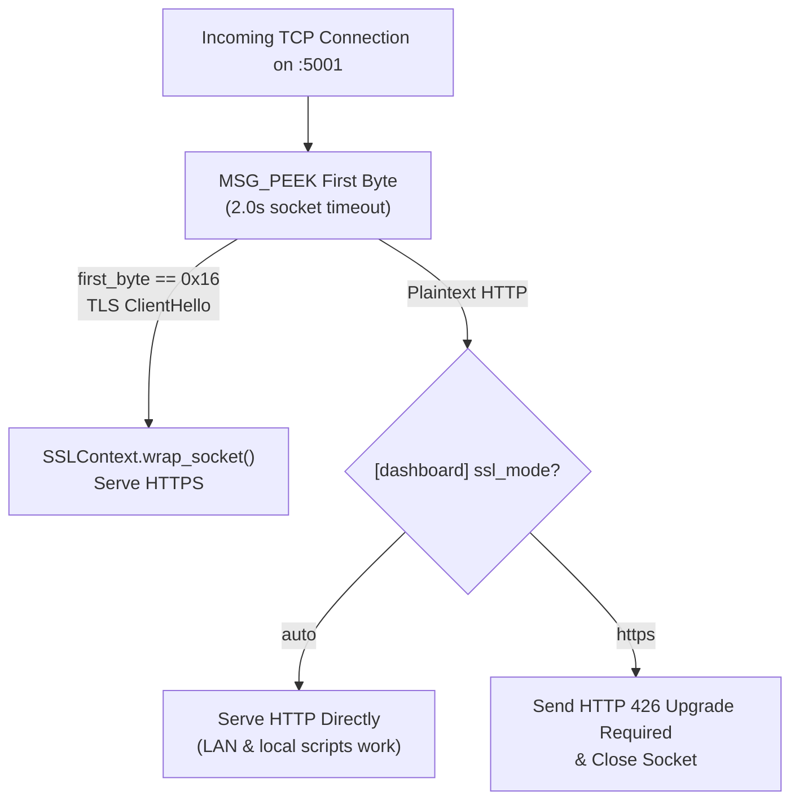
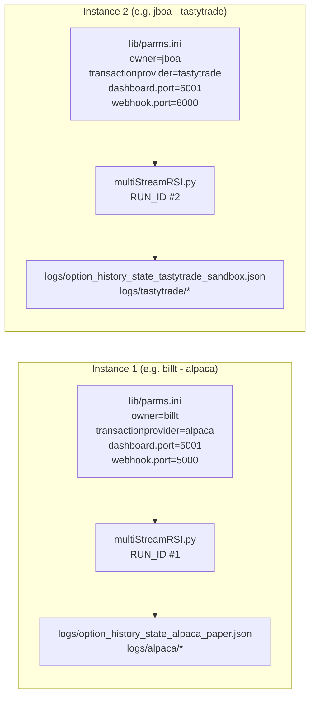

<div align="center">

# JBOA-RSI DEPLOYMENT, FILESYSTEM & OPERATIONS MANUAL

### Runtime Directory Layout, RHEL Host Operations, Adaptive TLS, Multi-Instance Isolation & Log Lifecycle

**Document ID:** `JBOA-RSI-DOC-03`  
**Scope:** Application Filesystem Map, RHEL Linux & `.venv` Operations, Dual-Instance Isolation, Adaptive HTTPS/TLS, Chart Capture CLI/TTY, & External Packaging Audit  
**Primary Runtime Root:** `/home/billt/jboa-1/src` (per workspace convention)  
**Audience:** Site Reliability Engineers, Linux Administrators, & Desk Operators

</div>

**Navigation:** [Overview (`README.md`)](../README.md) · [Changelog (`CHANGELOG.md`)](./CHANGELOG.md) · [Trading Algorithms & Risk](./TRADING_ALGORITHMS_AND_RISK.md) · [Option Buyer Guide](./OPTION_BUYER_GUIDE.md) · [Option Seller & Stop-Loss Guide](./OPTION_SELLER_AND_STOP_LOSS_GUIDE.md) · [Frontend Dashboard](./FRONTEND_DASHBOARD.md) · **Deployment & Operations** · [Configuration & API Reference](./CONFIGURATION_AND_API_REFERENCE.md)

---

## Table of Contents

1. [Complete Directory and File Map](#1-complete-directory-and-file-map)
   - [1.1 Workspace Source Tree (Present in This Repository)](#11-workspace-source-tree-present-in-this-repository)
   - [1.2 Runtime and Log Directory Tree (`multiStreamRSI.py` and `findthewinners.py`)](#12-runtime-and-log-directory-tree-multistreamrsipy-and-findthewinnerspy)
   - [1.3 File Writer and Reader Matrix](#13-file-writer-and-reader-matrix)
2. [RHEL Host Setup, `.venv` and Process Lifecycle](#2-rhel-host-setup-venv-and-process-lifecycle)
   - [2.1 Local Python Execution and One-Shot CLI Flags](#21-local-python-execution-and-one-shot-cli-flags)
   - [2.2 Interactive TTY Console Commands (`TTY-CLI`)](#22-interactive-tty-console-commands-tty-cli)
   - [2.3 Graceful Shutdown and Persistence Hooks](#23-graceful-shutdown-and-persistence-hooks)
3. [Network Architecture, Ports, Firewall and Adaptive TLS](#3-network-architecture-ports-firewall-and-adaptive-tls)
   - [3.1 Port Matrix and Binding Security Rules](#31-port-matrix-and-binding-security-rules)
   - [3.2 Adaptive HTTP and HTTPS Server with Auto Self-Signed SAN Certificates](#32-adaptive-http-and-https-server-with-auto-self-signed-san-certificates)
   - [3.3 RHEL `firewalld` and SELinux Operational Guidelines](#33-rhel-firewalld-and-selinux-operational-guidelines)
4. [Dual-Instance and Multi-Broker Isolation Architecture](#4-dual-instance-and-multi-broker-isolation-architecture)
5. [Chart Capture (`ChartCaptureManager`) and Post-Session Analysis (`findthewinners.py`)](#5-chart-capture-chartcapturemanager-and-post-session-analysis-findthewinnerspy)
6. [Log Lifecycle, Persistent Disk Caches and `.gitignore` Hygiene](#6-log-lifecycle-persistent-disk-caches-and-gitignore-hygiene)
7. [External Deployment and Packaging Artifacts Audit (Not Found in Codebase)](#7-external-deployment-and-packaging-artifacts-audit-not-found-in-codebase)

---

## 1. Complete Directory and File Map

### 1.1 Workspace Source Tree (Present in This Repository)

| Path | Type | Role |
| :--- | :--- | :--- |
| `/multiStreamRSI.py` | Python (27,233 lines) | Primary async multi-provider RSI/kinematics engine, option buyer/seller, position monitor, chart capture manager, TradingView webhook server (`:5000`), and Flask operational dashboard (`:5001`). |
| `/findthewinners.py` | Python (4,171 lines) | Offline/post-session option strike profitability & multi-horizon back-evaluator reading `logs/optionchains/*.json`. |
| `/public/assets/aistudio/getOptionsContracts_87f349cc.py` | Python (216 lines) | Reference copy of Alpaca option-chain pruning helper (3rd Friday expiration, 80-strike window, 2nd OTM selection). |
| `/src/App.tsx` | TypeScript/React | Root UI of the Pine Script Alert Studio companion app (Vite `:3000`). |
| `/src/components/*.tsx` | TypeScript/React (10 files) | `MultiStreamRSIViewer`, `Merged21ScriptViewer`, `WatchlistScriptGenerator`, `BatchedScriptGenerator`, `RateLimitSimulator`, `ComparisonTable`, `SetupGuide`, `PythonReceiver`, `PayloadInspector`, `CodeViewer`. |
| `/src/data/pineScripts.ts` | TypeScript | Pine Script v5 template generators for merged 21-symbol, batched, and watchlist TradingView indicators. |
| `/vite.config.ts` | TypeScript | Vite config with `serveRootPythonPlugin()` bridging `/multiStreamRSI.py` into dev and `dist/`. |
| `/package.json` | JSON | Node/Vite/React scripts (`dev`, `build`, `preview`, `lint`). |
| `/.env.example` | Config template | Placeholder environment variable template (no real secrets). |
| `/AGENTS.md` | Markdown | Workspace operational guardrails and host path conventions. |
| `/README.md` & `/docs/*.md` | Markdown (5 files) | Complete technical documentation suite. |

### 1.2 Runtime and Log Directory Tree (`multiStreamRSI.py` and `findthewinners.py`)

When deployed on RHEL (conventionally rooted at `/home/billt/jboa-1/src/`), `multiStreamRSI.py` resolves paths relative to `Path(__file__).resolve().parent` (`APP_ROOT`) and creates log/certificate directories automatically via `mkdir(parents=True, exist_ok=True)`:

```text
<APP_ROOT>/                                      # e.g. /home/billt/jboa-1/src/
├── multiStreamRSI.py                            # Core engine executable / script
├── findthewinners.py                            # Post-session strike winner evaluator
├── jboa.log                                     # Master process/service log (referenced in AGENTS.md & L9717)
├── lib/                                         # External config & helper modules ([Not Found in Codebase])
│   ├── parms.ini                                # Runtime INI configuration & redacted secrets
│   ├── utils.py                                 # JsonIniParser, load_tradier_token()
│   └── getOptionsContracts.py                   # Alpaca pruned option chain fetcher
├── certs/                                       # Auto-generated or operator-supplied TLS keypair
│   ├── dashboard.crt                            # X.509 PEM certificate (825-day SAN cert if auto-generated)
│   └── dashboard.key                            # 2048-bit RSA private key (PEM)
└── logs/                                        # LOG_ROOT (all telemetry, trade logs & caches)
    ├── minute-summary-<RUN_ID>.jsonl            # 1-minute consensus & kinematics JSONL stream
    ├── option_history_state_<prov>_<env>.json   # Atomic persisted open/closed contract ledger
    ├── option_history_prices_<prov>_<env>.json  # Atomic persisted 1m option price bars cache
    ├── alpaca/
    │   ├── _STREAM-ALPACA-<RUN_ID>.log          # Provider lifecycle, warmup & WS reconnect logs
    │   └── <SYMBOL>-ALPACA-<RUN_ID>.log         # Per-symbol bar & RSI trace logs
    ├── tastytrade/
    │   ├── _STREAM-TASTYTRADE-<RUN_ID>.log      # DXLink #1/#2 & OAuth refresh trace
    │   └── <SYMBOL>-TASTYTRADE-<RUN_ID>.log
    ├── tradingview/
    │   ├── _STREAM-TRADINGVIEW-<RUN_ID>.log     # Webhook server startup & validation events
    │   └── <SYMBOL>-TRADINGVIEW-<RUN_ID>.log
    ├── tradier/                                 # Same _STREAM-* & <SYMBOL>-* pattern
    ├── twelvedata/                              # Same _STREAM-* & <SYMBOL>-* pattern
    ├── yahoofinance/                            # Same _STREAM-* & <SYMBOL>-* pattern
    ├── positions/
    │   └── <BROKER>-POSITIONS-<RUN_ID>.log      # Periodic broker position & P/L snapshots
    ├── option_buyer/
    │   └── <BROKER>-OPTION_BUYER-<RUN_ID>.log   # Every buyer qualification, rejection & order fill
    ├── option_seller/
    │   └── <BROKER>-OPTION_SELLER-<RUN_ID>.log  # Every seller 4-tier exit check, rejection & fill
    ├── option_chain_collector/
    │   └── _RSI-OPTION_CHAIN_COLLECTOR-<RUN_ID>.log  # RSI-triggered option chain fetch logs
    ├── optionchains/
    │   └── optionchain-<SRC>-<SYM>-<BUY|SELL>-rsi<VAL>-<YYYYMMDDTHHMMSS>_<TZ>-<hex>.json
    ├── charts/
    │   └── <SYMBOL>/
    │       ├── <SYMBOL>_<YYYYMMDD_HHMM>_<TZ>.png # Timestamped 1m Matplotlib kinematic snapshot
    │       └── latest.png                       # Rolling symlink/copy of newest chart (write_latest=true)
    └── strike_analysis/
        └── winners_<YYYYMMDD-HHMMSS>.txt        # Output report from findthewinners.py
```

### 1.3 File Writer and Reader Matrix

| Artifact Pattern | Written By | Read By | Persistence / Atomicity |
| :--- | :--- | :--- | :--- |
| `logs/minute-summary-<RUN_ID>.jsonl` | `MinuteCoordinator.finalize_due()` | `AdminCliProvider` (`GET /api/minute-summaries`) | Append-only JSON Lines; rotated per `RUN_ID`. |
| `logs/option_buyer/*.log` & `logs/option_seller/*.log` | `OptionBuyer`, `OptionSeller` | `AdminCliProvider` (`GET /api/option-logs` -> `read_option_analysis_logs()`) | Structured timestamped text lines; parsed live for the Decision Audit Modal. |
| `logs/optionchains/optionchain-*.json` | `RsiOptionChainCollector`, `TradingviewProvider`, `OptionBuyer` | `analyze_option_chain_strikes()` (`/api/strike-analysis`), `findthewinners.py` | Immutable point-in-time JSON snapshots containing pruned call/put chains + underlying kinematics. |
| `logs/option_history_state_<prov>_<env>.json` | `OptionContractHistoryTracker` | `OptionContractHistoryTracker` (on startup) | Atomic write (`.tmp` + `os.replace`) scoped by `(transactionprovider, env)` so Alpaca paper/live and Tastytrade sandbox/prod never collide. |
| `logs/option_history_prices_<prov>_<env>.json` | `OptionContractHistoryTracker` (periodic + `finally:` on shutdown, L27026) | `OptionContractHistoryTracker` (on startup) | Atomic JSON cache preserving minute-by-minute option mark prices across restarts. |
| `logs/charts/<SYM>/*.png` | `ChartCaptureManager` (dedicated daemon thread) | Operators / external archiving | Generated on 1m boundaries when `[chart_capture] enabled = true`. |
| `certs/dashboard.crt` & `certs/dashboard.key` | `AdminCliProvider._generate_self_signed_cert()` (L26461) | `AdminCliProvider._ensure_dashboard_ssl_context()` (L26554) | Created once if missing and `ssl_auto_self_signed = true`; reused on subsequent restarts. |

---

## 2. RHEL Host Setup, `.venv` and Process Lifecycle

### 2.1 Local Python Execution and One-Shot CLI Flags

Per `multiStreamRSI.py :: handle_cli_command()` and `resolve_parms_ini_path()`, the script operates in **two invocation modes** and supports both uncompiled Python and Nuitka `--onefile` binary runs:

1. **Full Async Engine Startup (source or compiled `--onefile`):**
   ```bash
   source /home/billt/jboa-1/.venv/bin/activate
   python /home/billt/jboa-1/src/multiStreamRSI.py

   # Explicit INI path (recommended for Nuitka --onefile / Podman containers):
   ./multiStreamRSI --ini /home/jboa/app/src/parms.ini
   # Or via environment variable:
   INI_PATH=/home/jboa/app/src/parms.ini ./multiStreamRSI
   ```
   Startup sequence (`main()`, L26778):
   1. `load_settings()` parses `lib/parms.ini` + environment overrides and validates non-loopback webhook tokens and dashboard auth passwords.
   2. Instantiates `MinuteCoordinator`, `AdminCliProvider` (`:5001`), `shared_option_chain_client`, and all enabled stream routers.
   3. **Pre-Warmup Barrier (`RSI_PRE_WARMUP_START`):** Runs `await asyncio.gather(*(r.warmup() for r in warmup_routers))` **before** the coordinator finalizes its first minute so Wilder RSI(14) is converged prior to 09:30 ET open.
   4. Spawns isolated tasks (`run_provider_isolated`) for `MINUTE_COORDINATOR`, `CLI_ADMIN_PANEL`, `POSITION_MONITOR`, `OPTION_BUYER`, `OPTION_SELLER`, `OPTION_CHAIN_COLLECTOR`, `OPTION_HISTORY_BACKFILL`, `CHART_CAPTURE`, and all enabled market-data providers.

2. **One-Shot Chart Capture Control CLI (signals running daemon + updates `lib/parms.ini`):**
   ```bash
   # Subcommand form
   python multiStreamRSI.py chart-capture start [--ini /path/to/parms.ini] [--port 5001]
   python multiStreamRSI.py chart-capture stop  [--ini /path/to/parms.ini] [--port 5001]
   python multiStreamRSI.py chart-capture status [--ini /path/to/parms.ini] [--port 5001]

   # Flag form (equivalent)
   python multiStreamRSI.py --chart-capture start
   python multiStreamRSI.py --chart-capture stop
   python multiStreamRSI.py --chart-capture status
   ```
   `_call_running_chart_capture_cli()` (L27077) automatically reads `[dashboard] port` and `[dashboard] password` from `lib/parms.ini`, tries both `http://127.0.0.1:<port>/cli/chart-capture` and `https://127.0.0.1:<port>/cli/chart-capture` with `X-Dashboard-Password`, persists the change to `lib/parms.ini`, and prints a JSON summary.

### 2.2 Interactive TTY Console Commands (`TTY-CLI`)

When started in an interactive terminal (`sys.stdin.isatty() == True`, L26956 — strictly bypassed under `systemd` or non-TTY daemons so `EOF` never causes a spin-loop), a daemon thread `TTY-CLI` accepts live stdin commands:

| Command (Aliases) | Effect |
| :--- | :--- |
| `chart-capture start` (`chart_capture start`, `cc start`) | Starts the 1m PNG capture thread and sets `[chart_capture] enabled = true` in `lib/parms.ini`. |
| `chart-capture stop` (`chart_capture stop`, `cc stop`) | Stops the 1m PNG capture thread and sets `[chart_capture] enabled = false` in `lib/parms.ini`. |
| `chart-capture status` (`chart_capture status`, `cc status`) | Prints JSON status of `ChartCaptureManager`. |
| `status` | Prints JSON with `coordinator.connected`, `chart_capture`, and `tradingview` stats. |
| `help` (`?`) | Prints available TTY commands. |

### 2.3 Graceful Shutdown and Persistence Hooks

On `SIGINT` / `SIGTERM` (`KeyboardInterrupt` or task cancellation, L27023–27036):
1. Forces an atomic flush of the option price bar cache via `coordinator.option_history._persist_option_prices_cache(force=True)`.
2. Cancels all active asyncio tasks in `tasks` and `PROVIDER_REGISTRY`.
3. Awaits clean shutdown (`asyncio.gather(*tasks, return_exceptions=True)`) and invokes `logging.shutdown()` before exiting.

---

## 3. Network Architecture, Ports, Firewall and Adaptive TLS

### 3.1 Port Matrix and Binding Security Rules

| Service | Default Bind | INI Keys | Env Fallback | Security & Firewall Notes |
| :--- | :--- | :--- | :--- | :--- |
| **TradingView Webhook Receiver** | `127.0.0.1:5000` | `[webhook] host`, `[webhook] port`, `[webhook] token` | `WEBHOOK_HOST`, `WEBHOOK_PORT`, `WEBHOOK_TOKEN` | **Does NOT require external firewall opening** when bound to loopback (e.g., behind a reverse proxy or tunnel). If bound to a non-loopback address (`0.0.0.0` or LAN IP), `load_settings()` enforces a non-empty `WEBHOOK_TOKEN` (`X-Webhook-Token` header or JSON `webhook_token`). |
| **Operational Dashboard & Admin CLI** | `0.0.0.0:5001` | `[dashboard] host`, `[dashboard] port`, `[dashboard] password` | `DASHBOARD_HOST`, `DASHBOARD_PORT`, `ADMIN_HOST`, `ADMIN_PORT`, `DASHBOARD_PASSWORD` | Serves LAN/subnet browsers. Open `5001/tcp` (and `6001/tcp` for a second instance) in `firewalld` if accessed remotely. Requires `[dashboard] password` whenever `auth_enabled = true`. |
| **React Companion Studio (Dev)** | `0.0.0.0:3000` | N/A (Vite) | `vite.config.ts` | Development / engineering workstation only; not required for live trade execution. |

### 3.2 Adaptive HTTP and HTTPS Server with Auto Self-Signed SAN Certificates

`AdminCliProvider` implements `AdaptiveSSLThreadedWSGIServer` (`multiStreamRSI.py`, L26598–26649), a custom Werkzeug `ThreadedWSGIServer` subclass that handles mixed or strict TLS seamlessly on a single port:



- **Auto Self-Signed Certificate Generation (`_generate_self_signed_cert`, L26461):**
  - Triggered when `ssl_enabled = true`, `ssl_auto_self_signed = true`, and `certs/dashboard.crt` or `certs/dashboard.key` is missing.
  - Builds a **2048-bit RSA** X.509 certificate valid for **825 days** with Subject Alternative Names (`SAN`) covering `DNS:localhost`, `DNS:<hostname>`, `IP:127.0.0.1`, `IP:::1`, and the detected host LAN IP (`get_lan_ip()`).
  - Primary generator uses Python `cryptography.x509`; automatically falls back to CLI `openssl req -x509 ...` if `cryptography` is not installed.
- **Modes (`[dashboard] ssl_mode`):**
  - `auto` *(default)*: Accepts both `https://` and `http://` on port `5001`.
  - `https`: Rejects plaintext HTTP with `426 Upgrade Required` and refuses startup if cert/key cannot load.
  - `http`: Disables TLS entirely.

### 3.3 RHEL `firewalld` and SELinux Operational Guidelines

When exposing the operational dashboard on RHEL 9.x:
```bash
# Open dashboard port(s) only (webhook port 5000 does NOT need firewall exposure unless directly receiving external webhooks)
sudo firewall-cmd --permanent --add-port=5001/tcp
# Optional second instance dashboard port:
sudo firewall-cmd --permanent --add-port=6001/tcp
sudo firewall-cmd --reload
```
- **SELinux Container Volume Labeling:** When mounting host directories (`logs/`, `lib/`, `certs/`) into rootless or rootful Podman containers on SELinux-enforcing RHEL hosts, append `:Z` (private unshared label) or `:z` (shared label across containers) to volume mounts (`-v /path/logs:/app/logs:Z`) so the container process has write permission to log files and `option_history_*.json` caches. *(Note: exact `Containerfile` and Podman launch commands are external to this workspace — see Section 7.)*

---

## 4. Dual-Instance and Multi-Broker Isolation Architecture

Operators frequently run **two simultaneous instances** on the same RHEL host (for example, Instance 1 owned by `billt` running **Alpaca** market data + Alpaca Paper execution on `5000/5001`, and Instance 2 owned by `jboa` running **Tastytrade** DXLink market data + Tastytrade Sandbox execution on `6000/6001`).



### Mandatory Isolation Checklist for Dual Instances

| Dimension | How Isolation Is Enforced |
| :--- | :--- |
| **Ports** | Configure distinct `[dashboard] port` (e.g., `5001` vs. `6001`) and `[webhook] port` (e.g., `5000` vs. `6000`). |
| **Visual Identity** | Set distinct `[general] owner` values (e.g., `billt` vs. `jboa`) so the dashboard header badge, browser tab prefix, and 3px accent stripe are visually unmistakable. |
| **Separate Working Directories / Logs** | Run each instance from its own isolated root directory (or container volume) so `logs/`, `certs/`, and `lib/parms.ini` never collide on disk. |
| **Broker Account & Dry-Run Safety** | **Never** point two live/sandbox instances at the **same broker account** with `dry_run = false`, or both instances will compete on positions and close each other's contracts. To run two Tastytrade instances simultaneously with a single Tastytrade Sandbox account, set `[option_buyer] dry_run = true` and `[option_seller] dry_run = true` on at least one instance (both buys **and** sells are simulated when `dry_run = true`). |
| **History Cache Namespacing** | Even within a shared directory, `OptionContractHistoryTracker` namespaces its persisted JSON state by `<transactionprovider>_<env>` (e.g., `alpaca_paper`, `alpaca_live`, `tastytrade_sandbox`, `tastytrade_prod`). |

---

## 5. Chart Capture (`ChartCaptureManager`) and Post-Session Analysis (`findthewinners.py`)

### 1-Minute PNG Chart Capture (`ChartCaptureManager`, L17920)
- Runs in a dedicated background thread coordinated with `MinuteCoordinator`.
- On each finalized minute, renders a 3-panel Matplotlib PNG (`width × height`, default `1440×860`, showing `history_bars = 20` trailing bars) into `logs/charts/<SYMBOL>/<SYMBOL>_<YYYYMMDD_HHMM>_<TZ>.png` and updates `latest.png` when `write_latest = true`.
- Skips symbols without fresh updates (`only_updated = true`) or older than `stale_after_seconds` (`180s`).
- Toggleable live via **three synchronized controls** (all persist `[chart_capture] enabled` in `lib/parms.ini`):
  1. Dashboard Telemetry **`Start` / `Stop`** button (`POST /cli/chart-capture`).
  2. One-shot CLI (`python multiStreamRSI.py chart-capture start|stop|status`).
  3. Interactive TTY command (`cc start` / `cc stop` / `cc status`).

### Post-Session Strike Evaluator (`findthewinners.py`)
Standalone CLI tool that reads captured `logs/optionchains/*.json` snapshots and evaluates forward option contract returns across configurable time horizons and strikes (`-2 ITM` to `+4 OTM`), writing structured reports to `logs/strike_analysis/winners_<YYYYMMDD-HHMMSS>.txt`. Run `python findthewinners.py --help` to inspect CLI filter flags (`--symbol`, `--days`, `--dir`, etc.).

---

## 6. Log Lifecycle, Persistent Disk Caches and `.gitignore` Hygiene

- **Per-Run Log Naming:** Every process startup generates a unique `RUN_ID` (`YYYYMMDD-HHMMSS-<pid>-<8hex>`), preventing log overwrites across restarts. Archive or purge older `logs/` subdirectories periodically on RHEL hosts to prevent disk exhaustion, especially `logs/charts/` (PNGs) and `logs/optionchains/` (JSON chains).
- **Recommended `.gitignore` Rules for Local Operations:**
  - Exclude runtime secrets, virtual environments, logs, certificates, and build artifacts:
    - `lib/parms.ini`, `src/lib/parms.ini`, `.env`
    - `.venv/`, `.build_venv/`, `**/__pycache__/`, `*.pyc`
    - `logs/*`, `src/logs/*`, `jboa.log`, `src/jboa.log`, `certs/*`, `src/certs/*`
    - `dist/` (note: if a file under `dist/` was previously committed to Git, `.gitignore` alone will not stop Git from tracking modifications — untrack it with `git rm --cached <path>`).

---

## 7. External Deployment and Packaging Artifacts Audit (Not Found in Codebase)

In strict accordance with zero-hallucination documentation rules, the following operational, packaging, and helper files are referenced by host conventions or `multiStreamRSI.py` imports, **but are NOT present in this workspace repository**:

| Artifact / File | Status in This Workspace | Grounded Context Found in Codebase |
| :--- | :--- | :--- |
| `lib/parms.ini` | `[Not Found in Codebase]` | Parsed at runtime by `multiStreamRSI.py :: _apply_ini_feature_settings()` & `load_settings()`. Complete parameter schema is reconstructed 100% from source code in [Configuration and API Reference](./CONFIGURATION_AND_API_REFERENCE.md). |
| `lib/utils.py` | `[Not Found in Codebase]` | Imported by `multiStreamRSI.py` for `JsonIniParser` and `load_tradier_token()`; engine falls back gracefully to `configparser` and environment variables when absent. |
| `lib/getOptionsContracts.py` | `[Not Found in Codebase]` | Imported by `multiStreamRSI.py` for Alpaca option chain pruning. A 216-line reference copy exists in this workspace at `/public/assets/aistudio/getOptionsContracts_87f349cc.py`. |
| `jboa-rsi.service` (`systemd` unit) | `[Not Found in Codebase]` | Referenced by name in `AGENTS.md` (`managed by jboa-rsi.service`, root `/home/billt/jboa-1/src`). Exact `ExecStart`, `User`, and `Restart=` directives are not stored in this repository. |
| `build_and_package.sh` (Nuitka build script) | `[Not Found in Codebase]` | Referenced externally (not present in workspace tree). Exact Nuitka `--onefile` flags, `.build_venv` steps, and archive commands cannot be verified from this repo. |
| `Containerfile` (Red Hat UBI 9.8 / Podman) | `[Not Found in Codebase]` | Not present in workspace tree. Exact `FROM` image digest, `USER jboa` setup, and `ENTRYPOINT` cannot be verified from this repo. |
| `sh/run_dual_instances.sh` | Present | Dual-instance manager for `billt` (5000/5001, Alpaca) and `jboa` (6000/6001, Tastytrade); `--stop-all` loops until all matching `multiStreamRSI.py` PIDs have exited and all four ports are closed. |
| `run_windows.bat` / `rollit.sh` | `[Not Found in Codebase]` | Not present in workspace tree. |
| Log rotation / cron archive scripts | `[Not Found in Codebase]` | No `logrotate` config or shell archiving script exists in this workspace. |
