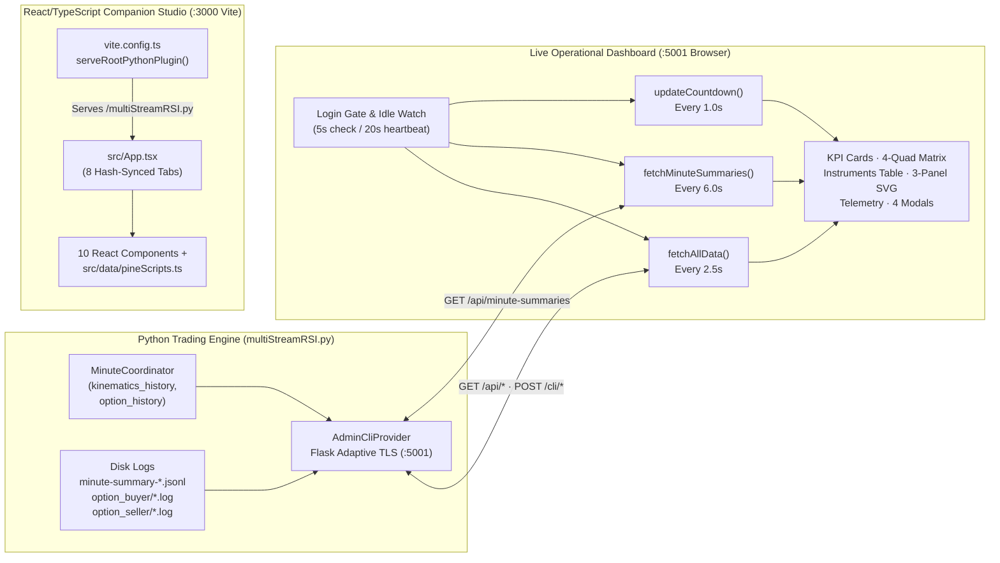
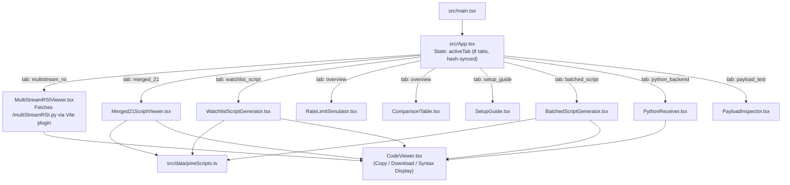

# JBOA-RSI FRONTEND & DASHBOARD MANUAL

### Live Port-5001 Operational Dashboard & React/TypeScript Pine Script Alert Studio

**Document ID:** `JBOA-RSI-DOC-02`  
**Scope:** Embedded Operational Web UI (`multiStreamRSI.py`), SVG Kinematics Charts, Option P/L Modals, & React/Vite Companion Studio (`/src/`)  
**Ports:** Live Operational Dashboard `5001` (HTTP/HTTPS Adaptive TLS) · React/Vite Companion Studio `3000`  
**Audience:** Traders, Desk Operators, Quantitative Analysts, & Frontend Engineers

**Navigation:** [Overview (`README.md`)](../README.md) · [Trading Algorithms & Risk](./TRADING_ALGORITHMS_AND_RISK.md) · **Frontend Dashboard** · [Deployment & Operations](./DEPLOYMENT_AND_OPERATIONS.md) · [Configuration & API Reference](./CONFIGURATION_AND_API_REFERENCE.md)

---

## Table of Contents

1. [Dual-Frontend Architecture Overview](#1-dual-frontend-architecture-overview)
2. [Live Operational Dashboard (Port 5001): Authentication, Identity and Session Lifecycle](#2-live-operational-dashboard-port-5001-authentication-identity-and-session-lifecycle)
   - [2.1 Login Gate (`LOGIN_HTML_TEMPLATE`)](#21-login-gate-login_html_template)
   - [2.2 Multi-Instance Owner Visual Branding](#22-multi-instance-owner-visual-branding)
   - [2.3 Cross-Tab Inactivity Timeout and `401` Recovery](#23-cross-tab-inactivity-timeout-and-401-recovery)
3. [Live Operational Dashboard: Panel-by-Panel, Field-by-Field and Button Reference](#3-live-operational-dashboard-panel-by-panel-field-by-field-and-button-reference)
   - [3.1 Top Header Bar and Action Controls](#31-top-header-bar-and-action-controls)
   - [3.2 Four Top-Line KPI Metric Cards](#32-four-top-line-kpi-metric-cards)
   - [3.3 Kinematics 4-Quadrant Phase Matrix](#33-kinematics-4-quadrant-phase-matrix)
   - [3.4 Instruments Table Toolbar and Sortable Kinematics Grid](#34-instruments-table-toolbar-and-sortable-kinematics-grid)
   - [3.5 Bottom Multi-Stream Kinematics Inspector (`bottomInspectorSection`)](#35-bottom-multi-stream-kinematics-inspector-bottominspectorsection)
   - [3.6 How to Read and Operate the 3-Panel Synchronized Kinematic Crossover Chart](#36-how-to-read-and-operate-the-3-panel-synchronized-kinematic-crossover-chart)
   - [3.7 Provider Comparison Table, TradingView Diagnostic Banner and Diagnosis Bar](#37-provider-comparison-table-tradingview-diagnostic-banner-and-diagnosis-bar)
   - [3.8 Section 2: Emitted Minute Summaries Feed and Engine Diagnostic Telemetry](#38-section-2-emitted-minute-summaries-feed-and-engine-diagnostic-telemetry)
4. [Interactive Modals and Deep-Dive Workflows](#4-interactive-modals-and-deep-dive-workflows)
   - [4.1 Manual Bar Injection Modal (`injectModal`)](#41-manual-bar-injection-modal-injectmodal)
   - [4.2 Option Buyer and Seller Drilldown Modal (`optionDrilldownModal`)](#42-option-buyer-and-seller-drilldown-modal-optiondrilldownmodal)
   - [4.3 Live Option Buy and Sell Decision Log Modal (`optionLogsModal`)](#43-live-option-buy-and-sell-decision-log-modal-optionlogsmodal)
   - [4.4 Option Chain Strike Analyzer Modal (`strikeAnalysisModal`)](#44-option-chain-strike-analyzer-modal-strikeanalysismodal)
5. [Profit and Loss Calculation and Position Tracking Formulas](#5-profit-and-loss-calculation-and-position-tracking-formulas)
6. [Client Polling Cadence, API Synchronization and Error States](#6-client-polling-cadence-api-synchronization-and-error-states)
7. [React and TypeScript Companion Application (`src/`, Vite Port 3000)](#7-react-and-typescript-companion-application-src-vite-port-3000)
   - [7.1 Component Hierarchy and Data Flow](#71-component-hierarchy-and-data-flow)
   - [7.2 Tab-by-Tab and Component Reference](#72-tab-by-tab-and-component-reference)
   - [7.3 Vite Static Bridge (`serveRootPythonPlugin`)](#73-vite-static-bridge-serverootpythonplugin)

---

## 1. Dual-Frontend Architecture Overview

This repository contains **two distinct web interfaces** serving complementary operational roles:

| Interface | Runtime Host & Port | Source Location | Tech Stack | Intended Purpose |
| :--- | :--- | :--- | :--- | :--- |
| **Live Operational Dashboard** | `AdminCliProvider` (`0.0.0.0:5001` default; Adaptive HTTP/HTTPS) | `multiStreamRSI.py :: LOGIN_HTML_TEMPLATE` (L18380) & `DASHBOARD_HTML_TEMPLATE` (L18549) | Flask WSGI, Tailwind CDN, JetBrains Mono & Plus Jakarta Sans, Vanilla ES6 JS, Inline SVG Charts | **Live trading desk telemetry**: real-time multi-provider kinematics, 4-quadrant phase monitoring, 3-panel synchronized crossover charts, live option P/L drilldown, Buy/Sell decision log auditing, strike analysis, and manual CLI controls. |
| **Pine Script Alert Studio (Companion Web App)** | Vite Dev Server (`0.0.0.0:3000`) | `/src/App.tsx`, `/src/components/*`, `/src/data/pineScripts.ts`, `/vite.config.ts` | React 19, TypeScript, Vite 6, Tailwind CSS 4, `lucide-react` | **TradingView alert & Pine Script engineering workstation**: generate 21-symbol merged/batched/watchlist Pine scripts, simulate TradingView webhook rate limits, inspect webhook JSON schemas, and browse `multiStreamRSI.py` kinematics architecture. |

---

## 2. Live Operational Dashboard (Port 5001): Authentication, Identity and Session Lifecycle

### 2.1 Login Gate (`LOGIN_HTML_TEMPLATE`)

When `[dashboard] auth_enabled = true` and a non-empty `[dashboard] password` is configured (`multiStreamRSI.py :: AdminCliProvider._is_auth_active()`), every route on port `5001` except `/login`, `/auth/login`, `/auth/logout`, and `/favicon.ico` is gated by `@app.before_request` (`_enforce_dashboard_auth`, L25730).

| UI Element / Field | Location / ID | Behavior & Intended Use |
| :--- | :--- | :--- |
| **Instance Owner Header Badge** | `__INSTANCE_OWNER_HEADER_BADGE_HTML__` | Displays the configured `[general] owner` and active `transactionprovider` (e.g., `billt - alpaca`, `jboa - tastytrade`) so operators confirm which trading instance they are unlocking before entering credentials. |
| **Notice Banner (Amber)** | Rendered when `?reason=idle` | Appears when redirected after exceeding `inactivity_timeout_minutes`, displaying `"Session closed after N minutes of inactivity. Enter your password to continue."` |
| **Error Banner (Rose)** | Rendered on `401` / `429` | Displays `"Invalid password. Check [dashboard] password in parms.ini."` or `"Too many failed attempts. Try again in Xs."` (rate-limited per client IP). |
| **Password Input** | `<input type="password" name="password" autofocus>` | Accepts the dashboard password. Submitted via `POST /auth/login`. |
| **Unlock Dashboard Button** | Submit button (`POST /auth/login`) | Issues an `HttpOnly`, `SameSite=Lax` session cookie (`secure=True` when over HTTPS) with TTL `max(3600, DASHBOARD_SESSION_TTL_HOURS * 3600)` seconds, then redirects to `safe_next` (default `/`). |

### 2.2 Multi-Instance Owner Visual Branding

Function `_build_instance_owner_template_vars(owner, tx_provider)` (`multiStreamRSI.py`, L18293) deterministically hashes the `[general] owner` string into a distinct visual color palette to prevent operator confusion when running dual instances side by side (e.g., `:5001` Alpaca vs. `:6001` Tastytrade):
- **Browser Tab Prefix:** `[<owner> - <tx_provider>]` prepended to `<title>`.
- **Top 3px Gradient Accent Bar:** Fixed full-width top stripe across the viewport.
- **Header & Panel Chips:** Injected into the top navigation bar, the 4-Quadrant Phase Matrix header, and the Bottom Inspector header.

### 2.3 Cross-Tab Inactivity Timeout and `401` Recovery

Implemented in `DASHBOARD_HTML_TEMPLATE` (L19405–19555):
- **Activity Events:** `pointerdown`, `keydown`, `wheel`, `touchstart`, and `click` update `localStorage["msi_dashboard_last_activity"]` so interacting with any browser tab keeps sibling tabs alive.
- **Server Heartbeat:** Sends `POST /auth/heartbeat` at most once every **20 seconds** while user activity occurs, refreshing the server-side sliding idle timestamp.
- **Client Idle Watchdog:** `_idleWatchTimer = setInterval(_checkInactivityTimeout, 5000)` checks idle elapsed time against `DASHBOARD_INACTIVITY_TIMEOUT_MINUTES` (default `15`; `0` disables). Upon expiry, it calls `signOutDashboard('idle')` which calls `POST /auth/logout` and redirects to `/login?reason=idle`.
- **Global `fetch()` Interceptor:** Wraps `window.fetch` so any HTTP `401` with `auth_required: true` from `/api/*` or `/cli/*` immediately clears local polling and redirects to `/login` (with `?reason=idle` when `reason === "inactivity_timeout"`).

---

## 3. Live Operational Dashboard: Panel-by-Panel, Field-by-Field and Button Reference

### 3.1 Top Header Bar and Action Controls

Located at the top of `DASHBOARD_HTML_TEMPLATE` (L18575–18635). Always visible as the global command strip.

| Control / Field | Element ID | Type | Detailed Description & Action |
| :--- | :--- | :--- | :--- |
| **Engine Title & Live Status Pill** | — | Badge | Shows `RSI & Price Kinematics Engine`, live `ACTIVE` indicator pill, and the instance owner badge (`owner - transactionprovider`). |
| **Run ID Badge** | `runIdBadge` | Readout | Displays the unique `RUN_ID` (`YYYYMMDD-HHMMSS-<pid>-<hex>`) identifying the current process's log files (`minute-summary-<RUN_ID>.jsonl`, etc.). |
| **Display Timezone Badge** | `displayTzBadge` | Readout | Active display timezone abbreviation configured via `[general] timezone` (default `PST`/`PDT`, mapped via `DISPLAY_TZ_IANA`). All chart axes, timestamps, and log times render in this zone. |
| **Next Minute Countdown** | `minuteCountdown` | Live Timer | Counts down (1s tick via `updateCountdown()`, L19880) to `next_finalize_utc` (`next_minute + 60s + SUMMARY_DELAY_SECONDS`), synchronized against `server_time_utc` via `serverClockOffsetMs`. |
| **`Flush Minute` Button** | `btnFlush` | Button (`forceFinalize()`) | Sends `POST /cli/finalize` to force `MinuteCoordinator.finalize_due()` immediately. Used during testing or after manual bar injection to emit pending minute summaries without waiting for the 45-second delay window. |
| **`+ Inject Bar` Button** | `btnToggleInject` | Button (`toggleInjectModal()`) | Opens the **Manual Bar Injection Modal** (`injectModal`) to submit a synthetic 1-minute close price for any provider/symbol. |
| **Refresh Icon Button** | `btnRefresh` | Icon Button (`fetchAllData()`) | Immediately triggers a full refresh of `/api/kinematics`, `/cli/status`, and (if open) `/api/option-history`. |
| **`Lock` Button** | `btnLogout` | Button (`signOutDashboard()`) | Visible only when dashboard auth is active. Sends `POST /auth/logout`, revokes the server session token, deletes the session cookie, and redirects to `/login`. |

---

### 3.2 Four Top-Line KPI Metric Cards

Four horizontal summary cards (L18640–18715) providing an at-a-glance health and market-extremes scan across the entire tracked universe.

| Card | Fields & IDs | Meaning & Calculation | Intended Operational Use |
| :--- | :--- | :--- | :--- |
| **1. Tracked Symbols** | `activeProvidersCount` (`N Providers Online`), `uniqueSymbolsCount`, `streamFeedsCount` (`N streams`), `bullCount` (emerald) / `bearCount` (rose) / `neutralCount` (slate) | Total unique symbols in `target_symbols`, total active `(provider, symbol)` feed histories, and live breadth breakdown across Bullish, Bearish, and Neutral kinematic regimes. | Verify market breadth at a glance (e.g., `26 Bull · 2 Bear`) and confirm expected providers are online. |
| **2. Peak RSI Velocity ($\Delta\text{RSI}$)** | `peakRsiVel` (`±X.XX /min`), `peakRsiVelSymbol`, `peakRsiVelRegime` | Symbol with the largest absolute 1-minute RSI velocity (`|rsi_velocity|`) across all consolidated symbols. | Spot the fastest momentum impulse currently occurring in the watchlist. |
| **3. Peak Price Velocity ($\Delta P/P\%$)** | `peakPriceVel` (`±X.XX %/min`), `peakPriceVelSymbol`, `peakPriceVelRegime` | Symbol with the largest absolute percentage 1-minute price velocity (`|price_velocity_pct|`). | Identify sharp price breakouts or breakdowns (e.g., leveraged ETFs like `SQQQ` or high-beta leaders). |
| **4. Max Acceleration ($a$)** | `peakRsiAccel` (`±X.XX /min²`), `pendingQueueSize` (`Queue: N`), `lateRecordsCount` (`Late: N`) | Largest absolute RSI acceleration (`|rsi_acceleration|`) plus `MinuteCoordinator` queue health (`pending` map size and late-arriving bar count). | Confirm momentum convexity and monitor ingestion health (`Late > 0` indicates delayed upstream bars arriving past the 45s grace window). |

---

### 3.3 Kinematics 4-Quadrant Phase Matrix

A 2×2 interactive phase-space grid (`multiStreamRSI.py`, L18720–18765) grouping every tracked symbol by its consolidated velocity ($v$) and acceleration ($a$) signs:

| Quadrant | Container ID | Condition | Subtitle & Trading Interpretation |
| :--- | :--- | :--- | :--- |
| **Top-Left: Decelerating Bullish** | `quadDecBullish` | $v > 0,\; a \le 0$ | *Bullish exhaustion · upward velocity slowing · Overbought ($\ge 70$) = Bearish Reversal watch.* Price/RSI still rising, but thrust is fading. |
| **Top-Right: Accelerating Bullish** | `quadAccBullish` | $v > 0,\; a > 0$ | *Aggressive momentum expansion · Neutral RSI (40–60) = Strong Bullish Continuation.* Primary green zone for long Call qualification when emerging from oversold/neutral. |
| **Bottom-Left: Accelerating Bearish** | `quadAccBearish` | $v < 0,\; a < 0$ | *Aggressive selling impulse · Neutral RSI (40–60) = Strong Bearish Continuation.* High downside momentum; triggers bearish exits and blocks Call entries. |
| **Bottom-Right: Decelerating Bearish** | `quadDecBearish` | $v < 0,\; a \ge 0$ | *Downside absorption · Oversold ($\le 30$) = Bullish Reversal watch.* Selling pressure is losing downward acceleration—prime pre-bounce watch zone. |

- **Interactive Symbol Pills:** Each pill displays `<SYMBOL> <±rsi_vel/m>`. **Clicking any pill** immediately selects that symbol in the **Bottom Multi-Stream Kinematics Inspector** and scrolls/updates its 3-panel chart and provider comparison table.

---

### 3.4 Instruments Table Toolbar and Sortable Kinematics Grid

#### Toolbar Controls (L18770–18805)

| Control | Element ID / Handler | Action & Intended Use |
| :--- | :--- | :--- |
| **Symbol Filter Input** | `symbolSearch` | Case-insensitive live substring filter across ticker symbols (e.g., type `NVDA` or `AA`). |
| **Clear Search (`×`)** | `btnClearSearch` | Clears `symbolSearch` and restores the full table. |
| **`Consolidated Symbols (N)` Button** | `btnViewConsolidated` (`setViewMode('consolidated')`) | Displays **one consensus row per symbol**, synthesized across all reporting providers according to `[providers] priority`. Default operational view. |
| **`All Provider Feeds (N)` Button** | `btnViewStreams` (`setViewMode('streams')`) | Expands the grid into **one row per `(provider, symbol)` stream**, useful for comparing raw Alpaca vs. Tastytrade vs. TradingView values side-by-side. |
| **Regime Filter Pills** | `All`, `Acc Bull`, `Dec Bull`, `Acc Bear`, `Dec Bear`, `Neutral` (`setRegimeFilter()`) | Filters the table to symbols currently in the chosen kinematic quadrant. |

#### Table Columns & Row Actions (L18810–18865)

Every numeric header supports ascending/descending sorting via `toggleTableSort(columnKey)`.

| Column | Content & Formatting | Meaning & Use |
| :--- | :--- | :--- |
| **Symbol / Feeds** | Ticker + expandable `N/M feeds ▾` badge (in Consolidated mode) or Provider badge (in Streams mode). | Shows how many configured providers have reported data for this symbol. Clicking the `N/M feeds` button expands inline sub-rows comparing each provider's close, RSI, and kinematics. |
| **Close ($)** | Latest smoothed/raw 1m close price (`$XXX.XX`). | Reference underlying price $P_t$. |
| **Projected $\hat{P}_{t+1}$** | Forecasted next-minute price + expected `%` delta (`+0.07%` green / `-0.05%` red). | One-step Taylor kinematic projection $\hat{P}_{t+1} = P_t + v_t + \frac{1}{2}a_t$. Directly checked by buyer/seller `require_projection_alignment` filters. |
| **Price Velocity ($v$)** | Dollar velocity (`±X.XX`) and percentage velocity (`(±X.XX%)`). | Smoothed 1st derivative of price ($v_t = S_t - S_{t-1}$). |
| **Price Accel ($a$)** | Signed 2nd derivative (`±X.XX`). | Convexity of smoothed price ($a_t = v_t - v_{t-1}$). |
| **RSI (14)** | Numeric RSI + horizontal mini progress bar (rose $\ge 70$, emerald $\le 30$, indigo neutral). | Wilder 14-period session-seeded RSI. Primary trigger gate for option chain collection, buyer entry, and seller exit. |
| **RSI Vel / Acc** | Primary line `±X.XX/m` ($\Delta\text{RSI}$), secondary line `±X.XX/m²` ($\Delta^2\text{RSI}$). | Rate of change and curvature of RSI. |
| **Forecast Matrix Signal** | Color-coded badge (e.g., `Bullish Continuation`, `Bullish Reversal`, `Bearish Decel`) + sub-label showing quadrant (`↑ Accelerating Bullish`). | Combined RSI-zone + velocity/acceleration forecast signal evaluated against `allowed_forecasts` in `[option_buyer]` and `[option_seller]`. |
| **Inspect / Test** | Three action buttons per row: **`Inspect`** (selects symbol in Bottom Inspector), **`+`** (opens `injectModal` pre-filled with this symbol), **`Buy/Sell Log`** (opens `optionLogsModal` pre-filtered to this symbol). | Direct jump to deep chart inspection, synthetic bar testing, or trade-decision audit logs. |

---

### 3.5 Bottom Multi-Stream Kinematics Inspector (`bottomInspectorSection`)

The primary deep-analysis workspace for a single selected symbol (L18890–19070).

#### Header Strip
- **`detailSymbolBadge` / `detailSymbolTitle`:** Selected ticker badge and `<SYMBOL> Multi-Stream Kinematics Analysis` heading.
- **`detailRegimeBadge`:** Current quadrant pill (e.g., `↑ Accelerating Bullish`).
- **Instance Owner Chip:** Confirms active instance (`owner - tx_provider`).
- **`detailSymbolSubtitle`:** Consensus summary: `"Synthesized consensus across N/M reporting feeds (<PROVIDERS>) · Close $XXX.XX · RSI XX.X"`.
- **`Inspect Symbol` Dropdown (`bottomSymbolSelect`):** Allows switching to any tracked symbol without scrolling back up to the table.

#### Left Card — Next-Step Projection Panel
| Field / Button | Element ID | Meaning & Intended Use |
| :--- | :--- | :--- |
| **Smoothing Tag** | `detailSmoothTag` | Displays active smoother from `[kinematics]`, e.g., `HMA(14) Synced`, `EMA(14) Synced`, or `Raw Price`. |
| **Projected Price ($\hat{P}_{t+1}$)** | `detailProjectedPrice` | Large cyan readout of $\hat{P}_{t+1} = P_t + v_t + \frac{1}{2}a_t$. |
| **Expected $\Delta$** | `detailProjectedDelta` | Signed dollar and percent step change (`+0.32 (+0.09%)`). |
| **RSI Boundary Zone** | `detailRsiZone` | Current zone: `overbought (≥70)`, `oversold (≤30)`, or `neutral band`. |
| **Crossover Event** | `detailCrossoverSignal` | Latest detected velocity/acceleration zero-line crossover (`bullish_vel_cross`, `bearish_vel_cross`, `accel_turn_positive`, `accel_turn_negative`, or `none`). |
| **Forecast Action** | `detailTradingAction` | Prescriptive label from the Forecast Matrix (e.g., `Hold Long / Trend Follow`, `Accumulate Calls`, `Trim / Watch Reversal`). |
| **`Buy/Sell Log` Button** | `btnDetailBuySellLog` | Calls `openOptionLogsPanel(selectedSymbol)` to inspect every `BUY`, `SELL`, `QUALIFIED_*`, and `REJECTED` evaluation recorded for this ticker. |
| **`Strike Analyzer` Button** | `btnDetailStrikeAnalyzer` | Hidden unless `[dashboard] strike_analyzer_enabled = true`. Calls `openStrikeAnalysisPanel(selectedSymbol)` to evaluate `-2 ITM` to `+4 OTM` strike performance on historical entries. |

---

### 3.6 How to Read and Operate the 3-Panel Synchronized Kinematic Crossover Chart

Rendered as a high-DPI inline SVG inside `detailCrossoverChart` (L18960–19030) backed by `GET /api/kinematics/history?symbol=<SYM>&limit=<MAX_BARS>`.

#### Visual Anatomy (3 Vertically Aligned Shared-Time Panels)

| Panel (Top to Bottom) | Visual Series & Markers | How to Interpret |
| :--- | :--- | :--- |
| **Panel 1 — Price & Projection** | **Solid White Line:** 1-minute Close price $P_t$. **Dashed Indigo Line:** Smoothed curve $S_t$ (`HMA(14)` or `EMA(14)`). **Dashed Cyan Extension + Cyan Dot (`+1m`):** Next-step kinematic forecast $\hat{P}_{t+1}$. **Red Star (`★`):** Executed Option **Buy** bar (sourced from `option_history` / buyer orders). **Amber Star (`★`):** Executed Option **Sell** bar. | Compare price position relative to the HMA/EMA curve and verify whether the `+1m` cyan projection points in the direction of your intended trade. Star markers let you audit exact entry/exit timing against price inflections. |
| **Panel 2 — Velocity ($v$) & Acceleration ($a$)** | **Cyan Line:** Price/kinematic velocity $v_t$. **Orange Line:** Acceleration $a_t$. **Horizontal Dashed Zero Line:** $0$ boundary. **Cyan / Orange Dots on Zero Crossings:** Exact bars where $v$ or $a$ crossed zero. | **Golden inflection pattern for Long Calls:** Orange ($a$) turns positive first (bottoming out while $v$ is still negative — *Decelerating Bearish*), followed by Cyan ($v$) crossing above zero (*Accelerating Bullish*). Conversely, Orange dropping below zero warns of momentum exhaustion before price rolls over. |
| **Panel 3 — RSI (14)** | **Purple Line:** Wilder 14-period RSI. **Red Shaded Band & Dashed Line:** Overbought threshold (`[kinematics] rsi_overbought`, default `70`). **Green Shaded Band & Dashed Line:** Oversold threshold (`[kinematics] rsi_oversold`, default `30`). | Confirm whether RSI dipped into or near the green oversold band within the `oversold_lookback_minutes` window (default `3m`) and is rebounding below `bounce_rsi_max` (`45.0`), or approaching the red overbought band (`65–70`) for exit evaluation. |

#### Chart Interactive Controls & Navigation
- **`LIVE` / `HISTORY` Badge (`cxModeBadge`):** Green `LIVE` when anchored to the rightmost current bar; switches to amber `HISTORY` when panned backward into historical bars.
- **Window Zoom Buttons (`20m`, `1h`, `2h`, `4h`, `6.5h`):** Changes the number of 1-minute bars visible in the viewport (20, 60, 120, 240, or 390 bars — a full regular US equity session).
- **Hover Crosshair & Readout Bar:** Moving the mouse across any panel snaps a synchronized vertical crosshair across all 3 panels and updates the readout bar with exact timestamp (`DISPLAY_TZ`), `P`, `HMA`, `v`, `a`, and `RSI` at that minute.
- **Click-and-Drag Panning:** Grab anywhere on the SVG and drag left/right to scrub smoothly through up to `KINEMATICS_HISTORY_MAX_BARS` (default `2400` minutes ≈ 6+ trading days).
- **Bottom Timeline Scrub Bar:**
  - `|<` — Jump to oldest loaded bar in history.
  - `<` — Step backward by one viewport window.
  - `cxActiveDateBadge` — Displays active trading date range of the current viewport.
  - `cxPanRange` — Range slider scrubbing linearly across loaded history.
  - `>` — Step forward by one viewport window.
  - `Live` — Snap immediately back to the live trailing edge and resume live updates.

---

### 3.7 Provider Comparison Table, TradingView Diagnostic Banner and Diagnosis Bar

Below the 3-panel chart inside `bottomInspectorSection`:
- **Provider Comparison Table (`detailProvidersTableBody`):** Lists every enabled provider reporting on the selected symbol with individual `Provider`, `Status`, `Close`, `v`, `a`, `RSI`, `Regime`, and `Last Update` timestamp. Essential for diagnosing cross-provider discrepancies (e.g., Alpaca IEX vs. Tastytrade DXLink).
- **TradingView Webhook Diagnostic Banner (`detailTvDiagnosticBanner`):** Automatically shown when `TRADINGVIEW` is enabled in `[providers]` but no webhook bar has arrived yet for the currently inspected symbol; shows webhook counters and provides one-click jump buttons to symbols that *do* have live TradingView data.
- **Kinematic Diagnosis Banner (`detailPhaseExplanation`):** Plain-English summary of the selected symbol's current quadrant, RSI zone, and alignment state, paired with a **`Test Inject This Symbol`** button that opens `injectModal` pre-populated with `selectedSymbol`.

---

### 3.8 Section 2: Emitted Minute Summaries Feed and Engine Diagnostic Telemetry

Split into a 2-column left log feed and a 1-column right telemetry stack (L19075–19250).

#### Left (2 cols) — Emitted Minute Summaries Log Feed
- Polls `GET /api/minute-summaries` every **6 seconds**, displaying the latest **30** finalized records from `logs/minute-summary-<RUN_ID>.jsonl`.
- **`Refresh Logs` Button:** Forces an immediate fetch of `fetchMinuteSummaries()`.
- **Per-Record `Copy JSON` Button:** Copies the full serialized minute-summary JSON object to the clipboard for debugging or audit sharing.

#### Right (1 col) — Engine Diagnostic Telemetry
| Telemetry Row / Card | Source Field (`/cli/status`) | Interactive Behavior & Meaning |
| :--- | :--- | :--- |
| **Position Monitor** | `position_monitor.status`, `provider`, `last_error_detail` | Shows active broker (`ALPACA` or `TASTYTRADE`) and polling health (`ok`, `error`, `disabled`). |
| **Active Equity Positions** | `position_monitor.active_equity_positions` | Live count of open stock/ETF positions on the broker account. |
| **Active Option Positions** | `position_monitor.active_option_positions` | Live count of open option contracts on the broker account. |
| **Last Telemetry Poll** | `position_monitor.last_poll_utc`, `poll_count`, `poll_interval_seconds`, `last_poll_duration_ms` | Displays date, time, poll sequence number (`#N`), cadence (`15s`), and broker round-trip latency (`ms`) of the latest snapshot. |
| **Trading Account Card** | `position_monitor.account` | Displays active `transactionprovider` / environment badge, Account ID/Number, Available to Invest, Balance Invested, Today's P/L (`$ / %`), Overall P/L (`$ / %`), and single-trade cap / withhold buffer budget footer. |
| **Option Buyer (1m Sync) Card** *(Clickable)* | `option_buyer` + `history_summary` | Displays buyer mode (`LIVE` / `DRY_RUN` / `DISABLED`), open contract count, aggregate unrealized dollar/percent change, and **Overall vs. This Run** order counts. **Clicking this card opens `optionDrilldownModal` on the `Open Contracts` tab.** |
| **Last Option Order** | `option_buyer.last_order_contract`, `last_order_utc`, `last_order_reason` | Most recently submitted (or dry-run simulated) entry contract and trigger reason. |
| **Option Seller (1m Sync) Card** *(Clickable)* | `option_seller` + `history_summary` | Displays seller mode, closed contract count, aggregate realized dollar/percent P/L, Win/Loss tally, and **Overall vs. This Run** exit counts. **Clicking this card opens `optionDrilldownModal` on the `Closed Contracts` tab.** |
| **Last Sell Order** | `option_seller.last_order_contract`, `last_order_utc`, `last_order_reason` | Most recently closed (or dry-run simulated) exit contract and exit tier (`profit_target`, `trailing_stop`, `stop_loss`, `rsi_kinematic`). |
| **Stop Loss Watches** | `option_seller.stop_loss_watches` | Lists any open contracts currently accumulating a consecutive-minute stop-loss streak (`streak / N`, `pnl_pct`). |
| **Peak Profit Guard** | `option_seller.peak_profit_watches` | Lists open contracts tracked for trailing peak-profit drawdown (`peak_pnl_pct`, `last_pnl_pct`, `drawdown_pct`). |
| **Chart Capture (1m PNG)** | `chart_capture` + **`Start` / `Stop` Toggle (`btnChartCaptureToggle`)** | Shows PNG capture thread state, total captured PNG count, and output directory (`logs/charts`). Clicking the toggle sends `POST /cli/chart-capture` (`{"action": "toggle"}`), immediately starting/stopping the background thread **and** persisting `[chart_capture] enabled` in `lib/parms.ini`. |
| **Option Chain Strike Analyzer Row** | `telemetryStrikeAnalyzerRow` | Visible only when `[dashboard] strike_analyzer_enabled = true`. Opens `strikeAnalysisModal`. |
| **Connected Feeds** | `connected_providers` & `loaded_providers` | Displays status pills for each configured market-data provider (`ALPACA`, `TASTYTRADE`, `TRADINGVIEW`, `TRADIER`, `TWELVEDATA`, `YAHOOFINANCE`) with live connected/offline coloring and reconnect trigger (`POST /cli/reconnect`). |

---

## 4. Interactive Modals and Deep-Dive Workflows

### 4.1 Manual Bar Injection Modal (`injectModal`)

Opened via `+ Inject Bar` (header), `+` (table row), or `Test Inject This Symbol` (inspector).

| Field / Button | Purpose |
| :--- | :--- |
| **Provider Dropdown** | Select target provider (`ALPACA`, `TASTYTRADE`, `TRADINGVIEW`, `TRADIER`, `TWELVEDATA`, `YAHOOFINANCE`). |
| **Symbol Input** | Ticker symbol (auto-uppercased). |
| **Close Price Input** | Numeric synthetic close price. |
| **Submit / Inject Button** | Sends `POST /cli/inject` with `{provider, symbol, price, timestamp: now_utc}`. Enters `MinuteCoordinator.submit(..., source="CLI_MANUAL_INJECT", kind="bar")`, updating live kinematics immediately. |
| **Cancel / Close (`×`)** | Dismisses the modal without submitting. |

### 4.2 Option Buyer and Seller Drilldown Modal (`optionDrilldownModal`)

Opened by clicking either the **Option Buyer (1m Sync)** or **Option Seller (1m Sync)** card in Engine Diagnostic Telemetry (`renderOptionDrilldown`, L23162). Backed by `GET /api/option-history`.

| Control / Section | Description & Intended Use |
| :--- | :--- |
| **`Open Contracts` / `Closed Contracts` Tabs** | Switches between currently held positions (`buyer` view) and completed round-trip trades (`seller` view). |
| **Next Minute Countdown & Status Badges** | Mirrors `optDrilldownMinuteCountdown`, displays active broker (`ALPACA` / `TASTYTRADE`) and broker backfill health badge. |
| **`Sync Broker History` Button** | Calls `POST /api/option-history/refresh`, triggering `OptionContractHistoryTracker.startup_backfill()` synchronously (20s timeout) to reconcile broker positions, fills, and option bar history. |
| **Aggregate Summary Banner** | Displays portfolio-level totals across the active tab: **Contracts**, **Total Cost Basis ($)**, **Current Value / Proceeds ($)**, and **Total Value Change ($ & %)** (plus Wins/Losses on Closed tab). |
| **Left Contract List** | Scrollable list of OCC option contracts (e.g., `AAPL261120C00345000`) showing underlying, right (`CALL`/`PUT`), quantity, entry price, latest/exit price, and color-coded P/L badge. Clicking any contract loads its timeline on the right. |
| **Right Per-Contract Interactive SVG Chart** | Plots minute-by-minute option contract price (including `pre_entry_lookback_minutes` pre-entry history, default `390m`) with horizontal Entry Price reference line, Entry/Exit markers, and P/L tooltip on hover. Includes window zoom buttons (`20m`, `1h`, `2h`, `4h`, `6.5h`, `All`) and pan controls (`|<`, `<`, `>`, `Live`). |
| **Minute-by-Minute History Table** | Tabular log of every recorded price point (`Timestamp`, `Price`, `Market Value`, `P/L $`, `P/L %`, `Source`). |

### 4.3 Live Option Buy and Sell Decision Log Modal (`optionLogsModal`)

Opened via row **`Buy/Sell Log`** button or Inspector **`Buy/Sell Log`** button (`renderOptionLogsPanel`, L22078). Backed by `GET /api/option-logs`, which parses the on-disk buyer and seller log files (`logs/option_buyer/*.log`, `logs/option_seller/*.log`).

| Control / Column | Description & Intended Use |
| :--- | :--- |
| **Stream Filter Pills** | `All` · `Buy` · `Sell` — scopes log lines to buyer evaluations, seller evaluations, or both. |
| **Decision Filter Pills** | `All Decisions` · `Qualified / Orders` (`BUY`, `SELL`, `QUALIFIED_*`) · `Rejected / Hold` (`REJECTED`, `SKIPPED`, `HOLD`). |
| **Search Input + `Show All` Button** | Filters by ticker, OCC contract, or rejection reason string (e.g., `kinematics_unfavorable`, `spread_too_wide`). `Show All` clears the symbol pre-filter. |
| **`Refresh Logs` Button** | Re-fetches `/api/option-logs` immediately. |
| **Decision Audit Table Columns** | `Time`, `Side` (`BUY`/`SELL`), `Decision` (color-coded badge: Emerald `BUY`, Amber `SELL`, Cyan `QUALIFIED`, Rose `REJECTED`, Slate `SKIPPED`), `Symbol / Contract`, `RSI`, `v` (velocity), `a` (acceleration), `ΔP̂` (projected delta), `P/L %` (for exits), and `Reason / Details` (exact guardrail code & numeric metrics). |

### 4.4 Option Chain Strike Analyzer Modal (`strikeAnalysisModal`)

Feature-gated by `[dashboard] strike_analyzer_enabled = true` (`renderStrikeAnalysisModal`, L23639). Backed by `GET /api/strike-analysis?symbol=<SYM>&limit=<N>&force=<bool>`.

- **Controls:** Symbol filter input, Lookback limit selector (`15`, `25`, `50`, `100` recent option-chain captures), and **`Re-analyze`** button (`force=true` bypasses cache).
- **Output:** For each historical entry capture in `logs/optionchains/`, compares surrounding strikes from **`-2 ITM` through `+4 OTM`** across forward holding horizons (**`+5m`**, **`+10m`**, **`+15m`**, **`+30m`**, **`+60m`**, **Actual Exit**, and **Peak**) so quants can verify whether the 2nd-OTM selection rule (`get_pruned_option_chain_*`) is capturing optimal risk-adjusted delta/gamma return.

---

## 5. Profit and Loss Calculation and Position Tracking Formulas

All open and closed P/L figures displayed in the dashboard header telemetry cards and `optionDrilldownModal` are computed server-side in `multiStreamRSI.py :: OptionContractHistoryTracker` so UI and logs remain 100% consistent:

### Per-Contract Point Calculation (`_build_point`, L3084–3087)
Let $P_{\text{entry}}$ be the fill/entry price, $P_t$ be the current/exit mark price, $Q$ be contract/share quantity, and $M$ be the contract multiplier ($M = 100.0$ for options, $M = 1.0$ for equities):

$$\text{cost\_basis} = \text{round}\!\left(P_{\text{entry}} \times Q \times M,\; 2\right)$$

$$\text{market\_value} = \text{round}\!\left(P_t \times Q \times M,\; 2\right)$$

$$\text{pnl\_dollars} = \text{round}\!\left(\text{market\_value} - \text{cost\_basis},\; 2\right)$$

$$\text{pnl\_pct} = \begin{cases} \text{round}\!\left(\dfrac{P_t - P_{\text{entry}}}{P_{\text{entry}}} \times 100.0,\; 2\right) & \text{if } P_{\text{entry}} > 0 \\ 0.0 & \text{otherwise} \end{cases}$$

### Open Portfolio Aggregate (`get_buyer_summary`, L5764)
$$\text{total\_cost} = \sum_{i \in \text{open}} \text{cost\_basis}_i, \qquad \text{total\_val} = \sum_{i \in \text{open}} \text{market\_value}_i$$

$$\text{total\_pnl} = \sum_{i \in \text{open}} \text{pnl\_dollars}_i, \qquad \text{total\_pct} = \text{round}\!\left(\frac{\text{total\_pnl}}{\text{total\_cost}} \times 100.0,\; 2\right) \quad (\text{when } \text{total\_cost} > 0)$$

### Closed Realized Aggregate (`get_seller_summary`, L5813)
$$\text{total\_cost} = \sum_{j \in \text{closed}} \text{cost\_basis}_j, \qquad \text{total\_proc} = \sum_{j \in \text{closed}} \text{proceeds}_j$$

$$\text{total\_pnl} = \sum_{j \in \text{closed}} \text{total\_pnl\_dollars}_j, \qquad \text{total\_pct} = \text{round}\!\left(\frac{\text{total\_pnl}}{\text{total\_cost}} \times 100.0,\; 2\right)$$

$$\text{wins} = \left|\{j : \text{pnl}_j > 0\}\right|, \qquad \text{losses} = \left|\{j : \text{pnl}_j < 0\}\right|$$

---

## 6. Client Polling Cadence, API Synchronization and Error States

| Timer / Loop | Interval | Endpoint(s) Called | Behavior & Graceful Degradation |
| :--- | :--- | :--- | :--- |
| **`fetchAllData()`** (L19895, L23908) | **2,500 ms** (`2.5s`) | `GET /api/kinematics?history_limit=20` `GET /cli/status` `GET /api/option-history` *(when drilldown modal open)* `GET /api/kinematics/history` *(when selected symbol advances)* | Updates KPI cards, 4-Quadrant Matrix, Instruments Table, Telemetry cards, and Bottom Inspector. If the Python service restarts or returns a transient network error, errors are caught silently in `try/catch` without clearing the last rendered snapshot; once the server returns, live polling self-recovers on the next 2.5s tick. |
| **`fetchMinuteSummaries()`** (L21725, L23909) | **6,000 ms** (`6.0s`) | `GET /api/minute-summaries` | Refreshes the 30-record minute-summary JSONL feed. |
| **`updateCountdown()`** (L19880, L23910) | **1,000 ms** (`1.0s`) | Local clock + `serverClockOffsetMs` | Keeps `Next Minute` countdown accurate even if browser and RHEL host clocks differ. |
| **`_checkInactivityTimeout()`** (L19548) | **5,000 ms** (`5.0s`) | Local `localStorage` check → `POST /auth/logout` on timeout | Automatically locks the session across all open browser tabs when idle beyond `DASHBOARD_INACTIVITY_TIMEOUT_MINUTES`. |
| **Activity Heartbeat** | **20,000 ms** throttled | `POST /auth/heartbeat` | Extends server-side session activity window on active pointer/keyboard interaction. |
| **HTTP `401` / `403` / `503` Handling** | Event-driven | All `/api/*` & `/cli/*` fetches | `401` triggers immediate redirect to `/login`; `403` on `/api/strike-analysis` displays the feature-toggle disabled notice; `503` on option history shows `"Option history tracker unavailable"`. |

---

## 7. React and TypeScript Companion Application (`src/`, Vite Port 3000)

The React/TypeScript single-page application in `/src/` (title **"Pine Script Alert Studio"** in `src/App.tsx`) runs on Vite (`port: 3000`, `host: 0.0.0.0`) as an interactive Pine Script generator, TradingView webhook architect, and `multiStreamRSI.py` reference workbench.

### 7.1 Component Hierarchy and Data Flow

### 7.2 Tab-by-Tab and Component Reference

Root state in `src/App.tsx` (398 lines) maintains `activeTab: TabId` synchronized with `window.location.hash` (defaulting to `'multistream_rsi'`).

| Tab ID (`App.tsx`) | Component File | Key Props & State | Interactive Features & Intended Use |
| :--- | :--- | :--- | :--- |
| `multistream_rsi` | `src/components/MultiStreamRSIViewer.tsx` (1,620 lines) | Fetches `/multiStreamRSI.py` via `fetch()` on mount; local tab/filter/copy state. | Interactive visual explorer and source-code browser for `multiStreamRSI.py`, featuring downloadable script export, kinematics architecture breakdown, and live code viewer. |
| `merged_21` | `src/components/Merged21ScriptViewer.tsx` (112 lines) | Uses `generateMerged21SymbolScript()` from `src/data/pineScripts.ts`; renders `CodeViewer`. | Generates a single consolidated TradingView Pine Script v5 indicator monitoring 21 target equities simultaneously in one alert payload. |
| `watchlist_script` | `src/components/WatchlistScriptGenerator.tsx` (163 lines) | Symbol-list editor state; calls `generateWatchlistScript()`; renders `CodeViewer`. | Generates customizable multi-symbol watchlist Pine scripts tailored to the user's `[symbols] target_symbols` list. |
| `overview` | `src/components/RateLimitSimulator.tsx` (296 lines) + `src/components/ComparisonTable.tsx` (108 lines) | Interactive symbol count, timeframe, and alert-batching sliders. | Simulates TradingView's alert rate limits (alerts/3m) vs. batching strategies and compares single-symbol, watchlist, and merged-21 alert architectures. |
| `setup_guide` | `src/components/SetupGuide.tsx` (266 lines) | Step-by-step interactive checklist state. | Guides operators through configuring TradingView alerts, webhook URLs, `X-Webhook-Token` payloads, and connecting to port `5000`. |
| `batched_script` | `src/components/BatchedScriptGenerator.tsx` (136 lines) | Batch size & symbol group selectors; calls `generateBatchedScript()`; renders `CodeViewer`. | Splits larger symbol universes into rate-limit-safe Pine Script batches. |
| `python_backend` | `src/components/PythonReceiver.tsx` (219 lines) | Renders `CodeViewer` with reference Flask webhook receiver code. | Documents the minimal Flask `/webhook` JSON ingestion contract expected by `TradingviewProvider`. |
| `payload_test` | `src/components/PayloadInspector.tsx` (226 lines) | Editable JSON payload editor + validation result state. | Validates sample TradingView webhook payloads against the required `symbol`, `close`, `timestamp`, and optional `rsi` fields before going live. |
| *(Shared)* | `src/components/CodeViewer.tsx` | `CodeViewerProps`: `{ code: string; language?: string; filename: string; title?: string; badge?: string }` | Standardized syntax display box with one-click **Copy to Clipboard** and **Download File** buttons. |

### 7.3 Vite Static Bridge (`serveRootPythonPlugin`)

Defined in `/vite.config.ts`, the custom Vite plugin `serveRootPythonPlugin()`:
1. **Dev Server Middleware:** Intercepts HTTP `GET /multiStreamRSI.py` and streams the root `/multiStreamRSI.py` file directly with `Content-Type: text/plain; charset=utf-8` and `Cache-Control: no-store`.
2. **Production Build Hook (`closeBundle`):** Copies `/multiStreamRSI.py` into `/dist/multiStreamRSI.py` so the React companion app can serve and download the latest Python engine file identically in production builds.
