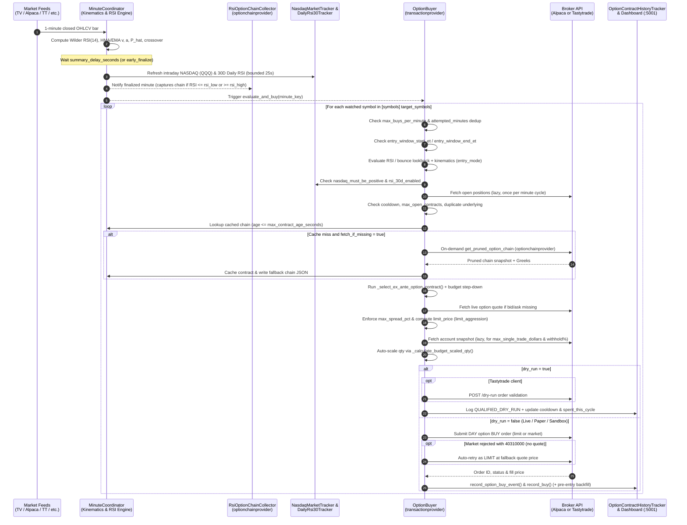
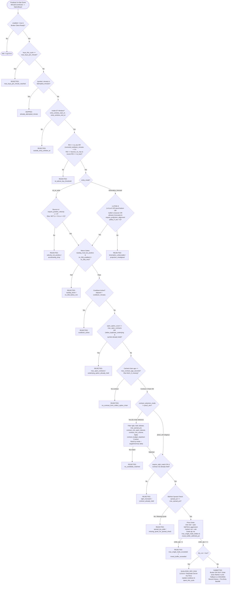

<div align="center">

# JBOA-RSI OPTION BUYING PROCESS & `OptionBuyer` LOGIC FLOW

### End-to-End Automated Entry Pipeline, Complete `[option_buyer]` Parameter Reference & UI Telemetry Guide

**Document ID:** `JBOA-RSI-DOC-05`  
**Scope:** `OptionBuyer` (`multiStreamRSI.py`), Ex-Ante Entry Gates, Zero-Hindsight Strike Selection, Dynamic Capital Scaling, Execution Fallback, and All 33 `[option_buyer]` Parameters  
**Engine Baseline:** `multiStreamRSI.py` (`v0.1.24`) · `lib/parms.ini`  
**Audience:** Traders, Quantitative Analysts, Risk Engineers & System Operators

</div>

**Navigation:** [Overview (`README.md`)](../README.md) · [Changelog (`CHANGELOG.md`)](./CHANGELOG.md) · [Trading Algorithms & Risk](./TRADING_ALGORITHMS_AND_RISK.md) · **Option Buyer Guide** · [Option Seller & Stop-Loss Guide](./OPTION_SELLER_AND_STOP_LOSS_GUIDE.md) · [Frontend Dashboard](./FRONTEND_DASHBOARD.md) · [Deployment & Operations](./DEPLOYMENT_AND_OPERATIONS.md) · [Configuration & API Reference](./CONFIGURATION_AND_API_REFERENCE.md)

---

## Table of Contents

1. [Executive Overview: How Automated Option Buying Works](#1-executive-overview-how-automated-option-buying-works)
2. [End-to-End System Interaction Sequence](#2-end-to-end-system-interaction-sequence)
3. [Complete 14-Stage `OptionBuyer` Decision Pipeline Flowchart](#3-complete-14-stage-optionbuyer-decision-pipeline-flowchart)
4. [Stage-by-Stage Logic Flow & Parameter Control Walkthrough](#4-stage-by-stage-logic-flow--parameter-control-walkthrough)
   - [Stage 0 — Master Enable, Execution Mode & Strict Zero-Fallback Broker Routing](#stage-0--master-enable-execution-mode--strict-zero-fallback-broker-routing)
   - [Stage 1 — Minute Finalization Wake-Up, Per-Minute Cap & Deduplication](#stage-1--minute-finalization-wake-up-per-minute-cap--deduplication)
   - [Stage 2 — US/Eastern Entry Window Gate](#stage-2--useastern-entry-window-gate)
   - [Stage 3 — Oversold RSI & Confirmed Bounce-Lookback Qualification](#stage-3--oversold-rsi--confirmed-bounce-lookback-qualification)
   - [Stage 4 — Kinematics & Entry Mode Evaluation (`kinematics_forecast` vs `rsi_ex_ante`)](#stage-4--kinematics--entry-mode-evaluation-kinematics_forecast-vs-rsi_ex_ante)
   - [Stage 5 — Ex-Ante Macro & Multi-Timeframe Gates (NASDAQ Direction & 30-Day Daily RSI)](#stage-5--ex-ante-macro--multi-timeframe-gates-nasdaq-direction--30-day-daily-rsi)
   - [Stage 6 — Per-Symbol Cooldown & Portfolio Exposure Locks](#stage-6--per-symbol-cooldown--portfolio-exposure-locks)
   - [Stage 7 — Option Chain Cache Lookup & On-Demand Fetch](#stage-7--option-chain-cache-lookup--on-demand-fetch)
   - [Stage 8 — Zero-Hindsight Ex-Ante Contract Selection & Budget Step-Down](#stage-8--zero-hindsight-ex-ante-contract-selection--budget-step-down)
   - [Stage 9 — Contract Parsing, Right Verification & Duplicate-Contract Guard](#stage-9--contract-parsing-right-verification--duplicate-contract-guard)
   - [Stage 10 — Live Quote Enrichment, Bid/Ask Spread Filter & Order Pricing](#stage-10--live-quote-enrichment-bidask-spread-filter--order-pricing)
   - [Stage 11 — Dynamic Capital Budgeting & Quantity Auto-Scaling](#stage-11--dynamic-capital-budgeting--quantity-auto-scaling)
   - [Stage 12 — Dry-Run Simulation vs Live Submission & No-Quote Market Fallback](#stage-12--dry-run-simulation-vs-live-submission--no-quote-market-fallback)
   - [Stage 13 — Post-Buy Bookkeeping, History Backfill & Audit Telemetry](#stage-13--post-buy-bookkeeping-history-backfill--audit-telemetry)
5. [Complete `[option_buyer]` Parameter Reference (All 33 Parameters + Cross-Section Gates)](#5-complete-option_buyer-parameter-reference-all-33-parameters--cross-section-gates)
6. [Worked End-to-End Buying Scenarios](#6-worked-end-to-end-buying-scenarios)
7. [Dashboard UI Mockups & Log Inspection Reference](#7-dashboard-ui-mockups--log-inspection-reference)

---

## 1. Executive Overview: How Automated Option Buying Works

In JBOA-RSI, `OptionBuyer` is an asynchronous decision and execution task synchronized to `MinuteCoordinator`'s finalized 1-minute equity bar clock. Every time a 1-minute bar finalizes across the configured market-data providers (e.g., `TRADINGVIEW`, `ALPACA`, `TASTYTRADE`, `TRADIER`, `TWELVEDATA`, `YAHOOFINANCE`), `MinuteCoordinator` notifies `RsiOptionChainCollector`, `OptionBuyer`, and `OptionSeller`.

`OptionBuyer` is strictly **ex-ante** (zero look-ahead): every single check uses only information known at the moment the 1-minute bar closes. Currently, `OptionBuyer` targets **long `CALL`** entries on oversold dips or confirmed post-oversold upward bounces, enforcing layered guardrails across:

1. **Clock & Rate Limits:** Optional US/Eastern time windows, per-minute order rate caps, and minute deduplication.
2. **Technical & Kinematic Qualification:** Current RSI $\le$ `rsi_low` (or a recent dip within `oversold_lookback_minutes` followed by a positive-velocity bounce below `bounce_rsi_max`), coupled with velocity ($v$), acceleration ($a$), zero-line crossover, Taylor forecast alignment ($\Delta\hat{P} > 0$), or forecast-independent `rsi_ex_ante` mode.
3. **Macro & Multi-Timeframe Filters:** Optional intraday NASDAQ direction (`[general] nasdaq_must_be_positive`) and 30-day daily Wilder RSI floor (`[general] rsi_30d_enabled`).
4. **Portfolio Risk Locks:** Per-underlying cooldowns, portfolio-wide max concurrent option contracts, and duplicate-underlying prevention.
5. **Strike Quality, Liquidity & Capital Math:** 9 zero-hindsight strike selection modes (from fixed OTM/ITM offsets to Delta-banded and 4-factor `composite_score`), OI/Volume floors, bid/ask spread caps, automated outward strike budget step-down, per-trade dollar caps, and account buying-power cash-reserve withholding.
6. **Execution Resilience:** Local or Tastytrade server-side dry-run validation, limit-price aggression tuning, and automatic market-to-limit fallback on Alpaca `40310000` (no available quote) rejections.

> **Audit Transparency:** Every watched symbol produces an `OPTION_BUY_ANALYSIS` entry on every finalized minute in `logs/option_buyer/` — whether it is `REJECTED`, `SKIPPED`, `QUALIFIED_DRY_RUN`, or `SUBMITTED` — so operators can inspect the exact reason for every decision in the live Port `5001` Dashboard **Buy/Sell Log**.

---

## 2. End-to-End System Interaction Sequence



---

## 3. Complete 14-Stage `OptionBuyer` Decision Pipeline Flowchart

Every decision gate in `OptionBuyer.evaluate_and_buy()` executes in strict sequential order. Any failed gate immediately logs `OPTION_BUY_ANALYSIS ... decision=REJECTED reason=<exact_code>` and moves to the next watched symbol.



---

## 4. Stage-by-Stage Logic Flow & Parameter Control Walkthrough

### Stage 0 — Master Enable, Execution Mode & Strict Zero-Fallback Broker Routing

| Parameter | Section | Default | Role in Stage 0 |
| :--- | :--- | :---: | :--- |
| `enabled` | `[option_buyer]` | `true` | Master kill switch. When `false`, the `OptionBuyer` async task is not launched and no buy evaluations occur. |
| `dry_run` | `[option_buyer]` | `true` | Safety gate. When `true`, all 14 stages run identically (including live quotes, account balance checks, and contract selection), but no real/paper order fills are placed. For Alpaca, simulation is local; for Tastytrade, `OptionBuyer` calls Tastytrade's `/dry-run` endpoint to validate margin/buying power server-side. |
| `paper` | `[option_buyer]` | `true` | For Alpaca (`transactionprovider = alpaca`), selects the Paper Trading API (`true`) vs Live Brokerage API (`false`). For Tastytrade, order routing is controlled by `[tastytrade_api] transaction_env` (`sandbox` vs `prod`). |
| `optionchainprovider` | `[option_trading]` | `alpaca` | Selects which broker provides pruned option chain snapshots & Greeks (`alpaca` or `tastytrade`). **Strict zero-fallback:** never silently switches providers if credentials fail. |
| `transactionprovider` | `[option_trading]` | `alpaca` | Selects which broker receives buy/sell orders, open-position queries, and account balance snapshots (`alpaca` or `tastytrade`). |

---

### Stage 1 — Minute Finalization Wake-Up, Per-Minute Cap & Deduplication

When `MinuteCoordinator` finalizes a 1-minute bar (after `[kinematics] summary_delay_seconds` or early finalization), `OptionBuyer` iterates through `[symbols] target_symbols` in configured order:

* **`max_buys_per_minute`** (default `1`, `0 = unlimited`): Caps how many new option buys (`QUALIFIED_DRY_RUN` or `SUBMITTED`) can fire during a single finalized minute cycle. Once `buys_this_cycle >= max_buys_per_minute`, all remaining symbols in that minute are logged as `REJECTED` with `max_buys_per_minute_reached(X/Y)`. This prevents simultaneous correlated market dips from draining buying power across 5–6 tickers in the same 60-second bar.
* **Minute Deduplication (`attempted_minutes`):** Once a symbol qualifies at Stage 4 for a given `minute_key`, `(symbol, minute_key)` is added to `self.attempted_minutes` so duplicate wake-ups can never submit two buy orders for the same symbol in the same minute (`SKIPPED: already_attempted_minute`).

---

### Stage 2 — US/Eastern Entry Window Gate

* **`entry_window_start_et`** (default blank) & **`entry_window_end_et`** (default blank): Optional `HH:MM` 24-hour US/Eastern clock bounds evaluated against the finalized bar's timestamp converted to `America/New_York`.
* Leaving either blank removes that bound (e.g., `entry_window_start_et = 09:45` and `entry_window_end_et = 15:30` avoids opening-bell spread chaos and late-day 0DTE/1DTE gamma crush).
* Bars outside the window immediately reject with `outside_entry_window_et(et=HH:MM,window=START-END)`.

---

### Stage 3 — Oversold RSI & Confirmed Bounce-Lookback Qualification

`OptionBuyer._evaluate_kinematics()` requires the finalized bar to have a finite Wilder RSI(14) satisfying one of two paths:

1. **Direct Oversold Path:**
   $$\text{RSI}_t \le \texttt{rsi\_low}$$
2. **Confirmed Bounce-Lookback Path** (active when `oversold_lookback_minutes > 0`):
   $$\texttt{rsi\_low} < \text{RSI}_t \le \max(\texttt{rsi\_low},\ \texttt{bounce\_rsi\_max})$$
   **AND** at least one finalized 1-minute bar within the prior `oversold_lookback_minutes` (default `3`) had $\text{RSI} \le \texttt{rsi\_low}$.

> **Why Bounce Lookback Exists:** When a stock flushes to `RSI = 29` with downward velocity ($v < 0$), `require_positive_velocity = true` wisely blocks catching a falling knife. One or two minutes later, the stock bounces and turns $v > 0$, but its RSI has already ticked up to `38.5` (above `rsi_low = 35.0`). Without `oversold_lookback_minutes` + `bounce_rsi_max`, the system would miss the confirmed reversal. Note that entering via bounce lookback **always mandates strictly positive velocity ($v > 0$)** even if `require_positive_velocity = false`.

* **`rsi_low`** (default `35.0`): Primary oversold threshold for both `RsiOptionChainCollector` (triggers automatic option chain capture) and `OptionBuyer`.
* **`rsi_high`** (default `65.0`): Stored in `[option_buyer]` as the legacy shared overbought threshold for `RsiOptionChainCollector` high-RSI capture and as a fallback for `OptionSeller` if `[option_seller] rsi_high` is omitted. It does **not** gate buy entries directly.
* **`oversold_lookback_minutes`** (default `3`, `0` disables): Lookback horizon in minutes to search `kinematics_history` for a recent $\text{RSI} \le \texttt{rsi\_low}$ bar.
* **`bounce_rsi_max`** (default `45.0`): Ceiling on current RSI when entering via the bounce-lookback path.

---

### Stage 4 — Kinematics & Entry Mode Evaluation (`kinematics_forecast` vs `rsi_ex_ante`)

After passing Stage 3, `OptionBuyer` reads smoothed velocity $v$ (`smoothed_velocity`, falling back to `price_velocity`) and smoothed acceleration $a$ (`smoothed_acceleration`, falling back to `price_acceleration`), and branches on **`entry_mode`**:

#### Mode A: `entry_mode = kinematics_forecast` (Default — Strict Taylor/Kinematics Confirmation)

Requires both $v$ and $a$ to be finite, then checks:
1. **Velocity Sign Gate (`require_positive_velocity`, default `true`):** If `true` (or if Stage 3 used the bounce-lookback path), $v \le 0$ is immediately rejected (`velocity_not_positive` or `bounce_velocity_not_positive`).
2. **Qualifying Kinematic Pattern** (any one must match):
   * **Bullish Thrust:** $v > 0 \land a > 0$
   * **Oversold Decelerating Bottom** *(only when `require_positive_velocity = false` and not a bounce)*: $v < 0 \land a > 0$
   * **Bullish Zero-Line Crossover:** `crossover_signal` $\in \{\texttt{leading\_bullish}, \texttt{confirmed\_bullish}\}$ $\land\ a \ge 0$ (and $v > 0$ if velocity gate active)
   * **Allowed Forecast Match (`allowed_forecasts`):** `forecast_direction` $\in$ `allowed_forecasts` (default `bullish_reversal,bullish_continuation,bullish_momentum`) $\land\ a > 0$ (and $v > 0$ if velocity gate active)
3. **1-Minute Projection Alignment (`require_projection_alignment`, default `true`):** When `true` and `projected_delta` ($\Delta\hat{P} = v + \frac{1}{2}a$) is present, requires $\Delta\hat{P} > 0$. Otherwise rejects with `projection_misaligned(CALL,delta=...)`.

#### Mode B: `entry_mode = rsi_ex_ante` (Opt-In Forecast-Independent Mode)

Designed for operators who want clean RSI oversold/bounce entries without requiring 1-minute Taylor `forecast_direction` or `projected_delta > 0`:
* If entering via bounce lookback **or** `require_positive_velocity = true`: requires $v > 0$.
* If `require_positive_velocity = false` and directly oversold: still blocks accelerating freefalls ($v < 0 \land a \le 0 \rightarrow$ `accelerating_drop`).
* Bypasses `allowed_forecasts` and `require_projection_alignment`, qualifying directly as `CALL` with tag `rsi_ex_ante(v=...,a=...)`.

---

### Stage 5 — Ex-Ante Macro & Multi-Timeframe Gates (NASDAQ Direction & 30-Day Daily RSI)

Configured in `[general]` (always collected, logged, and displayed on the dashboard even when disabled as buy gates):

* **`[general] nasdaq_must_be_positive`** (default `false`) & **`[general] nasdaq_symbol`** (default `QQQ`): When `true`, requires $(\text{current\_price} - \text{prev\_trading\_day\_close}) > 0$ on `nasdaq_symbol`. Blocks long CALL entries during red market sessions (`nasdaq_down(...)`).
* **`[general] rsi_30d_enabled`** (default `false`) & **`[general] rsi_30d_min`** (default `30.0`): When `true`, requires the symbol's 30-day daily Wilder RSI (blending prior daily closes with live intraday close) to be **strictly greater** than `rsi_30d_min` (`rsi_30d > rsi_30d_min`). Blocks buying falling-knife downtrends (`rsi_30d_below_min(...)`).

---

### Stage 6 — Per-Symbol Cooldown & Portfolio Exposure Locks

Before querying option chains, `OptionBuyer` enforces three portfolio-level protections (lazily fetching open broker positions once per minute cycle):

* **`cooldown_minutes`** (default `15`, `0` disables): Minimum elapsed minutes since `last_buy_by_symbol[symbol]` before another buy on the same underlying is allowed (`cooldown_active`).
* **`max_open_contracts`** (default `5`): Hard ceiling on total concurrent open option positions across the entire brokerage account (`open_option_count >= max_open_contracts` $\rightarrow$ `max_open_contracts(X/Y)`). Incremented live within the same minute cycle if multiple buys succeed.
* **`allow_duplicate_underlying`** (default `false`): When `false`, blocks opening a second option position on any underlying ticker already present in open broker positions (`underlying_option_already_held`).

---

### Stage 7 — Option Chain Cache Lookup & On-Demand Fetch

* **`max_contract_age_seconds`** (default `180`, min `30`): Looks up the latest option chain snapshot captured by `RsiOptionChainCollector` for `symbol`. If its age exceeds `max_contract_age_seconds`, the cached snapshot is considered stale and discarded.
* **`fetch_if_missing`** (default `true`): If no fresh cached snapshot exists and `fetch_if_missing = true`, `OptionBuyer` performs an on-demand option chain fetch using `[option_trading] optionchainprovider` (`get_pruned_option_chain_tastytrade` or `get_pruned_option_chain` for Alpaca), caches the result in `MinuteCoordinator`, and writes a fallback JSON file to `logs/optionchains/`. If `false` and no fresh snapshot exists, rejects with `no_contract_from_collect_option_chain`.

---

### Stage 8 — Zero-Hindsight Ex-Ante Contract Selection & Budget Step-Down

When **`contract_selection_mode`** is `"plus2_otm"` (legacy default), `OptionBuyer` uses the primary `+2 OTM` contract pre-selected by the option chain fetcher. For all other 8 modes, `OptionBuyer` executes `_select_ex_ante_option_contract()` across the entire `chain_snapshot` using **strictly live data** (mirroring `findthewinners.py`):

#### Step 8A — OTM Rank Assignment
For `CALL` contracts against live spot price $S$:
* Strikes $\le S$ sorted descending receive ranks `0` (ATM), `-1` (1 ITM), `-2` (2 ITM), ...
* Strikes $> S$ sorted ascending receive ranks `+1` (1 OTM), `+2` (2 OTM), `+3`, `+4`, ...

#### Step 8B — Hard Quality & Liquidity Pre-Filters
Every strike in `chain_snapshot` must pass:
1. Right matches `CALL` (when `require_right_match = true`).
2. Contract symbol is not already held in `open_contracts`.
3. Valid positive two-sided quote (`bid > 0` and `ask >= bid`).
4. Bid/ask spread $\le$ **`max_spread_pct`**.
5. Open interest $\ge$ **`contract_min_open_interest`** (default `0` = disabled).
6. Daily volume $\ge$ **`contract_min_volume`** (default `0` = disabled).

#### Step 8C — Automated Budget Step-Down (`contract_budget_stepdown`, default `true`)
If `contract_budget_stepdown = true` and a capital ceiling is active (`max_single_trade_dollars > 0` or `invest_buffer_withhold_pct > 0`), the selector computes the max affordable 1-contract cost (`max_1ct_budget`) and removes contracts whose estimated 1-contract cost exceeds it. If the primary strike was eliminated solely due to budget, fixed-rank and `atm_itm_low_spread` modes automatically step outward toward cheaper OTM strikes (up to `+4 OTM`), and delta modes step toward the closest affordable delta contract, annotating the reason with `stepdown`.

#### Step 8D — All 9 `contract_selection_mode` Algorithms

| `contract_selection_mode` | Selection Rule | Parameters Used |
| :--- | :--- | :--- |
| `plus2_otm` *(default)* | Legacy fetcher default: 2 strikes out-of-the-money (`otm_rank = +2`). | Chain fetcher default |
| `itm2` / `itm1` / `atm` / `otm1` | Fixed strike rank `-2`, `-1`, `0`, or `+1`; steps outward (up to `+4`) if over budget & `contract_budget_stepdown = true`. | `contract_budget_stepdown` |
| `atm_itm_low_spread` | Picks the tightest-spread contract between ATM (`0`) and 1-ITM (`-1`); steps outward (`+1..+4`) on budget cap. | `max_spread_pct`, `contract_budget_stepdown` |
| `delta_mid` | Filters to `contract_delta_min <= |delta| <= contract_delta_max` and picks closest to `contract_target_delta` (tie-break: lowest spread, closest to ATM). | `contract_target_delta`, `contract_delta_min`, `contract_delta_max` |
| `delta_itm_low_spread` | Targets ITM delta band `[max(0.55, contract_delta_min), max(0.85, contract_delta_max)]`, minimizing spread first, then distance to `contract_target_delta`. | `contract_target_delta`, `contract_delta_min`, `contract_delta_max` |
| `composite_score` | Scores all strikes in rank window `[-2, +4]` using a 4-factor weighted formula:<br/>`0.45 * spread_score + 0.35 * delta_score + 0.15 * liq_score + 0.05 * theta_score`<br/>Highest composite score wins. | `max_spread_pct`, `contract_target_delta`, `contract_min_open_interest`, `contract_min_volume` |

---

### Stage 9 — Contract Parsing, Right Verification & Duplicate-Contract Guard

* Extracts the canonical OCC contract symbol (e.g., `NVDA261211C00144000`). Unparseable contracts reject with `unparseable_contract`.
* **`[general] options_only`** (default `true`): Major buy & sell gate — rejects any candidate whose resolved symbol is not a valid OCC option contract (`options_only_non_option_contract`).
* **`require_right_match`** (default `true`): Verifies the OCC symbol's inferred right (`C` = `CALL`, `P` = `PUT`) equals `desired_right` (`CALL`). Rejects with `right_mismatch(expected=CALL,got=PUT)` if mismatched.
* Verifies `contract_symbol` is not already in `open_contracts` (`contract_already_held`).

---

### Stage 10 — Live Quote Enrichment, Bid/Ask Spread Filter & Order Pricing

1. **Quote Enrichment:** Extracts `(bid, ask)` from the selected contract/chain; if either side is missing or `<= 0`, queries the live quote API (`_fetch_option_quote`) on the configured `transactionprovider` (Tastytrade Prod quotes or Alpaca Option Data API).
2. **Bid/Ask Spread Guard (`max_spread_pct`, default `5.0`, `0` disables):**
   $$\text{mid} = \frac{\text{bid} + \text{ask}}{2}, \qquad \text{spread\_pct} = \frac{\text{ask} - \text{bid}}{\text{mid}} \times 100$$
   * If `spread_pct > max_spread_pct` $\rightarrow$ `REJECTED: spread_too_wide(X.XX%>Y.YY%)`.
   * If `max_spread_pct > 0` and either `bid` or `ask` is still unavailable $\rightarrow$ `REJECTED: missing_quote_for_spread_check`.
3. **Order Type & Limit Pricing (`order_type`, `limit_aggression`):**
   * **`order_type = limit`** *(default)*: Computes a bounded limit price between `bid` (`0.0`) and `ask` (`1.0`) controlled by **`limit_aggression`** (default `0.25`):
     $$\text{limit\_price} = \text{round}\!\Big(\max\!\big(0.01,\ \min(\text{ask},\ \max(\text{bid},\ \text{bid} + (\text{ask} - \text{bid}) \times \texttt{limit\_aggression}))\big),\ 2\Big)$$
     *Example:* `bid = $2.00`, `ask = $2.08`, `limit_aggression = 0.25` $\rightarrow$ `$2.00 + $0.08 × 0.25 = $2.02`.
   * **`order_type = market`**: Submits a DAY Market order; uses `ask` (falling back to `bid`) as `est_unit_price` for capital checks.

---

### Stage 11 — Dynamic Capital Budgeting & Quantity Auto-Scaling

`OptionBuyer` calls `_calculate_budget_scaled_qty()` so oversized **`qty`** settings automatically step down to the largest affordable integer contract count instead of needlessly rejecting good setups:

$$\text{contract\_cost} = \text{est\_unit\_price} \times 100$$

1. **Single-Trade Dollar Cap (`max_single_trade_dollars`, default `8000.0`, `0 = unlimited`):**
   $$q_{\text{single}} = \left\lfloor \frac{\texttt{max\_single\_trade\_dollars}}{\text{contract\_cost}} \right\rfloor$$
2. **Account Cash-Reserve Buffer (`invest_buffer_withhold_pct`, default `10.0`, range `0.0–100.0`):**
   Reads live broker `available_to_invest` and `balance_invested` (adjusted for `spent_this_cycle`):
   $$\text{total\_base} = \text{adj\_avail} + \text{adj\_inv}, \qquad \text{max\_investable} = \text{total\_base} \times \left(1 - \frac{\texttt{invest\_buffer\_withhold\_pct}}{100}\right)$$
   $$\text{remaining\_budget} = \max\!\big(0,\ \min(\text{adj\_avail},\ \text{max\_investable} - \text{adj\_inv})\big), \qquad q_{\text{buffer}} = \left\lfloor \frac{\text{remaining\_budget}}{\text{contract\_cost}} \right\rfloor$$
3. **Final Quantity:**
   $$\texttt{order\_qty} = \min(\texttt{qty},\ q_{\text{single}},\ q_{\text{buffer}})$$
   * If `order_qty < 1`: rejects with `max_single_trade_exceeded`, `invest_buffer_exceeded`, or `account_balance_unavailable`.
   * If `1 <= order_qty < qty`: scales down automatically and logs `OPTION_BUY_QTY_SCALED_DOWN` plus `|qty_scaled(orig->scaled:reason)` in the decision reason.

---

### Stage 12 — Dry-Run Simulation vs Live Submission & No-Quote Market Fallback

* **When `dry_run = true`:**
  * On **Tastytrade**, invokes `client.dry_run_order()` against the broker's `/dry-run` API (`dry_mode=server_ok` or `server_err:...`).
  * On **Alpaca**, evaluates locally (`dry_mode=local`).
  * Increments `dry_run_orders`, `buys_this_cycle`, and `spent_this_cycle`, starts the symbol cooldown timer, and logs `OPTION_BUY_ANALYSIS ... decision=QUALIFIED_DRY_RUN`.
* **When `dry_run = false`:**
  * Submits a `DAY` option `BUY` order via `_submit_option_order()` on `transactionprovider`.
  * **Automatic No-Quote Market Fallback:** If `order_type = market` and the broker rejects the order with Alpaca code `40310000` / `"no available quote"` / `"market orders are not available"`, `OptionBuyer` picks the best fallback price (`limit_price → ask → bid → close/mark/last`), re-validates budget via `_calculate_budget_scaled_qty()`, logs `OPTION_BUY_MARKET_FALLBACK_TO_LIMIT`, and automatically resubmits as a `DAY` `LIMIT` order!

---

### Stage 13 — Post-Buy Bookkeeping, History Backfill & Audit Telemetry

Upon broker acceptance of a live/paper/sandbox order:
1. Updates in-memory counters (`orders_submitted`, `buys_this_cycle`, `spent_this_cycle`, `open_option_count`, `open_contracts`, `open_underlyings`, `last_buy_by_symbol[symbol]`).
2. Calls `coordinator.record_option_buy_event()` so the Dashboard **3-Panel Kinematics Chart** plots a green **BUY** marker at the exact execution minute and so `OptionSeller` knows the exact entry timestamp for `min_hold_minutes`.
3. Calls `coordinator.option_history.record_buy()` to open an active P/L history ledger for the contract (including backfilling up to `[option_trading] pre_entry_lookback_minutes` of pre-entry 1m option bars) and schedules an async fill-price refresh if `filled_avg_price` was not yet populated on immediate submission.
4. Logs `OPTION_BUY_ANALYSIS ... decision=SUBMITTED` and `OPTION_BUY_SUBMITTED`.

---

## 5. Complete `[option_buyer]` Parameter Reference (All 33 Parameters + Cross-Section Gates)

### 5.1 All 33 `[option_buyer]` Parameters in `lib/parms.ini`

| # | Parameter Name | Type & Default | Pipeline Stage | How It Controls / Influences Buying |
| :-: | :--- | :--- | :---: | :--- |
| 1 | `enabled` | `bool` (`true`) | Stage 0 | Master on/off switch for the `OptionBuyer` async loop. When `false`, no buy analysis or orders run. |
| 2 | `dry_run` | `bool` (`true`) | Stage 12 | When `true`, runs full pipeline and logs `QUALIFIED_DRY_RUN` without placing real fills (calls Tastytrade `/dry-run` when Tastytrade is active). |
| 3 | `paper` | `bool` (`true`) | Stage 0 | Selects Alpaca Paper Trading (`true`) vs Live (`false`). Also serves as the default fallback for `[option_seller] paper`. |
| 4 | `rsi_low` | `float` (`35.0`) | Stage 3 | Oversold RSI threshold. Directly qualifies bars with `RSI <= rsi_low` and triggers `RsiOptionChainCollector` buy-side chain capture. |
| 5 | `rsi_high` | `float` (`65.0`) | Shared / Sell | Legacy shared overbought RSI threshold for `RsiOptionChainCollector` sell-side chain capture; overridden for sells by `[option_seller] rsi_high`. |
| 6 | `qty` | `int >= 1` (`1`) | Stage 11 | Desired contract count per buy order. Automatically scaled down if `max_single_trade_dollars` or `invest_buffer_withhold_pct` requires fewer contracts. |
| 7 | `order_type` | `limit \| market` (`limit`) | Stages 10, 12 | Buy order type. `limit` prices via `limit_aggression`; `market` submits DAY market with automatic `40310000` fallback-to-limit. |
| 8 | `cooldown_minutes` | `int >= 0` (`15`) | Stage 6 | Minimum minutes after a symbol's last buy (or dry-run buy) before `OptionBuyer` can re-enter that underlying (`cooldown_active`). |
| 9 | `max_open_contracts` | `int >= 1` (`5`) | Stage 6 | Maximum total concurrent open option positions across the brokerage account (`max_open_contracts`). |
| 10 | `max_contract_age_seconds` | `int >= 30` (`180`) | Stage 7 | Max age in seconds of a cached `RsiOptionChainCollector` snapshot before it is treated as stale. |
| 11 | `fetch_if_missing` | `bool` (`true`) | Stage 7 | If `true`, fetches a fresh option chain on demand from `optionchainprovider` when no fresh cached snapshot exists. |
| 12 | `allow_duplicate_underlying` | `bool` (`false`) | Stage 6 | If `false`, blocks buying any contract on an underlying already present in open broker positions (`underlying_option_already_held`). |
| 13 | `require_projection_alignment` | `bool` (`true`) | Stage 4 | In `kinematics_forecast` mode, requires 1-minute Taylor projected delta $\Delta\hat{P} > 0$ for `CALL` entries (`projection_misaligned`). |
| 14 | `require_right_match` | `bool` (`true`) | Stages 8, 9 | Ensures the selected OCC contract right (`CALL`/`PUT`) strictly matches the strategy's desired right (`CALL`). |
| 15 | `require_positive_velocity` | `bool` (`true`) | Stage 4 | Requires strictly positive underlying velocity ($v > 0$) before buying, preventing falling-knife entries during active flushes. |
| 16 | `oversold_lookback_minutes` | `int >= 0` (`3`) | Stage 3 | Enables post-oversold bounce entries if a finalized bar within the last $N$ minutes had `RSI <= rsi_low` (`0` disables lookback). |
| 17 | `bounce_rsi_max` | `float` (`45.0`) | Stage 3 | Maximum current RSI permitted when qualifying via `oversold_lookback_minutes` (requires $v > 0$). |
| 18 | `max_spread_pct` | `float >= 0.0` (`5.0`) | Stages 8, 10 | Hard ceiling on `(ask - bid) / mid * 100`. Eliminates illiquid strikes during selection and rejects wide quotes before order submission (`0` disables). |
| 19 | `limit_aggression` | `float 0.0–1.0` (`0.25`) | Stage 10 | Places limit buy price at `bid + (ask - bid) * limit_aggression` (`0.0` = passive at bid, `0.5` = mid, `1.0` = aggressive at ask). |
| 20 | `max_buys_per_minute` | `int >= 0` (`1`) | Stage 1 | Maximum buy orders allowed per finalized minute cycle across all symbols (`0 = unlimited`). |
| 21 | `max_single_trade_dollars` | `float >= 0.0` (`8000.0`) | Stages 8, 11 | Hard dollar cap on a single buy order (`0 = unlimited`). Drives both strike budget step-down and integer `qty` auto-scaling. |
| 22 | `invest_buffer_withhold_pct` | `float 0.0–100.0` (`10.0`) | Stages 8, 11 | Percentage of total account investable base (`available + invested`) held back as a cash reserve. Scales down `qty` or rejects (`invest_buffer_exceeded`). |
| 23 | `allowed_forecasts` | `csv` (`bullish_reversal, bullish_continuation, bullish_momentum`) | Stage 4 | Comma-separated `forecast_direction` labels allowed to qualify in `kinematics_forecast` mode when $a > 0$. |
| 24 | `entry_mode` | `kinematics_forecast \| rsi_ex_ante` (`kinematics_forecast`) | Stage 4 | Switches between full Taylor kinematics/forecast confirmation (`kinematics_forecast`) and forecast-independent RSI+velocity gating (`rsi_ex_ante`). |
| 25 | `entry_window_start_et` | `HH:MM` (blank) | Stage 2 | Earliest US/Eastern time allowed to open new trades (blank = no start restriction). |
| 26 | `entry_window_end_et` | `HH:MM` (blank) | Stage 2 | Latest US/Eastern time allowed to open new trades (blank = no end restriction). |
| 27 | `contract_selection_mode` | `enum` (`plus2_otm`) | Stage 8 | Ex-ante strike selection rule: `plus2_otm`, `atm`, `itm1`, `itm2`, `otm1`, `atm_itm_low_spread`, `delta_mid`, `delta_itm_low_spread`, or `composite_score`. |
| 28 | `contract_target_delta` | `float 0.05–0.95` (`0.55`) | Stage 8 | Target `|delta|` used by `delta_mid`, `delta_itm_low_spread`, and `composite_score`. |
| 29 | `contract_delta_min` | `float 0.0–1.0` (`0.45`) | Stage 8 | Lower bound on `|delta|` for delta-banded selection modes. |
| 30 | `contract_delta_max` | `float` (`0.70`) | Stage 8 | Upper bound on `|delta|` for delta-banded selection modes (`>= contract_delta_min`, `<= 1.0`). |
| 31 | `contract_min_open_interest` | `int >= 0` (`0`) | Stage 8 | Minimum open interest required for a candidate strike in ex-ante selection (`0 = disabled`). |
| 32 | `contract_min_volume` | `int >= 0` (`0`) | Stage 8 | Minimum daily contract volume required for a candidate strike in ex-ante selection (`0 = disabled`). |
| 33 | `contract_budget_stepdown` | `bool` (`true`) | Stage 8 | When `true`, automatically steps down to a cheaper eligible strike if the primary pick exceeds `max_single_trade_dollars` or the cash-reserve budget. |

### 5.2 Cross-Section Parameters That Directly Gate `OptionBuyer`

| Section & Parameter | Default | Effect on `OptionBuyer` |
| :--- | :---: | :--- |
| `[general] nasdaq_must_be_positive` | `false` | When `true`, blocks all buys unless `(current - prev_trading_day_close) > 0` on `nasdaq_symbol`. |
| `[general] nasdaq_symbol` | `QQQ` | Reference index ETF tracked every minute for `nasdaq_must_be_positive`. |
| `[general] rsi_30d_enabled` | `false` | When `true`, blocks buys unless the symbol's 30-day daily RSI `> rsi_30d_min`. |
| `[general] rsi_30d_min` | `30.0` | Strict lower bound on 30-day daily RSI when `rsi_30d_enabled = true`. |
| `[general] options_only` | `true` | Major buy & sell gate: restricts `OptionBuyer` purchases (`options_only_non_option_contract`) and `OptionSeller` exits/peak-profit guards strictly to OCC option contracts. |
| `[option_trading] optionchainprovider` | `alpaca` | Broker queried for option chains & Greeks (`alpaca` or `tastytrade`). |
| `[option_trading] transactionprovider` | `alpaca` | Broker queried for open positions, account balance, live quotes, and order submission. |
| `[option_trading] chain_include_greeks` | `true` | Must be `true` for delta/theta-based `contract_selection_mode` (`delta_mid`, `delta_itm_low_spread`, `composite_score`). |

---

## 6. Worked End-to-End Buying Scenarios

### Scenario A — Confirmed Oversold Bounce Entry with `composite_score` & Limit Aggression

* **Config:** `rsi_low = 35.0`, `oversold_lookback_minutes = 3`, `bounce_rsi_max = 45.0`, `require_positive_velocity = true`, `entry_mode = kinematics_forecast`, `contract_selection_mode = composite_score`, `contract_target_delta = 0.55`, `max_spread_pct = 5.0`, `limit_aggression = 0.25`, `qty = 3`, `max_single_trade_dollars = 2000.0`.
* **Minute 10:14 ET (`NVDA`):** `RSI = 31.40`, `v = -0.1840`, `a = +0.0620` $\rightarrow$ **REJECTED** (`velocity_not_positive` — falling knife blocked).
* **Minute 10:15 ET (`NVDA`):** `RSI = 36.85` (above `35.0`, but `31.40 <= 35.0` occurred `1m` ago, and `36.85 <= 45.0`), `v = +0.0910`, `a = +0.1450`, $\Delta\hat{P} = +0.1635$ $\rightarrow$ **Passes Stage 3 & Stage 4** (`rsi=36.85<=45.00(oversold_1m_ago=31.40)&bullish_thrust`).
* **Contract Selection (Stage 8):** `composite_score` ranks strikes `[-2..+4]` and selects ATM `NVDA261211C00142000` (`delta = 0.54`, `bid = $7.80`, `ask = $8.00`, `spread = 2.53% <= 5.0%`, `score = 0.872`).
* **Pricing & Qty Auto-Scaling (Stages 10–11):**
  * `limit_price = 7.80 + (8.00 - 7.80) * 0.25 = $7.85` (`$785/contract`).
  * `qty = 3` would cost `$2,355 > $2,000` (`max_single_trade_dollars`), so `_calculate_budget_scaled_qty()` auto-scales `3 -> 2` contracts (`$1,570.00`) and logs `|qty_scaled(3->2:max_single_trade_cap)`.
* **Execution (Stage 12):** Submits `BUY 2 NVDA261211C00142000 LIMIT @ $7.85 DAY`.

### Scenario B — Budget Step-Down Outward to an Affordable OTM Strike

* **Config:** `contract_selection_mode = atm_itm_low_spread`, `contract_budget_stepdown = true`, `max_single_trade_dollars = 600.0`, `qty = 1`.
* **Chain Snapshot (`META`):** `ITM-1` costs `$1,120`, `ATM (0)` costs `$840` (both exceed `$600`), while `OTM+1` costs `$510` (`spread = 3.1% <= 5.0%`).
* **Outcome:** Because `contract_budget_stepdown = true`, `OptionBuyer` sees that `ATM`/`ITM-1` existed pre-budget and steps outward to `OTM+1` (`$510 <= $600`), annotating `|sel=atm_itm_low_spread(rank=+1,spr=3.10%,stepdown)` and submitting the buy instead of rejecting the trade.

---

## 7. Dashboard UI Mockups & Log Inspection Reference

### 7.1 Live Dashboard — Option Buyer Status Panel Mockup

```text
+------------------------------------------------------------------------------+
| OPTION BUYER (TASTYTRADE · SANDBOX)                          [ENABLED · LIVE]|
+------------------------------------------------------------------------------+
| Mode: kinematics_forecast  | Selection: composite_score (d=0.55)             |
| RSI Low: <= 35.00          | Bounce: 3m lookback, RSI <= 45.00, v > 0        |
| Order: LIMIT (aggr=0.25)   | Max Spread: 5.0% | Qty: 3 (Cap $2,000 / 10% res)|
| Limits: 2/5 Open Contracts | Cooldown: 15m    | Rate: 1 buy/min              |
+------------------------------------------------------------------------------+
| Last Eval: 10:15:46 ET     | Submitted: 2     | Dry-Run: 0                   |
| Last Order: NVDA261211C00142000 (2 ct @ $7.85) — bullish_thrust|qty_scaled   |
+------------------------------------------------------------------------------+
```

### 7.2 Live Dashboard — Buy/Sell Decision & Execution Log (BUY Rows)

```text
TIME (EST)   SIDE  SYMBOL / CONTRACT     PROVIDER    RSI    30D   V        A        ΔP̂       P/L %   DECISION    REASON / DETAILS
---------------------------------------------------------------------------------------------------------------------------------------------------
10:15:46     BUY   NVDA                  ALPACA      36.85  44.12 +0.0910  +0.1450  +0.1635  --      SUBMITTED   rsi=36.85<=45.00(oversold_1m_ago=31.40)&bullish_thrust|sel=composite_score(rank=0,spr=2.53%,d=0.54,score=0.872)|qty_scaled(3->2:max_single_trade_cap)
                   NVDA261211C00142000
10:15:46     BUY   AMD                   ALPACA      33.10  41.80 +0.0420  +0.0310  +0.0575  --      REJECTED    max_buys_per_minute_reached(1/1)
10:14:46     BUY   NVDA                  ALPACA      31.40  43.95 -0.1840  +0.0620  -0.1530  --      REJECTED    velocity_not_positive(rsi=31.40,v=-0.1840,a=+0.0620)
10:13:46     BUY   AAPL                  ALPACA      34.22  28.40 +0.0550  +0.0210  +0.0655  --      REJECTED    rsi_30d_below_min(28.40<=30.0)
10:12:46     BUY   MSFT                  ALPACA      32.90  51.10 +0.0610  +0.0190  +0.0705  --      REJECTED    spread_too_wide(7.42%>5.00%)
                   MSFT261211C00430000
```

> **Tip:** Clicking any row in the **Buy/Sell Log** opens the **Buy/Sell Log Details** modal showing the full unwrapped decision reason, the `±3` minute surrounding kinematics & RSI context window, and the exact underlying price trajectory around the trigger bar.
