<div align="center">

# JBOA-RSI OPTION SELLING PROCESS, `OptionSeller` LOGIC FLOW & EXHAUSTIVE STOP-LOSS DEEP DIVE

### Complete 4-Tier Automated Exit Waterfall, All 30 `[option_seller]` Parameters, `[option_buyer]` Cross-Influences, & 12 Illustrated Stop-Loss Scenarios with Diagrams and UI Mockups

**Document ID:** `JBOA-RSI-DOC-06`  
**Scope:** `OptionSeller` (`multiStreamRSI.py`), 4-Tier Exit Waterfall, Exhaustive Stop-Loss Architecture, Complete Parameter Reference, & 12 Scenario Playbooks  
**Engine Baseline:** `multiStreamRSI.py` (`v0.1.24`) · `lib/parms.ini`  
**Audience:** Traders, Risk Managers, Quantitative Engineers & System Operators

</div>

**Navigation:** [Overview (`README.md`)](../README.md) · [Changelog (`CHANGELOG.md`)](./CHANGELOG.md) · [Trading Algorithms & Risk](./TRADING_ALGORITHMS_AND_RISK.md) · [Option Buyer Guide](./OPTION_BUYER_GUIDE.md) · **Option Seller & Stop-Loss Guide** · [Frontend Dashboard](./FRONTEND_DASHBOARD.md) · [Deployment & Operations](./DEPLOYMENT_AND_OPERATIONS.md) · [Configuration & API Reference](./CONFIGURATION_AND_API_REFERENCE.md)

---

## Table of Contents

1. [Executive Overview: How Automated Option Selling Works](#1-executive-overview-how-automated-option-selling-works)
2. [End-to-End `OptionSeller` Execution Sequence](#2-end-to-end-optionseller-execution-sequence)
3. [Complete 4-Tier `OptionSeller` Exit Waterfall Flowchart](#3-complete-4-tier-optionseller-exit-waterfall-flowchart)
4. [Stage-by-Stage `OptionSeller` Logic Flow](#4-stage-by-stage-optionseller-logic-flow)
   - [Pre-Flight & Position State Bookkeeping](#pre-flight--position-state-bookkeeping)
   - [Tier 1 — Fixed Profit Target (`profit_target`)](#tier-1--fixed-profit-target-profit_target)
   - [Tier 2 — Overbought RSI + Bearish Kinematics + Profit Guard (`take_profit`)](#tier-2--overbought-rsi--bearish-kinematics--profit-guard-take_profit)
   - [Tier 3 — Session High-Water-Mark Trailing Stop (`trailing_stop`)](#tier-3--session-high-water-mark-trailing-stop-trailing_stop)
   - [Tier 4 — Stop-Loss Protection (`hard_stop_loss` & `stop_loss`)](#tier-4--stop-loss-protection-hard_stop_loss--stop_loss)
   - [Post-Qualification — Cooldown, Quantity Sizing, Pricing, Execution & Post-Exit Capture](#post-qualification--cooldown-quantity-sizing-pricing-execution--post-exit-capture)
5. [Complete `[option_seller]` Parameter Reference (All 30 Parameters)](#5-complete-option_seller-parameter-reference-all-30-parameters)
6. [How `[option_buyer]` Parameters Cross-Influence `OptionSeller`](#6-how-option_buyer-parameters-cross-influence-optionseller)
7. [Exhaustive Deep Dive: The Stop-Loss Protection Engine](#7-exhaustive-deep-dive-the-stop-loss-protection-engine)
   - [7.1 Exact Unrealized P/L% Calculation Hierarchy](#71-exact-unrealized-pl-calculation-hierarchy)
   - [7.2 Hold Duration (`hold_minutes`) & `min_hold_minutes` Grace Window](#72-hold-duration-hold_minutes--min_hold_minutes-grace-window)
   - [7.3 Stop-Loss State Machine Diagram](#73-stop-loss-state-machine-diagram)
   - [7.4 Consecutive-Minute Streak Engine & The 95-Second Contiguity Rule](#74-consecutive-minute-streak-engine--the-95-second-contiguity-rule)
   - [7.5 Soft Stop-Loss Kinematics Confirmation (`_evaluate_stop_loss_kinematics`)](#75-soft-stop-loss-kinematics-confirmation-_evaluate_stop_loss_kinematics)
   - [7.6 Stop-Loss Order Pricing, Discount Anchoring & Market-to-Limit Fallback](#76-stop-loss-order-pricing-discount-anchoring--market-to-limit-fallback)
8. [12 Illustrated Stop-Loss Scenarios (With Diagrams & Dashboard UI Mockups)](#8-12-illustrated-stop-loss-scenarios-with-diagrams--dashboard-ui-mockups)
   - [Scenario 1 — Clean Soft Stop-Loss Exit (5 Consecutive Breaches + Downward Pressure)](#scenario-1--clean-soft-stop-loss-exit-5-consecutive-breaches--downward-pressure)
   - [Scenario 2 — Brief Dip & Recovery Streak Reset (`3/5 -> 0/5`)](#scenario-2--brief-dip--recovery-streak-reset-35---05)
   - [Scenario 3 — `min_hold_minutes` Grace Window Suppressing Soft Stop-Loss (`sl_hold_grace`)](#scenario-3--min_hold_minutes-grace-window-suppressing-soft-stop-loss-sl_hold_grace)
   - [Scenario 4 — `min_hold_minutes` Grace Window Suppressing Hard Emergency Stop (`hard_sl_hold_grace`)](#scenario-4--min_hold_minutes-grace-window-suppressing-hard-emergency-stop-hard_sl_hold_grace)
   - [Scenario 5 — Hard Emergency Stop-Loss Instant Bypass (Post-Grace Flash Drop)](#scenario-5--hard-emergency-stop-loss-instant-bypass-post-grace-flash-drop)
   - [Scenario 6 — Hard Stop Disabled (`stop_loss_hard_pct = 0`) vs Enabled (`25.0%`) Comparison](#scenario-6--hard-stop-disabled-stop_loss_hard_pct--0-vs-enabled-250-comparison)
   - [Scenario 7 — Kinematics Rebound Protection (`stop_loss_require_kinematics = true` -> `sl_hold`)](#scenario-7--kinematics-rebound-protection-stop_loss_require_kinematics--true---sl_hold)
   - [Scenario 8 — Kinematics Gate Disabled (`stop_loss_require_kinematics = false`) Mechanical Exit](#scenario-8--kinematics-gate-disabled-stop_loss_require_kinematics--false-mechanical-exit)
   - [Scenario 9 — Feed Pause / Service Restart Contiguity Reset (`gap_sec > 95s`)](#scenario-9--feed-pause--service-restart-contiguity-reset-gap_sec--95s)
   - [Scenario 10 — Stop-Loss Limit Order Discount Pricing (`stop_loss_limit_discount_pct = 3.0%`)](#scenario-10--stop-loss-limit-order-discount-pricing-stop_loss_limit_discount_pct--30)
   - [Scenario 11 — Emergency Market Override (`stop_loss_force_market = true`) & No-Quote Fallback (`40310000`)](#scenario-11--emergency-market-override-stop_loss_force_market--true--no-quote-fallback-40310000)
   - [Scenario 12 — Tier 3 Trailing Stop vs Tier 4 Stop-Loss Interaction, Cooldown & Dry-Run Modes](#scenario-12--tier-3-trailing-stop-vs-tier-4-stop-loss-interaction-cooldown--dry-run-modes)

---

## 1. Executive Overview: How Automated Option Selling Works

`OptionSeller` is an asynchronous risk-management and profit-taking task synchronized to `MinuteCoordinator`'s finalized 1-minute bar clock. On every finalized minute during active market sessions, `OptionSeller.evaluate_and_sell()`:

1. Fetches all open brokerage positions via `[option_trading] transactionprovider` (Alpaca or Tastytrade).
2. Snapshots open positions into `OptionContractHistoryTracker` (offloaded to a worker thread with a 20-second timeout so disk I/O never stalls the asyncio event loop).
3. Evaluates every long position (`qty > 0`, filtered by `options_only`) through a **strict 4-tier priority exit waterfall**:
   * **Tier 1 — Fixed Profit Target (`profit_target`):** Locks in rapid option spikes immediately when `pnl_pct >= profit_target_pct`.
   * **Tier 2 — Overbought RSI + Bearish Kinematics (`take_profit`):** Exits overbought rallies (`RSI >= rsi_high`) when velocity/acceleration roll over, protected by `take_profit_require_profit` / `take_profit_min_pnl_pct`.
   * **Tier 3 — Session High-Water-Mark Trailing Stop (`trailing_stop`):** Arms once peak unrealized return reaches `trailing_activation_pct`, then exits if compound drawdown from peak strictly exceeds `trailing_drawdown_pct` (and underlying velocity $v < 0$ when `trailing_require_negative_velocity = true`).
   * **Tier 4 — Stop-Loss Protection (`hard_stop_loss` & `stop_loss`):** Protects capital via a dual-layer defense — an instant **Hard Emergency Stop** (`pnl_pct < -stop_loss_hard_pct`) and a noise-filtered **Soft Consecutive-Minute Stop** (`pnl_pct < -stop_loss_pct` for `stop_loss_consecutive_minutes` contiguous bars, confirmed by downward kinematics when `stop_loss_require_kinematics = true`), both guarded during initial entry spread settling by `min_hold_minutes`.
4. Prices exits differently by urgency: profit/kinematic exits price cleanly around **Mid** (floored at **Bid**) using `limit_discount_pct`, while stop-loss exits aggressively undercut `min(live_bid, current_price)` using `stop_loss_limit_discount_pct` — or fire an immediate `MARKET` order when `stop_loss_force_market = true` (with automatic fallback to a discounted `LIMIT` order if the broker rejects the market order for lack of a live quote).

> **Zero-Guesswork Audit Trail:** Every evaluated open position writes a structured `OPTION_SELL_ANALYSIS` line into `logs/option_seller/` every minute showing exact `rsi`, `rsi_30d`, `v`, `a`, `projected_delta`, `pnl%`, `decision`, and compound `reason` notes across all 4 tiers — mirrored live in the Dashboard **Buy/Sell Log**.

---

## 2. End-to-End `OptionSeller` Execution Sequence

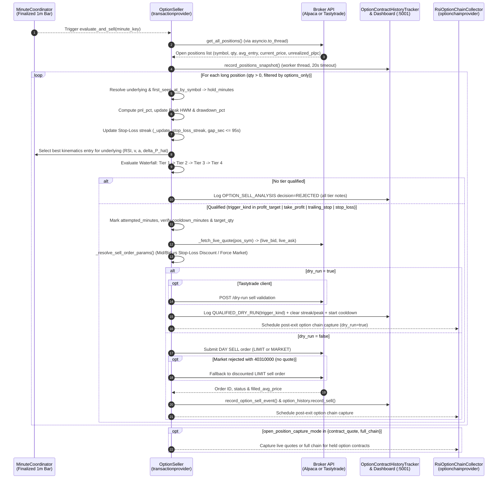

---

## 3. Complete 4-Tier `OptionSeller` Exit Waterfall Flowchart

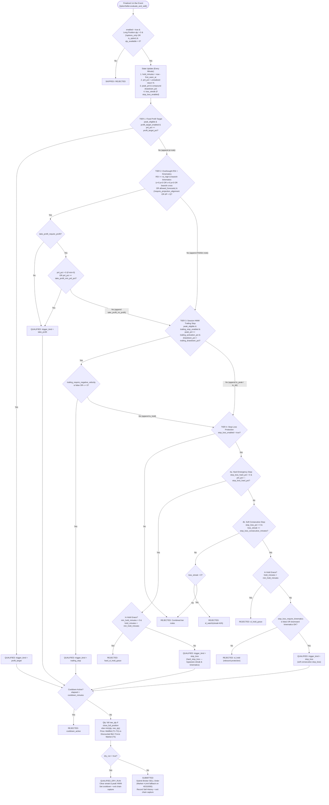

---

## 4. Stage-by-Stage `OptionSeller` Logic Flow

### Pre-Flight & Position State Bookkeeping

Before evaluating exit tiers on a held contract `pos_sym`, `OptionSeller` executes:

1. **Master Enable & Asset Filtering:** Skips evaluation if `enabled = false`, if broker positions are unavailable, if the position is non-long (`qty <= 0` or `side != "long"`), if `options_only = true` and the holding is an equity (`options_only_equity_ignored`), or if `qty_available <= 0` (e.g., locked by an open resting sell order $\rightarrow$ `no_qty_available`).
2. **Entry Timestamp & Hold Duration (`hold_minutes`):** On the first minute `OptionSeller` sees `pos_sym`, it scans `coordinator.option_buy_events[underlying]` in reverse for the matching OCC contract's exact buy execution timestamp (`executed_at_utc`). If found, `first_seen_at_by_symbol[pos_sym]` is anchored to that exact fill time; otherwise (e.g., pre-existing position opened before restart), it defaults to `now`. Then `hold_minutes = (now - first_seen_at_by_symbol[pos_sym]) / 60`.
3. **Peak HWM & Compound Drawdown (`_update_peak_profit_state`):** Tracks `peak_pnl_pct` across the session and computes true **compound drawdown** from peak equity value (not simple percentage-point subtraction):
   $$\text{peak\_factor} = 1 + \frac{\text{peak\_pnl\_pct}}{100}, \qquad \text{cur\_factor} = 1 + \frac{\text{pnl\_pct}}{100}$$
   $$\text{drawdown\_pct} = \begin{cases} \dfrac{\text{peak\_factor} - \text{cur\_factor}}{\text{peak\_factor}} \times 100 & \text{if } \text{cur\_factor} < \text{peak\_factor} \\[6pt] 0.0 & \text{otherwise} \end{cases}$$
   *Example:* Peak P/L = `+20.0%` (`peak_factor = 1.20`), current P/L = `+14.0%` (`cur_factor = 1.14`) $\rightarrow$ `drawdown_pct = (1.20 - 1.14) / 1.20 * 100 = 5.00%`. Note that trailing stop triggers on **strictly greater** (`drawdown_pct > trailing_drawdown_pct`), so at exactly `5.00%` it has not yet triggered — it fires once drawdown exceeds `5.00%` (e.g., `+13.99%` $\rightarrow$ `5.01% > 5.00%`).
4. **Stop-Loss Streak Update:** If `stop_loss_enabled = true`, calls `_update_stop_loss_streak(pos_sym, pnl_pct, minute_key, target_min_dt)` every minute regardless of whether Tiers 1–3 later fire.
5. **Open-Position Telemetry Capture (`open_position_capture_mode`):**
   * `none` *(default)*: No extra per-minute option quote/chain capture for held positions.
   * `contract_quote`: Batched live bid/ask/spread/Greeks snapshots attached to 1m bars while the contract is open.
   * `full_chain`: Full pruned option chain JSON snapshot written every minute for every held option's underlying.

---

### Tier 1 — Fixed Profit Target (`profit_target`)

* **Controlled by:** `profit_target_enabled` (default `true`), `profit_target_pct` (default `25.0`), `[general] options_only` (default `true`).
* **Logic:** If `peak_eligible` (`not options_only or is_option`) and `profit_target_enabled` and `profit_target_pct > 0`:
  $$\text{pnl\_pct} \ge \texttt{profit\_target\_pct} \implies \texttt{QUALIFIED (profit\_target)}$$
* **Why Tier 1 Runs First:** Options often surge `+25%` to `+40%` on an explosive 1-minute candle before Wilder RSI(14) even crosses `65.0`. Tier 1 captures windfall gains immediately — independent of RSI, kinematics, `stop_loss_enabled`, and `min_hold_minutes`.

---

### Tier 2 — Overbought RSI + Bearish Kinematics + Profit Guard (`take_profit`)

* **Controlled by:** `rsi_high` (default `65.0`, overrides `[option_buyer] rsi_high`), `allowed_forecasts` (default `bearish_reversal,bearish_continuation,bearish_momentum`), `require_projection_alignment` (default `true`), `take_profit_require_profit` (default `true`), `take_profit_min_pnl_pct` (default `0.0`).
* **Step 2A — `_evaluate_sell_kinematics(entry)`:**
  1. Requires finite `RSI >= rsi_high` (else rejects with `rsi_below_sell_threshold`).
  2. Requires finite $v$ and $a$, and at least one bearish roll-over condition:
     * **Bearish Thrust:** $v < 0 \land a < 0$
     * **Overbought Decelerating Top:** $v > 0 \land a < 0$
     * **Bearish Crossover:** `crossover_signal` $\in \{\texttt{leading\_bearish}, \texttt{confirmed\_bearish}\}$ $\land\ a \le 0$
     * **Allowed Forecast Match:** `forecast_direction` $\in$ `allowed_forecasts` $\land\ a < 0$
     *(Note: If $v > 0$ and $a \ge 0$, it logs `kinematics_unfavorable[still_accelerating_up]` so winners keep riding upward momentum!)*
  3. **Projection Alignment:** When `require_projection_alignment = true` and `projected_delta` is finite, requires $\Delta\hat{P} < 0$ (else `projection_misaligned(SELL,delta=...)`).
* **Step 2B — Profit Guard (`take_profit_require_profit` & `take_profit_min_pnl_pct`):**
  * When `take_profit_require_profit = true` (default): prevents an overbought underlying RSI from selling a theta-decayed or IV-crushed option at a loss!
    * If `take_profit_min_pnl_pct <= 0.0`: requires **strictly positive profit** (`pnl_pct > 0.0`).
    * If `take_profit_min_pnl_pct > 0.0`: requires `pnl_pct >= take_profit_min_pnl_pct`.
    * Otherwise appends `take_profit_no_profit(pnl=...)` and falls through to Tiers 3 & 4.

---

### Tier 3 — Session High-Water-Mark Trailing Stop (`trailing_stop`)

* **Controlled by:** `trailing_stop_enabled` (default `true`), `trailing_activation_pct` (default `10.0`), `trailing_drawdown_pct` (default `5.0`), `trailing_require_negative_velocity` (default `true`), `[general] options_only` (default `true`).
* **Logic:** Requires `peak_eligible`, `trailing_stop_enabled`, and `trailing_drawdown_pct > 0`:
  1. **Arming Check:** `peak_pnl >= trailing_activation_pct` (if not yet armed, logs `ts_peak=+X.XX%<10.00%`).
  2. **Drawdown Trigger:** `drawdown_pct > trailing_drawdown_pct` (strictly greater; if not exceeded, logs `ts_dd=X.XX%<=5.00%`).
  3. **Velocity Confirmation:** If `trailing_require_negative_velocity = true`, calls `_evaluate_trailing_stop_velocity(entry)` requiring $v < 0$. If $v \ge 0$, logs `ts_hold(dd=...,v=+...>=0)` (`OPTION_SELL_TRAILING_HOLD`) to avoid getting shaken out during an upward bounce!

---

### Tier 4 — Stop-Loss Protection (`hard_stop_loss` & `stop_loss`)

* **Controlled by:** `stop_loss_enabled` (default `true`), `stop_loss_hard_pct` (default `25.0`), `stop_loss_pct` (default `10.0`), `stop_loss_consecutive_minutes` (default `5`), `stop_loss_require_kinematics` (default `true`), `min_hold_minutes` (default `5`).
* Full mechanics, mathematical formulas, state diagrams, and 12 worked scenarios are detailed in [Section 7](#7-exhaustive-deep-dive-the-stop-loss-protection-engine) and [Section 8](#8-12-illustrated-stop-loss-scenarios-with-diagrams--dashboard-ui-mockups) below.

---

### Post-Qualification — Cooldown, Quantity Sizing, Pricing, Execution & Post-Exit Capture

Once any tier (1, 2, 3, or 4) sets `qualifies = True`:
1. **Minute Dedup & Cooldown (`cooldown_minutes`, default `15`):** Adds `(pos_sym, minute_key)` to `attempted_minutes`, then checks if `(now - last_sell_by_symbol[pos_sym]) < cooldown_minutes * 60`. If active, rejects with `cooldown_active(trigger=...)`.
2. **Quantity Sizing (`close_full_position`, `qty`):**
   * `close_full_position = true` *(default)*: closes entire `raw_qty`.
   * `close_full_position = false`: sells `min(qty, raw_qty)` contracts/shares (enabling partial scale-outs).
3. **Order Pricing (`order_type`, `limit_discount_pct`, `stop_loss_limit_discount_pct`, `stop_loss_force_market`):**
   * If `order_type = market` **OR** (`trigger_kind == "stop_loss"` and `stop_loss_force_market = true`): submits `MARKET`.
   * If `order_type = limit` and `trigger_kind != "stop_loss"` (Tiers 1–3) with valid `(live_bid, live_ask)`:
     $$\text{mid} = \frac{\text{live\_bid} + \text{live\_ask}}{2}, \qquad \text{limit\_price} = \text{round}\!\Big(\max\!\big(0.01,\ \max(\text{live\_bid},\ \min(\text{live\_ask},\ \text{mid} \times (1 - \tfrac{\texttt{limit\_discount\_pct}}{100})))\big),\ 2\Big)$$
     *(Never needlessly undercuts the live bid on profitable exits!)*
   * If `order_type = limit` and `trigger_kind == "stop_loss"` (or missing ask): anchors to `ref_price = min(live_bid, cur_price)` and applies `stop_loss_limit_discount_pct` (detailed in [Section 7.6](#76-stop-loss-order-pricing-discount-anchoring--market-to-limit-fallback)).
4. **Dry-Run (`dry_run = true`) vs Live Submission (`dry_run = false`):**
   * Clears `stop_loss_state_by_symbol[pos_sym]` and `peak_profit_state_by_symbol[pos_sym]`, updates `last_sell_by_symbol[pos_sym]`, increments tier counters (`profit_target_orders`, `trailing_stop_orders`, `stop_loss_orders`), and schedules an async post-exit option chain capture (`_schedule_exit_option_chain_capture`) for offline `findthewinners.py` auditing.

---

## 5. Complete `[option_seller]` Parameter Reference (All 30 Parameters)

| # | Parameter Name | Type & Default | Exit Tier / Stage | How It Controls / Influences Selling |
| :-: | :--- | :--- | :---: | :--- |
| 1 | `enabled` | `bool` (`true`) | Pre-Flight | Master on/off switch for `OptionSeller`. When `false`, no exit evaluations or stop-losses run. |
| 2 | `dry_run` | `bool` (`true`) | Execution | When `true`, logs `QUALIFIED_DRY_RUN(<kind>)` without placing real fills (invokes Tastytrade `/dry-run` on Tastytrade accounts). |
| 3 | `paper` | `bool` (`true`) | Pre-Flight | Selects Alpaca Paper (`true`) vs Live (`false`); defaults to `[option_buyer] paper` if omitted. |
| 4 | `rsi_high` | `float` (`65.0`) | Tier 2 | Minimum underlying Wilder RSI(14) required for Tier 2 RSI + bearish kinematics take-profit (overrides `[option_buyer] rsi_high`). |
| 5 | `qty` | `int >= 1` (`1`) | Sizing | Contracts/shares sold per trigger when `close_full_position = false`. |
| 6 | `close_full_position` | `bool` (`true`) | Sizing | When `true`, closes 100% of the open contract quantity on any qualifying exit; when `false`, sells `min(qty, raw_qty)`. |
| 7 | `order_type` | `limit \| market` (`limit`) | Pricing | Default exit order type across Tiers 1–4 (can be overridden to `market` for stop-losses via `stop_loss_force_market`). |
| 8 | `cooldown_minutes` | `int >= 0` (`15`) | Post-Trigger | Per-contract cooldown after a sell attempt (or dry-run sell) before another sell on the same contract can fire (`cooldown_active`). |
| 9 | `min_hold_minutes` | `int >= 0` (`5`) | **Tier 4 (Stop-Loss)** | **Exact Runtime Behavior (`multiStreamRSI.py` L18400–18448):** Grace period (minutes since `first_seen_at_by_symbol`) that **suppresses Tier 4 Hard & Soft Stop-Loss** (`hard_sl_hold_grace`, `sl_hold_grace`) to prevent instant Ask→Bid spread stop-outs right after buying. Tiers 1–3 can still take profits immediately during this window. *(Note: the inline `lib/parms.ini` comment briefly describes it as guarding RSI take-profit, but the actual engine code applies it specifically to Tier 4 Stop-Loss!)* |
| 10 | `[general] options_only` *(moved from `[option_seller]`; consolidates `peak_profit_calls_only`)* | `bool` (`true`) | Pre-Flight & Tiers 1/3 | Major buy & sell gate: when `true`, ignores non-option equity stock holdings (`options_only_equity_ignored`) and gates Tier 1 Fixed Profit Target & Tier 3 Trailing Stop (`peak_eligible`) strictly to OCC option contracts (also gates `OptionBuyer` against non-OCC contracts). |
| 11 | `require_projection_alignment` | `bool` (`true`) | Tier 2 | Requires 1-minute Taylor projected delta $\Delta\hat{P} < 0$ before Tier 2 RSI take-profit fires (`projection_misaligned`). |
| 12 | `allowed_forecasts` | `csv` (`bearish_reversal, bearish_continuation, bearish_momentum`) | Tier 2 | Allowed `forecast_direction` labels for Tier 2 RSI take-profit when $a < 0$. Also checked in Stop-Loss kinematics branch 3 (`bearish_rollover`). |
| 13 | `limit_discount_pct` | `float >= 0.0` (`0.5`) | Pricing (T1–T3) | Percentage discount off Mid (floored at Bid) for Tier 1/2/3 limit sell orders (or off `min(bid, cur_price)` when ask is unavailable). |
| 14 | `stop_loss_limit_discount_pct` | `float >= 0.0` (`3.0`) | Pricing (Tier 4) | Wider percentage discount below `min(live_bid, current_price)` for Tier 4 stop-loss limit sells to guarantee fast fills in falling books. |
| 15 | `stop_loss_force_market` | `bool` (`false`) | Pricing (Tier 4) | When `true`, forces `MARKET` orders on Tier 4 stop-loss exits even when `order_type = limit` (with automatic `40310000` fallback-to-limit if no quote exists). |
| 16 | `profit_target_enabled` | `bool` (`true`) | Tier 1 | Enables Tier 1 immediate fixed profit-target exit (completely independent of `stop_loss_enabled`). |
| 17 | `profit_target_pct` | `float >= 0.0` (`25.0`) | Tier 1 | Unrealized P/L% threshold (`pnl_pct >= profit_target_pct`) that triggers immediate Tier 1 profit taking. |
| 18 | `take_profit_require_profit` | `bool` (`true`) | Tier 2 | Blocks Tier 2 RSI take-profit sells unless unrealized P/L exceeds `take_profit_min_pnl_pct` (`take_profit_no_profit`). |
| 19 | `take_profit_min_pnl_pct` | `float` (`0.0`) | Tier 2 | Minimum P/L% floor for Tier 2 when `take_profit_require_profit = true` (`0.0` requires strictly `> 0.0%`; `> 0` requires `>= min`). |
| 20 | `trailing_stop_enabled` | `bool` (`true`) | Tier 3 | Enables Tier 3 session high-water-mark trailing stop (independent of `stop_loss_enabled`). |
| 21 | `trailing_activation_pct` | `float >= 0.0` (`10.0`) | Tier 3 | Session peak unrealized P/L% required to arm Tier 3 trailing stop (`peak_pnl >= trailing_activation_pct`). |
| 22 | `trailing_drawdown_pct` | `float >= 0.0` (`5.0`) | Tier 3 | Compound drawdown % from session peak that triggers exit (`drawdown_pct > trailing_drawdown_pct`, strictly greater). |
| 23 | `trailing_require_negative_velocity` | `bool` (`true`) | Tier 3 | Requires downward underlying velocity ($v < 0$) before Tier 3 trailing stop fires; holds (`ts_hold`) if underlying is rebounding. |
| 24 | `stop_loss_enabled` | `bool` (`true`) | Tier 4 | Master enable for Tier 4 stop-loss streak tracking, soft stop-loss, and hard emergency stop-loss. |
| 25 | `stop_loss_pct` | `float >= 0.0` (`10.0`) | Tier 4b (Soft) | Soft stop-loss breach threshold: increments streak on every contiguous minute where `pnl_pct < -stop_loss_pct` (strictly less than negative threshold). |
| 26 | `stop_loss_consecutive_minutes` | `int >= 1` (`5`) | Tier 4b (Soft) | Number of contiguous 1-minute breaches required before the soft stop-loss becomes eligible to fire. |
| 27 | `stop_loss_require_kinematics` | `bool` (`true`) | Tier 4b (Soft) | When `true`, requires downward underlying pressure (`_evaluate_stop_loss_kinematics`) to fire the soft stop; holds (`sl_hold`) during upward rebounds. |
| 28 | `stop_loss_hard_pct` | `float >= 0.0` (`25.0`) | Tier 4a (Hard) | Emergency catastrophic stop-loss (`pnl_pct < -stop_loss_hard_pct`). Bypasses streak and kinematics immediately once `min_hold_minutes` has elapsed (`0` disables). |
| 29 | `open_position_capture_mode` | `none \| contract_quote \| full_chain` (`none`) | Post-Loop Telemetry | Controls per-minute market data capture for held option contracts (`none` = off, `contract_quote` = live bid/ask/Greeks on 1m bars, `full_chain` = full JSON chain every minute). |
| 30 | `dynamic_rules_mode` | `off \| view_only \| view_and_act` (`off`) | Dynamic Exit Engine | Controls Peak-Ratcheting Trailing Stops, Breakeven Profit Lock, and Vol/Spread-Adaptive thresholds: `off` = disabled (static rules only); `view_only` (aliases `shadow`, `log_only`, `view`, `monitor`) = computes & logs `OPTION_SELL_DYNAMIC_SHADOW` + displays live UI telemetry without altering exits; `view_and_act` (aliases `view_take_action`, `take_action`, `active`, `act`, `live`) = displays UI telemetry AND actively overrides Tier 3 trailing stop, dynamic breakeven lock, and Tier 4b soft stop-loss. |
| 31 | `dynamic_ratchet_tiers` | `peak:dd,...` (`5:4.0,10:3.0,20:2.0`) | Dynamic Tier 3 | Comma-separated `peak_pct:drawdown_pct` ladder that tightens base trailing stop drawdown as the contract's session peak unrealized P/L% climbs (e.g., `+5% → -4%`, `+10% → -3%`, `+20% → -2%`). |
| 32 | `dynamic_breakeven_activation_pct` | `float >= 0.0` (`8.0`) | Dynamic Tier 3 | Session peak unrealized P/L% required to arm the dynamic **`+0.5%` breakeven floor** (`0` disables). When armed and P/L falls to `<= +0.5%` (subject to velocity confirmation if `trailing_require_negative_velocity = true`), triggers `dynamic_breakeven` (shadow alert in `view_only`, exit in `view_and_act`). |
| 33 | `dynamic_vol_adapt_enabled` | `bool` (`true`) | Dynamic Scaling | Scales dynamic trailing stop drawdown and dynamic soft stop-loss by realized 1-minute contract P/L volatility ($\sigma_{\Delta\text{pnl}}$) and live bid/ask `spread_pct` (multiplier clamped to `0.75x–1.50x`, with spread noise floors and strict clamping below `stop_loss_hard_pct`). |
| 34 | `dynamic_min_samples` | `int >= 2` (`3`) | Dynamic Scaling | Minimum number of 1-minute contract P/L samples required before applying realized volatility scaling (`adapt_mult` remains `1.0x` until sufficient bars exist). |

### 5.1 Dynamic Exit Rules Modes (`dynamic_rules_mode`)
- **`off` (Default):** 100% static `[option_seller]` thresholds are used; zero behavioral change.
- **`view_only` (Shadow / Log-Only + UI Visibility):** Every finalized minute, `OptionSeller` evaluates `_evaluate_dynamic_contract_rules()` for each open contract, records live per-contract state in `/cli/status` (`option_seller.dynamic_rules_by_symbol`) and `/api/findbest`, and logs `OPTION_SELL_DYNAMIC_SHADOW` whenever the dynamic rules would have triggered — **without submitting or altering any sell orders**. Visible across the main Option Seller dashboard card, the Open Contract drilldown banner, and the Find Best modal.
- **`view_and_act` (View + Take Action):** Exposes the same live UI telemetry AND overrides Tier 3 trailing stop (`eff_ts_activation_pct` / `eff_ts_drawdown_pct`), dynamic breakeven lock (`+0.5%` floor), and Tier 4b soft stop-loss (`eff_sl_pct`), tagging triggered orders with `[dynamic:xN.NN]`. Safety guardrails (`min_hold_minutes`, `stop_loss_hard_pct`, `trailing_require_negative_velocity`, `stop_loss_require_kinematics`, `cooldown_minutes`, and `dry_run`) remain strictly enforced.

---

## 6. How `[option_buyer]` Parameters Cross-Influence `OptionSeller`

Even though selling is governed primarily by `[option_seller]`, several **`[option_buyer]`** parameters directly control fallback defaults or strongly shape how `OptionSeller` behaves on every position opened by the engine:

| `[option_buyer]` Parameter | Direct Code / Operational Cross-Influence on `OptionSeller` |
| :--- | :--- |
| `[option_buyer] paper` | **Direct Config Fallback:** If `[option_seller] paper` is omitted, `OptionSeller` inherits `[option_buyer] paper` to choose Alpaca Paper vs Live routing. |
| `[option_buyer] rsi_high` | **Direct Config Fallback & Chain Sync:** Sets `OPTION_CHAIN_RSI_HIGH` whenever `[option_seller] rsi_high` is omitted, and triggers `RsiOptionChainCollector` high-RSI snapshots used for post-session sell-side analysis. |
| `[option_buyer] max_spread_pct` & `limit_aggression` | **Entry Slippage → Stop-Loss Grace Risk:** Entering an option with a `5%` bid/ask spread at `limit_aggression = 1.0` (hitting the Ask) immediately starts the position at `-5%` unrealized P/L on the Bid. If `stop_loss_pct` is tight (e.g., `4%`), `min_hold_minutes` is critical to stop instant spread liquidation. |
| `[option_buyer] contract_selection_mode`, `contract_target_delta`, `contract_delta_min` / `max` | **Option Leverage & P/L Velocity:** Deep OTM contracts (`plus2_otm`, low delta `0.25`) experience much wider percentage swings (often `-15%` to `+40%` in minutes) than ITM/ATM contracts (`itm1` / `delta_mid` at `0.55–0.70`), directly dictating how tightly `stop_loss_pct`, `stop_loss_hard_pct`, `profit_target_pct`, and `trailing_drawdown_pct` should be calibrated. |
| `[option_buyer] qty`, `max_single_trade_dollars`, `invest_buffer_withhold_pct` | **Position Size Entering `OptionSeller`:** Determines `raw_qty` held at the broker, which interacts with `[option_seller] close_full_position` and `[option_seller] qty`. |
| `[option_buyer] dry_run` | **Entry Timestamp & Hold Grace Anchor:** When `[option_buyer] dry_run = false`, `OptionBuyer` writes `coordinator.option_buy_events`, which `OptionSeller` reads to seed `first_seen_at_by_symbol` accurately for `min_hold_minutes`. If positions were opened manually or before restart, `OptionSeller` anchors `first_seen_at_by_symbol` to the first minute it sees the position. |

---

## 7. Exhaustive Deep Dive: The Stop-Loss Protection Engine

The Stop-Loss subsystem (Tier 4) is specifically engineered to solve the hardest problem in automated options trading: **distinguishing genuine trend breakdowns from transient 1-minute bid/ask noise and sharp V-bottom washouts**, without ever leaving the account exposed to catastrophic gap losses.

### 7.1 Exact Unrealized P/L% Calculation Hierarchy

Every minute, `OptionSeller._position_pnl_pct(pos)` resolves unrealized return percentage using a 3-level fallback cascade:

1. **Primary (Broker-Reported Return Fraction):**
   $$\text{pnl\_pct} = \texttt{unrealized\_plpc} \times 100.0$$
2. **Secondary (Mark vs Average Entry Price):** If `unrealized_plpc` is missing, and both `avg_entry_price > 0` and `current_price > 0`:
   $$\text{pnl\_pct} = \frac{\text{current\_price} - \text{avg\_entry\_price}}{\text{avg\_entry\_price}} \times 100.0$$
3. **Tertiary (Dollar P/L over Cost Basis):** If `unrealized_pl` is present and `cost_basis > 0`:
   $$\text{pnl\_pct} = \frac{\text{unrealized\_pl}}{\text{cost\_basis}} \times 100.0$$

> **Strict Inequality Rule:** Both stop-loss thresholds use **strict `<`** comparisons against the negated parameter:
> * Soft Stop Breach: `pnl_pct < -stop_loss_pct` (at `stop_loss_pct = 10.0`, `-10.00%` is **NOT** breached; `-10.01%` **IS** breached).
> * Hard Stop Breach: `pnl_pct < -stop_loss_hard_pct` (at `stop_loss_hard_pct = 25.0`, `-25.00%` is **NOT** breached; `-25.01%` **IS** breached).

---

### 7.2 Hold Duration (`hold_minutes`) & `min_hold_minutes` Grace Window

Right after an option fills near the Ask, broker position marks often value the contract at the Bid or Mid — instantly creating a paper loss of `-3%` to `-12%` in the first 60 seconds. To prevent immediate self-inflicted liquidation:

```python
in_hold_grace = (
    OPTION_SELL_MIN_HOLD_MINUTES > 0
    and hold_minutes < OPTION_SELL_MIN_HOLD_MINUTES
)
```

* While `in_hold_grace == True`:
  * **Hard Stop-Loss is suppressed** (`REJECTED: hard_sl_hold_grace(hold_min<min_hold_minutes)`, log event `OPTION_SELL_HOLD_GRACE_ACTIVE`).
  * **Soft Stop-Loss execution is suppressed** (`REJECTED: sl_hold_grace(hold_min<min_hold_minutes,streak=k)`), **HOWEVER** `_update_stop_loss_streak()` **continues counting the streak in the background**! That means if `min_hold_minutes = 5` and `stop_loss_consecutive_minutes = 5`, and the position bleeds below `-stop_loss_pct` on minutes `1, 2, 3, 4, 5`, by minute `5` (`hold_minutes >= 5.0`), the streak is ALREADY `5/5` and fires immediately on minute `5` (provided kinematics confirm).
  * **Tiers 1, 2, and 3 are NOT blocked** by `in_hold_grace` — profitable spikes can still exit right away!

---

### 7.3 Stop-Loss State Machine Diagram

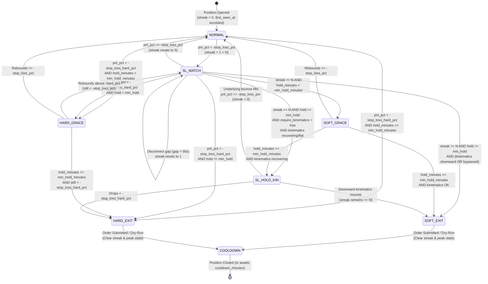

---

### 7.4 Consecutive-Minute Streak Engine & The 95-Second Contiguity Rule

In `OptionSeller._update_stop_loss_streak(pos_sym, pnl_pct, minute_key, minute_dt)`:

1. **Same-Minute Idempotency:** If `st["last_minute_key"] == minute_key`, returns the existing `st["streak"]` unchanged so duplicate notifications within the same minute never double-count.
2. **Breach Evaluation:**
   ```python
   is_breached = (
       OPTION_SELL_STOP_LOSS_PCT > 0
       and pnl_pct is not None
       and math.isfinite(pnl_pct)
       and pnl_pct < -OPTION_SELL_STOP_LOSS_PCT
   )
   ```
3. **95-Second Contiguity Window:**
   * If `is_breached` is `True`:
     * Computes `gap_sec = (minute_dt - prev_dt).total_seconds()`.
     * If `0 < gap_sec <= 95`: increments `streak = st["streak"] + 1`. *(Allows 60s normal bars + up to 35s jitter/finalization drift without breaking a valid streak.)*
     * If `gap_sec > 95` (e.g., feed pause, skipped bar, overnight boundary, or engine restart): resets `streak = 1` so stale losses from minutes or hours ago never concatenate into a false stop-out!
   * If `is_breached` is `False` (any recovery to `pnl_pct >= -stop_loss_pct`, or missing P/L): resets `streak = 0`.

---

### 7.5 Soft Stop-Loss Kinematics Confirmation (`_evaluate_stop_loss_kinematics`)

When `stop_loss_require_kinematics = true` (default), hitting `loss_streak >= stop_loss_consecutive_minutes` does **not** blindly dump the contract if the underlying stock has already bottomed and begun bouncing upward! Instead, `_evaluate_stop_loss_kinematics(entry)` computes `eff_proj = projected_delta if available else (v + 0.5 * a)` and approves the soft stop-loss **if and only if at least one of three downward pressure branches is true**:

| Branch | Exact Condition | Log Tag | Meaning |
| :-: | :--- | :--- | :--- |
| **1** | $v < 0 \land a \le 0$ | `downward_pressure(v=...,a=...)` | Underlying is falling and flat or accelerating downward — confirmed breakdown. |
| **2** | $v < 0 \land \text{eff\_proj} < 0$ | `downward_bleed(v=...,a=...,p_delta=...)` | Underlying is decelerating slightly ($a > 0$), but velocity is still negative enough that next-minute projection remains negative. |
| **3** | $v \le 0 \land a < 0 \land (\texttt{cross} \in \{\texttt{leading\_bearish}, \texttt{confirmed\_bearish}\} \lor \texttt{forecast} \in \texttt{allowed\_forecasts})$ | `bearish_rollover(v=...,a=...,cross=...)` | Flat or negative velocity rolling over sharply into a bearish crossover or bearish forecast. |
| **Hold** | None of Branches 1–3 match (e.g., $v > 0$, or $v < 0$ with strong $a > 0$ pushing $\text{eff\_proj} \ge 0$) | `kinematics_recovering_or_flat(...)` | **Holds position** (`sl_hold`, log event `OPTION_SELL_STOP_LOSS_HOLD`) to let an active rebound play out! |

> **Critical Contrast:** **Hard Emergency Stop-Loss** (`pnl_pct < -stop_loss_hard_pct`) **NEVER** calls `_evaluate_stop_loss_kinematics()`. Once `hold_minutes >= min_hold_minutes`, a hard stop-loss exits unconditionally to cap catastrophic tail risk.

---

### 7.6 Stop-Loss Order Pricing, Discount Anchoring & Market-to-Limit Fallback

When `trigger_kind == "stop_loss"`, `_resolve_sell_order_params()` prioritizes **fill certainty over squeezing pennies**:

1. **Market Path:** If `[option_seller] order_type = market` **OR** `stop_loss_force_market = true`:
   * Submits a `DAY` `MARKET` sell order immediately.
   * **Automatic No-Quote Fallback:** If the broker rejects the market sell with Alpaca error `40310000` / `"no available quote"` / `"market orders are not available"`, `OptionSeller` resolves `fallback_ref` via `_extract_position_fallback_price()` (`live_bid → current_price → lastday_price → avg_entry_price → market_value/qty → cost_basis/qty`), computes a discounted limit price via `_compute_discounted_limit_price(fallback_ref, "stop_loss")`, logs `OPTION_SELL_MARKET_FALLBACK_TO_LIMIT`, and immediately resubmits as a `DAY` `LIMIT` sell!
2. **Discounted Limit Path** (`order_type = limit` and `stop_loss_force_market = false`):
   * Fetches live `(live_bid, live_ask)`.
   * Picks the **conservative lower anchor** `ref_price = min(live_bid, cur_price)` (dropping `None` values; if both are missing, falls back to `market`).
   * Applies **`stop_loss_limit_discount_pct`** (default `3.0%`):
     $$\text{limit\_price} = \text{round}\!\left(\max\!\left(0.01,\ \text{ref\_price} \times \left(1 - \frac{\texttt{stop\_loss\_limit\_discount\_pct}}{100}\right)\right),\ 2\right)$$
   * **Penny-Step Guarantee:** If `stop_loss_limit_discount_pct > 0`, `ref_price > 0.01`, and rounding leaves `limit_price >= round(ref_price, 2)` (e.g., on cheap `$0.20` contracts), forces `limit_price = round(max(0.01, ref_price - 0.01), 2)` so the order always steps at least `$0.01` below the bid to sweep liquidity.

---

## 8. 12 Illustrated Stop-Loss Scenarios (With Diagrams & Dashboard UI Mockups)

Unless overridden inside a specific scenario, all scenarios below use the following **Baseline Configuration** from `lib/parms.ini`:
* `stop_loss_enabled = true`, `stop_loss_pct = 10.0`, `stop_loss_consecutive_minutes = 5`, `stop_loss_require_kinematics = true`, `stop_loss_hard_pct = 25.0`, `min_hold_minutes = 5`, `order_type = limit`, `stop_loss_limit_discount_pct = 3.0`, `stop_loss_force_market = false`, `cooldown_minutes = 15`, `close_full_position = true`, `dry_run = false`.

---

### Scenario 1 — Clean Soft Stop-Loss Exit (5 Consecutive Breaches + Downward Pressure)

**Setup:** Holding `2` contracts of `NVDA261211C00144000` (entry `$5.00`, held `18` minutes — well past `min_hold_minutes = 5`). NVDA rolls over and bleeds below `-10.0%` (`< $4.50`) for 5 straight minutes with negative velocity and negative acceleration.

| Minute (ET) | Hold (m) | Mark | P/L % | Breach (`< -10%`) | Streak | Underlying $v$ | Underlying $a$ | Decision & Reason |
| :---: | :---: | :---: | :---: | :---: | :---: | :---: | :---: | :--- |
| `10:20` | `18.0` | `$4.52` | `-9.60%` | No | `0/5` | `-0.0410` | `-0.0120` | `REJECTED`: no stop breach |
| `10:21` | `19.0` | `$4.45` | `-11.00%` | **Yes** | `1/5` | `-0.0620` | `-0.0210` | `REJECTED`: `sl_watch(streak=1/5)` |
| `10:22` | `20.0` | `$4.40` | `-12.00%` | **Yes** | `2/5` | `-0.0750` | `-0.0130` | `REJECTED`: `sl_watch(streak=2/5)` |
| `10:23` | `21.0` | `$4.32` | `-13.60%` | **Yes** | `3/5` | `-0.0890` | `-0.0140` | `REJECTED`: `sl_watch(streak=3/5)` |
| `10:24` | `22.0` | `$4.25` | `-15.00%` | **Yes** | `4/5` | `-0.0980` | `-0.0090` | `REJECTED`: `sl_watch(streak=4/5)` |
| `10:25` | `23.0` | `$4.18` | `-16.40%` | **Yes** | **`5/5`** | `-0.1120` | `-0.0140` | **`SUBMITTED`**: `stop_loss(pnl=-16.40%<-10.00%,streak=5/5)&downward_pressure` |

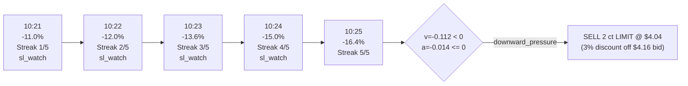

**Dashboard UI Mockup — Buy/Sell Log View:**
```text
TIME (EST)  SIDE  SYMBOL / CONTRACT     PROVIDER   RSI    V        A        ΔP̂       P/L %    DECISION   REASON / DETAILS
------------------------------------------------------------------------------------------------------------------------------------------
10:25:46    SELL  NVDA                  ALPACA     41.20  -0.1120  -0.0140  -0.1190  -16.40%  SUBMITTED  stop_loss(pnl=-16.40%<-10.00%,streak=5/5)&downward_pressure(v=-0.1120,a=-0.0140)
                  NVDA261211C00144000
10:24:46    SELL  NVDA                  ALPACA     43.05  -0.0980  -0.0090  -0.1025  -15.00%  REJECTED   pt=-15.00%<25.00%; rsi_below_sell_threshold; ts_peak=+4.20%<10.00%; sl_watch(streak=4/5)
                  NVDA261211C00144000
10:23:46    SELL  NVDA                  ALPACA     44.80  -0.0890  -0.0140  -0.0960  -13.60%  REJECTED   pt=-13.60%<25.00%; rsi_below_sell_threshold; ts_peak=+4.20%<10.00%; sl_watch(streak=3/5)
                  NVDA261211C00144000
```

---

### Scenario 2 — Brief Dip & Recovery Streak Reset (`3/5 -> 0/5`)

**Setup:** Holding `1` contract of `AAPL261211C00230000` (entry `$4.00`, held `12m`). A sudden 3-minute shakeout pushes unrealized P/L to `-11.50%`, then buyers step in on minute 4 and lift P/L to `-8.75%` (above `-10.0%`).

| Minute (ET) | Mark | P/L % | Breach (`< -10%`) | Streak | Outcome |
| :---: | :---: | :---: | :---: | :---: | :--- |
| `10:40` | `$3.58` | `-10.50%` | Yes | `1/5` | `REJECTED`: `sl_watch(streak=1/5)` |
| `10:41` | `$3.54` | `-11.50%` | Yes | `2/5` | `REJECTED`: `sl_watch(streak=2/5)` |
| `10:42` | `$3.56` | `-11.00%` | Yes | `3/5` | `REJECTED`: `sl_watch(streak=3/5)` |
| `10:43` | `$3.65` | `-8.75%` | **No** (`>= -10%`) | **`0/5`** | **Streak reset to `0`!** Position kept alive. |
| `10:44` | `$3.88` | `-3.00%` | No | `0/5` | Recovery continues; avoids false stop-out. |

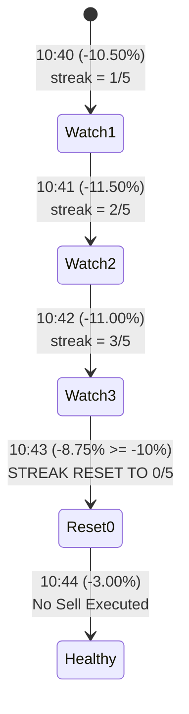

**Dashboard UI Mockup — Option Seller Position Telemetry Strip:**
```text
+----------------------------------------------------------------------------------+
| POSITION: AAPL261211C00230000 | Entry: $4.00 | Mark: $3.65 | P/L: -8.75%         |
| Hold: 15.0m (Grace: OK) | Peak: +2.50% | SL Threshold: -10.00% | SL Streak: 0/5  |
| Status: [ RECOVERED — STREAK CLEARED AT 10:43 ET ]                               |
+----------------------------------------------------------------------------------+
```

---

### Scenario 3 — `min_hold_minutes` Grace Window Suppressing Soft Stop-Loss (`sl_hold_grace`)

**Setup:** Custom tighter config: `stop_loss_pct = 8.0`, `stop_loss_consecutive_minutes = 3`, `min_hold_minutes = 5`. `AMD261211C00150000` is bought at `10:00:05 ET` near the Ask (`$3.00`), immediately marks at `$2.72` (`-9.33%`) on a wide spread, and stays below `-8.0%`.

| Minute (ET) | Hold (m) | P/L % | Streak | `in_hold_grace` (`< 5m`) | Decision & Exact Reason |
| :---: | :---: | :---: | :---: | :---: | :--- |
| `10:01` | `0.9` | `-9.33%` | `1/3` | Yes | `REJECTED`: `sl_watch(streak=1/3)` |
| `10:02` | `1.9` | `-10.00%` | `2/3` | Yes | `REJECTED`: `sl_watch(streak=2/3)` |
| `10:03` | `2.9` | `-10.67%` | **`3/3`** | **Yes** | `REJECTED`: **`sl_hold_grace(2.90m<5m,streak=3)`** *(Suppressed!)* |
| `10:04` | `3.9` | `-11.00%` | **`4/3`** | **Yes** | `REJECTED`: **`sl_hold_grace(3.90m<5m,streak=4)`** *(Still suppressed, streak keeps accumulating!)* |
| `10:05` | `5.1` | `-11.33%` | **`5/3`** | **No** | **`SUBMITTED`**: `stop_loss(pnl=-11.33%<-8.00%,streak=5/3)&downward_pressure` |

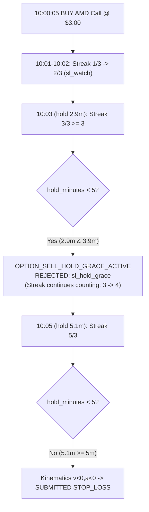

**Dashboard UI Mockup — Buy/Sell Log Rows:**
```text
TIME (EST)  SIDE  SYMBOL / CONTRACT     P/L %    DECISION   REASON / DETAILS
-------------------------------------------------------------------------------------------------------------
10:05:46    SELL  AMD261211C00150000    -11.33%  SUBMITTED  stop_loss(pnl=-11.33%<-8.00%,streak=5/3)&downward_pressure(v=-0.0640,a=-0.0110)
10:04:46    SELL  AMD261211C00150000    -11.00%  REJECTED   ...; sl_hold_grace(3.90m<5m,streak=4)
10:03:46    SELL  AMD261211C00150000    -10.67%  REJECTED   ...; sl_hold_grace(2.90m<5m,streak=3)
```

---

### Scenario 4 — `min_hold_minutes` Grace Window Suppressing Hard Emergency Stop (`hard_sl_hold_grace`)

**Setup:** `stop_loss_hard_pct = 25.0`, `min_hold_minutes = 5`. A wide-spread `META261211C00600000` is bought at `09:35:10 ET` for `$10.00`. One minute later, a brief market-maker quote flicker drops the Bid to `$7.20` (`-28.00% < -25.00%`), then liquidity normalizes to `$9.40` (`-6.00%`) at minute `3`.

| Minute (ET) | Hold (m) | Mark | P/L % | Hard Breach (`< -25%`) | `in_hold_grace` | Decision & Outcome |
| :---: | :---: | :---: | :---: | :---: | :---: | :--- |
| `09:36` | `0.8` | `$7.20` | `-28.00%` | **Yes** | **Yes** | `REJECTED`: **`hard_sl_hold_grace(0.80m<5m)`** — quote flicker ignored! |
| `09:37` | `1.8` | `$7.40` | `-26.00%` | **Yes** | **Yes** | `REJECTED`: **`hard_sl_hold_grace(1.80m<5m)`** |
| `09:38` | `2.8` | `$9.40` | `-6.00%` | No | Yes | Recovered above both thresholds; streak resets to `0/5`! |

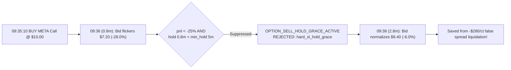

> **Operational Caution:** Because `min_hold_minutes` suppresses **both** hard and soft stop-losses, keep `min_hold_minutes` modest (`2–5` minutes) for liquid tickers, or set `min_hold_minutes = 0` if you want immediate unprotected hard stop-loss enforcement from second 1.

**Dashboard UI Mockup — Hold-Grace Banner in Buy/Sell Log Details Modal:**
```text
+------------------------------------------------------------------------------+
| BUY / SELL LOG DETAILS — META261211C00600000                       [ CLOSE ] |
+------------------------------------------------------------------------------+
| Timestamp: 09:36:46 ET    Side: SELL    Decision: [ REJECTED ]               |
| Unrealized P/L: -28.00%   Hold Time: 0.80 min / 5.00 min grace               |
| Reason: pt=-28.00%<25.00%; rsi_below_sell_threshold; hard_sl_hold_grace(0.80m<5m) |
| Note: Hard Stop-Loss suppressed until 09:40:10 ET (min_hold_minutes = 5).    |
+------------------------------------------------------------------------------+
```

---

### Scenario 5 — Hard Emergency Stop-Loss Instant Bypass (Post-Grace Flash Drop)

**Setup:** Holding `2` contracts of `MSFT261211C00430000` (entry `$6.00`, held `24m >= 5m`). Unexpected news hits MSFT; in a single 1-minute candle, the option collapses from `$5.70` (`-5.0%`) straight to `$4.20` (`-30.00%`). Underlying kinematics haven't even finished rolling over (`v = +0.01`, `loss_streak = 1/5`).

| Minute (ET) | Hold (m) | Mark | P/L % | Streak | Underlying $v$ | Tier 4a Hard Check (`< -25%`) | Decision |
| :---: | :---: | :---: | :---: | :---: | :---: | :---: | :--- |
| `11:04` | `23.0` | `$5.70` | `-5.00%` | `0/5` | `+0.0420` | No | `REJECTED` |
| `11:05` | `24.0` | `$4.20` | **`-30.00%`** | `1/5` | `+0.0110` | **YES (`-30.00% < -25.00%`)** | **`SUBMITTED`**: `hard_stop_loss(pnl=-30.00%<-25.00%,streak=1)` |

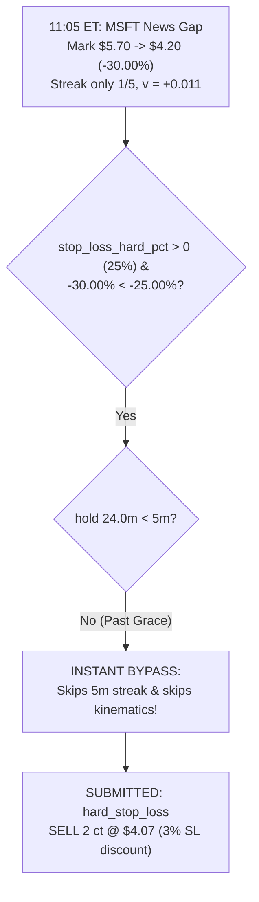

**Dashboard UI Mockup — Option Seller Alert & Execution Card:**
```text
+------------------------------------------------------------------------------+
| OPTION SELLER (ALPACA · PAPER)                         [STOP-LOSS EXECUTED!] |
+------------------------------------------------------------------------------+
| Trigger Counters:  Profit Target: 1  |  Trailing Stop: 2  |  Stop Loss: 1    |
| Last Exit: 11:05:46 ET · MSFT261211C00430000 · SELL 2 ct LIMIT @ $4.07       |
| Trigger Kind: [ HARD_STOP_LOSS ]  pnl=-30.00% < -25.00% (streak=1, bypassed) |
| Est. Proceeds: $814.00  |  Entry Cost: $1,200.00  |  Realized: -$386.00      |
+------------------------------------------------------------------------------+
```

---

### Scenario 6 — Hard Stop Disabled (`stop_loss_hard_pct = 0`) vs Enabled (`25.0%`) Comparison

**Setup:** Identical `-32.00%` flash crash on `AMZN261211C00210000` at `13:10 ET` (`hold = 15m`, `streak = 1/5`), comparing two configurations side by side:
* **Config A (`stop_loss_hard_pct = 25.0`):** Exits immediately at `13:10 ET` at `-32.00%`.
* **Config B (`stop_loss_hard_pct = 0.0` — hard stop disabled):** Falls through Tier 4a into Tier 4b (`sl_watch(streak=1/5)`), forcing the position to wait 4 more full minutes until `13:14 ET` (`streak = 5/5`), where the contract has fallen further to `-48.00%`!

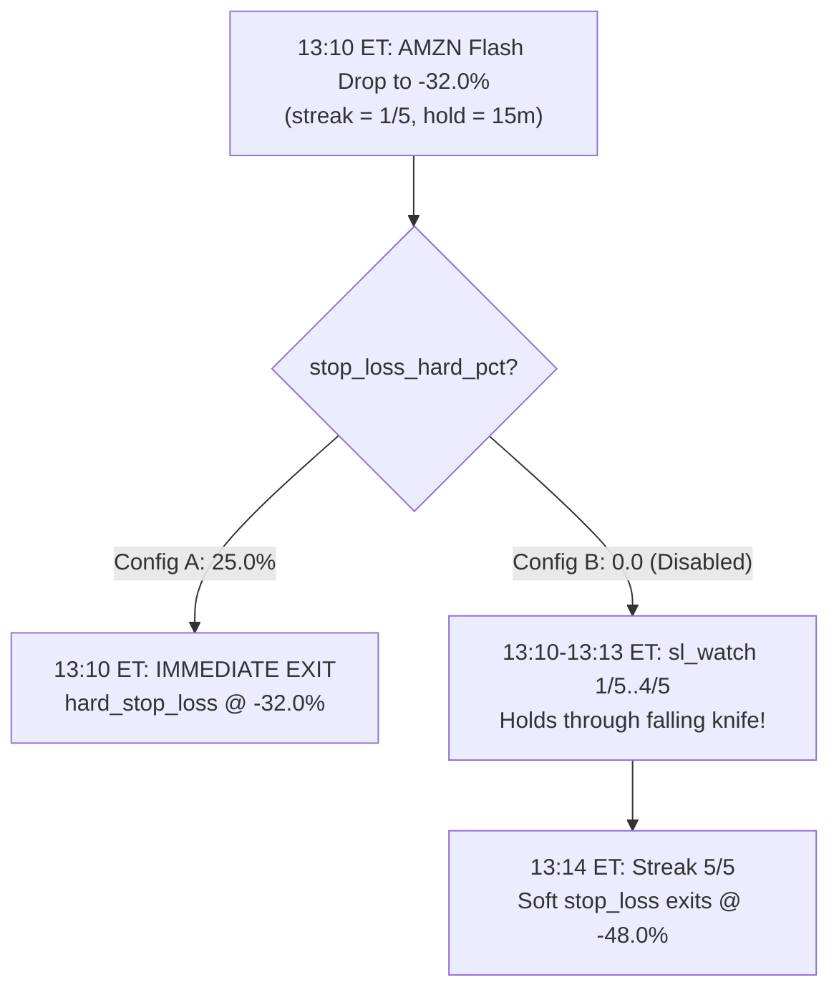

**Dashboard UI Mockup — Side-by-Side Log Comparison:**
```text
CONFIG A (stop_loss_hard_pct = 25.0):
  13:10:46  SELL  AMZN261211C00210000  -32.00%  SUBMITTED  hard_stop_loss(pnl=-32.00%<-25.00%,streak=1)

CONFIG B (stop_loss_hard_pct = 0.0):
  13:10:46  SELL  AMZN261211C00210000  -32.00%  REJECTED   ...; sl_watch(streak=1/5)
  13:11:46  SELL  AMZN261211C00210000  -37.50%  REJECTED   ...; sl_watch(streak=2/5)
  13:12:46  SELL  AMZN261211C00210000  -41.00%  REJECTED   ...; sl_watch(streak=3/5)
  13:13:46  SELL  AMZN261211C00210000  -45.20%  REJECTED   ...; sl_watch(streak=4/5)
  13:14:46  SELL  AMZN261211C00210000  -48.00%  SUBMITTED  stop_loss(pnl=-48.00%<-10.00%,streak=5/5)&downward_pressure
```

---

### Scenario 7 — Kinematics Rebound Protection (`stop_loss_require_kinematics = true` -> `sl_hold`)

**Setup:** Holding `NVDA261211C00144000` (held `20m`). It breaches `-10.0%` for 5 consecutive minutes (`11:15–11:19`). Exactly on minute `5` (`11:19`), NVDA hits support and prints a sharp green reversal bar: `v = +0.0840`, `a = +0.1120`, `eff_proj = +0.1400`, even though the option mark is still lagging at `-11.20%`.

| Minute (ET) | P/L % | Streak | Underlying $v$ | Underlying $a$ | $\Delta\hat{P}$ | Kinematics Result | Decision |
| :---: | :---: | :---: | :---: | :---: | :---: | :--- | :--- |
| `11:18` | `-12.80%` | `4/5` | `-0.0450` | `+0.0320` | `-0.0290` | *(not checked yet)* | `REJECTED`: `sl_watch(streak=4/5)` |
| `11:19` | `-11.20%` | **`5/5`** | **`+0.0840`** | **`+0.1120`** | **`+0.1400`** | `kinematics_recovering_or_flat` | `REJECTED`: **`sl_hold(streak=5/5,kinematics_recovering_or_flat)`** |
| `11:20` | `-9.10%` | **`0/5`** | `+0.1210` | `+0.0370` | `+0.1395` | Rebounded above `-10%` | **Streak resets to `0/5` — V-bottom saved!** |
| *(Alt `11:20b`)* | *`-13.40%`* | *`6/5`* | *`-0.0520`* | *`-0.0890`* | *`-0.0965`* | *`downward_pressure`* | ***`SUBMITTED`:*** *Bounce failed; exits immediately on minute 6!* |

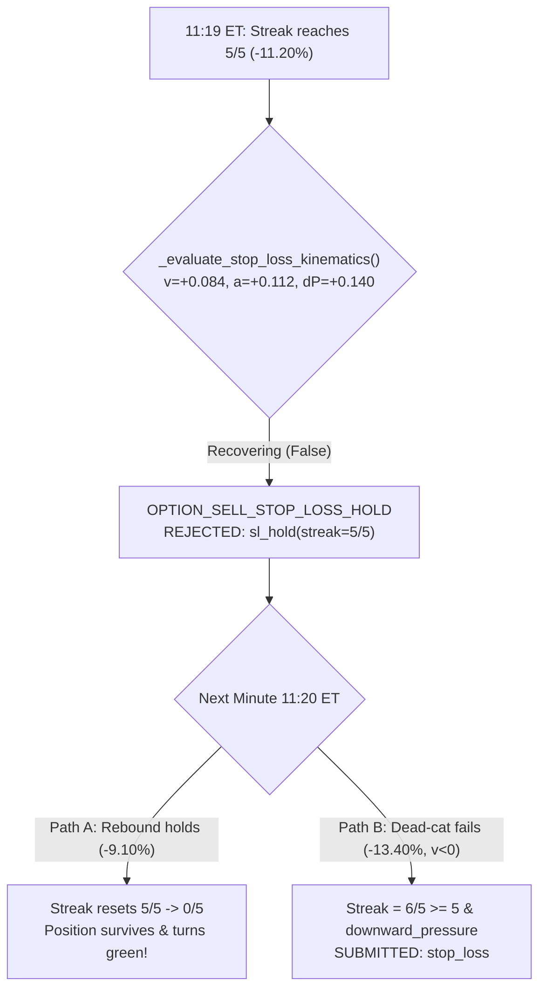

**Dashboard UI Mockup — Buy/Sell Log Details (`±3m` Context Window):**
```text
+----------------------------------------------------------------------------------+
| BUY / SELL LOG DETAILS — NVDA261211C00144000 (11:19:46 ET)             [ CLOSE ] |
+----------------------------------------------------------------------------------+
| Decision: [ REJECTED ]   P/L: -11.20%   Reason: sl_hold(streak=5/5,              |
|           kinematics_recovering_or_flat(v=+0.0840,a=+0.1120,p_delta=+0.1400))    |
+----------------------------------------------------------------------------------+
| SURROUNDING ±3 MINUTE KINEMATICS CONTEXT (NVDA)                                  |
| MINUTE   PRICE    RSI    V        A        ΔP̂       PHASE                        |
| 11:17    141.10   34.2   -0.0770  -0.0110  -0.0825  accelerating_bearish         |
| 11:18    141.05   33.8   -0.0450  +0.0320  -0.0290  decelerating_bearish         |
| >11:19   141.32   38.5   +0.0840  +0.1120  +0.1400  accelerating_bullish  <--    |
| 11:20    141.68   43.1   +0.1210  +0.0370  +0.1395  accelerating_bullish         |
+----------------------------------------------------------------------------------+
```

---

### Scenario 8 — Kinematics Gate Disabled (`stop_loss_require_kinematics = false`) Mechanical Exit

**Setup:** Identical market tape to Scenario 7 (`11:19 ET`, `P/L = -11.20%`, `streak = 5/5`, `v = +0.0840`, `a = +0.1120`), EXCEPT the operator has set **`stop_loss_require_kinematics = false`** for strict mechanical P/L discipline.

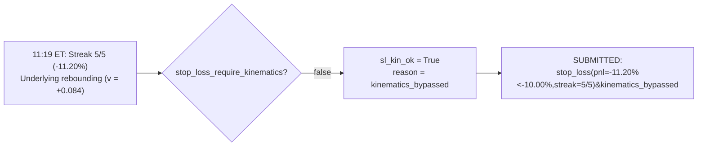

**Dashboard UI Mockup — Buy/Sell Log Row:**
```text
TIME (EST)  SIDE  SYMBOL / CONTRACT     RSI    V        A        P/L %    DECISION   REASON / DETAILS
--------------------------------------------------------------------------------------------------------------------------------
11:19:46    SELL  NVDA261211C00144000   38.50  +0.0840  +0.1120  -11.20%  SUBMITTED  stop_loss(pnl=-11.20%<-10.00%,streak=5/5)&kinematics_bypassed
```

---

### Scenario 9 — Feed Pause / Service Restart Contiguity Reset (`gap_sec > 95s`)

**Setup:** Holding `AMD261211C00150000` (`stop_loss_pct = 10.0`, `stop_loss_consecutive_minutes = 5`). The contract breaches `-10%` for 4 straight minutes (`12:01–12:04`), reaching `streak = 4/5`. Then a 2-minute network drop / provider stall skips `12:05`. The next finalized bar arrives at `12:06` (`gap_sec = 120s > 95s`) still at `-11.50%`.

| Minute (ET) | `prev_dt -> minute_dt` | `gap_sec` | `0 < gap_sec <= 95`? | P/L % | Streak | Decision |
| :---: | :---: | :---: | :---: | :---: | :---: | :--- |
| `12:03` | `12:02 -> 12:03` | `60s` | Yes | `-11.00%` | `3/5` | `REJECTED`: `sl_watch(streak=3/5)` |
| `12:04` | `12:03 -> 12:04` | `60s` | Yes | `-11.20%` | `4/5` | `REJECTED`: `sl_watch(streak=4/5)` |
| *`12:05`* | *(missing bar)* | *—* | *—* | *—* | *—* | *(no evaluation)* |
| `12:06` | `12:04 -> 12:06` | **`120s`** | **No (`> 95s`)** | `-11.50%` | **`1/5`** | `REJECTED`: `sl_watch(streak=1/5)` *(Reset to 1, NOT 5!)* |

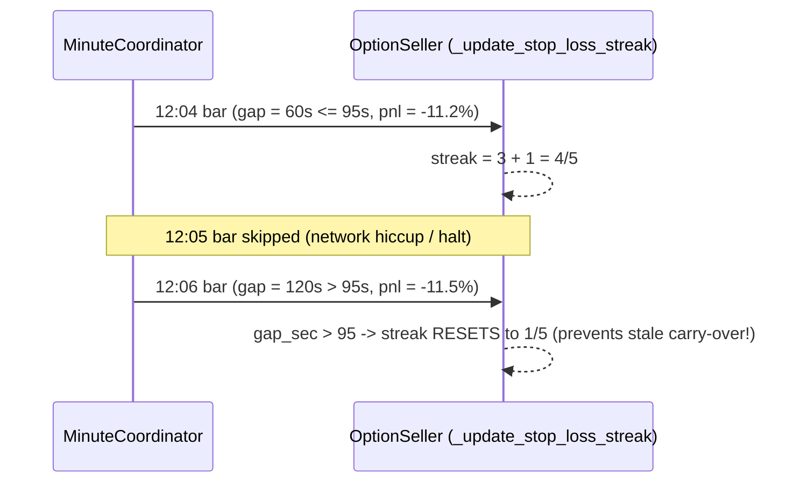

**Dashboard UI Mockup — Buy/Sell Log Rows:**
```text
TIME (EST)  SIDE  SYMBOL / CONTRACT     P/L %    DECISION   REASON / DETAILS
------------------------------------------------------------------------------------------------
12:06:46    SELL  AMD261211C00150000    -11.50%  REJECTED   ...; sl_watch(streak=1/5)
12:04:46    SELL  AMD261211C00150000    -11.20%  REJECTED   ...; sl_watch(streak=4/5)
12:03:46    SELL  AMD261211C00150000    -11.00%  REJECTED   ...; sl_watch(streak=3/5)
```

---

### Scenario 10 — Stop-Loss Limit Order Discount Pricing (`stop_loss_limit_discount_pct = 3.0%`)

**Setup:** `order_type = limit`, `stop_loss_force_market = false`, `limit_discount_pct = 0.5`, `stop_loss_limit_discount_pct = 3.0`. A soft stop-loss triggers on `NVDA261211C00144000`. Broker position reports `current_price = $4.18`, while `_fetch_live_quote()` returns `live_bid = $4.10`, `live_ask = $4.24`.

**Exact Pricing Math (`_resolve_sell_order_params` + `_compute_discounted_limit_price`):**
1. Because `trigger_kind == "stop_loss"`, it skips the Mid-based profit formula (`limit_discount_pct = 0.5%` is NOT used).
2. Computes conservative anchor: `ref_price = min(live_bid=$4.10, cur_price=$4.18) = $4.10`.
3. Applies `stop_loss_limit_discount_pct = 3.0%`:
   $$\text{limit\_price} = \text{round}(\$4.10 \times (1 - 0.03),\ 2) = \text{round}(\$3.977,\ 2) = \mathbf{\$3.98}$$
4. Submits `SELL LIMIT @ $3.98 DAY` — immediately marketable across `$4.10` bid while capping worst-case slippage at `$3.98` (unlike an uncapped market order).

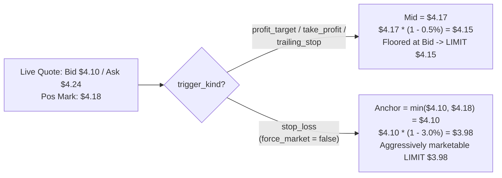

**Dashboard UI Mockup — Stop-Loss Pricing Breakdown Card:**
```text
+------------------------------------------------------------------------------+
| STOP-LOSS ORDER PRICING PREVIEW — NVDA261211C00144000                        |
+------------------------------------------------------------------------------+
| Order Type: LIMIT (stop_loss_force_market = false)                           |
| Live Bid: $4.10  |  Live Ask: $4.24  |  Position Mark: $4.18                 |
| Anchor Price = min(Bid, Mark) = $4.10                                        |
| Stop-Loss Discount: 3.0%  ->  Limit Price = $3.98  (Est. Sale: $398.00/ct)   |
+------------------------------------------------------------------------------+
```

---

### Scenario 11 — Emergency Market Override (`stop_loss_force_market = true`) & No-Quote Fallback (`40310000`)

**Setup:** `order_type = limit`, **`stop_loss_force_market = true`**, `stop_loss_limit_discount_pct = 3.0`. A hard stop-loss fires on `META261211C00600000` (`cur_price = $6.40`).
1. Because `stop_loss_force_market = true`, `OptionSeller` overrides `limit` and sends a **`MARKET`** sell order.
2. Suppose Alpaca temporarily lacks an active NBBO quote for that strike and returns HTTP 403 error code `40310000` (`"no available quote — reenter with a limit order"`).
3. `_is_no_quote_market_rejection(submit_exc)` catches the error, calls `_extract_position_fallback_price()` (`$6.40`), applies `stop_loss_limit_discount_pct = 3.0%` (`$6.40 × 0.97 = $6.21`), logs `OPTION_SELL_MARKET_FALLBACK_TO_LIMIT`, and **immediately resubmits `SELL LIMIT @ $6.21 DAY`**!

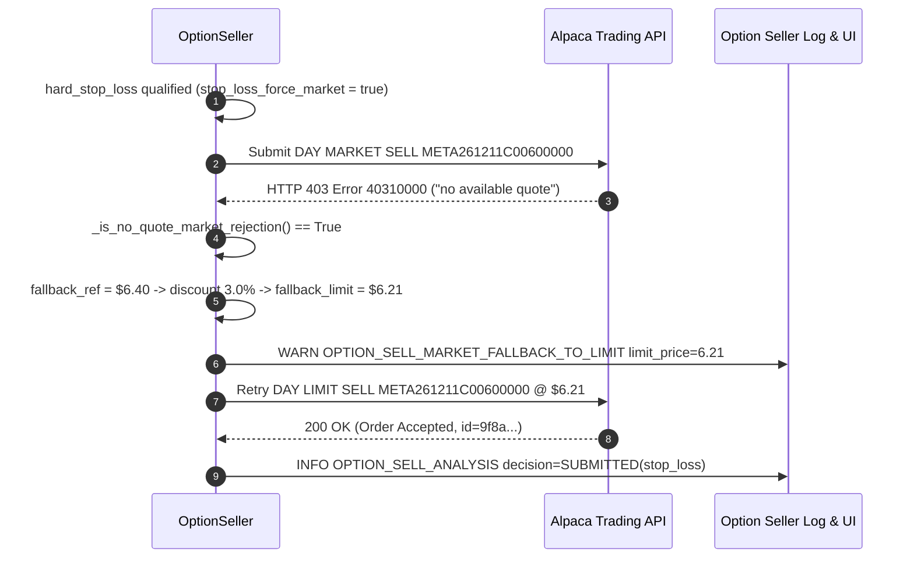

**Dashboard UI Mockup — Execution Log Feed:**
```text
14:22:47 ET  WARN  OPTION_SELL_MARKET_FALLBACK_TO_LIMIT underlying=META symbol=META261211C00600000 ref_price=6.4000 limit_price=6.21 reason=no_available_quote
14:22:47 ET  INFO  OPTION_SELL_ANALYSIS minute=2026-11-25T19:22Z contract=META261211C00600000 pnl%=-26.80% decision=SUBMITTED(stop_loss) reason=hard_stop_loss(pnl=-26.80%<-25.00%,streak=1)
```

---

### Scenario 12 — Tier 3 Trailing Stop vs Tier 4 Stop-Loss Interaction, Cooldown & Dry-Run Modes

**Setup:** Holding `NVDA261211C00144000` (`trailing_activation_pct = 10.0`, `trailing_drawdown_pct = 5.0`, `trailing_require_negative_velocity = true`, `stop_loss_pct = 10.0`, `stop_loss_consecutive_minutes = 5`, `cooldown_minutes = 15`, `dry_run = true`).

1. **10:15 ET:** Position rallies to `+14.00%` $\rightarrow$ **Tier 3 Trailing Stop ARMS** (`peak_pnl = +14.00% >= 10.0%`).
2. **10:18 ET:** Position pulls back to `+7.50%` (`drawdown = (1.14 - 1.075) / 1.14 = 5.70% > 5.0%`), with `v = -0.0620 < 0`. **Tier 3 fires BEFORE Tier 4** (`QUALIFIED_DRY_RUN(trailing_stop)`).
3. **10:18 ET (Dry-Run State Reset):** Because `dry_run = true`, no real fill occurs (on Tastytrade, `/dry-run` validates server-side; on Alpaca, simulated locally). `OptionSeller` clears `peak_profit_state_by_symbol` and `stop_loss_state_by_symbol`, and starts the **`15m` `cooldown_minutes` timer**.
4. **10:19–10:28 ET (Reversal During Cooldown):** Because the simulated dry-run position is still open at the broker, suppose NVDA now dumps to `-27.00%` at `10:25 ET` (`7m` into the `15m` cooldown). Tier 4a qualifies (`hard_stop_loss`), **but the post-qualification cooldown gate catches it** (`7m < 15m`) and logs `REJECTED: cooldown_active(trigger=hard_stop_loss(...))` until `10:33 ET` (`15m` elapsed)!

```mermaid
stateDiagram-v2
    [*] --> ArmedT3 : 10:15 Peak +14.0% >= 10%<br/>Trailing Stop ARMED
    ArmedT3 --> T3Exit : 10:18 Pullback +7.5%<br/>dd = 5.70% > 5.0% & v < 0
    T3Exit --> Cooldown15m : dry_run = true<br/>QUALIFIED_DRY_RUN(trailing_stop)<br/>Reset peak & streak; start 15m cooldown
    Cooldown15m --> BlockedSL : 10:25 Drops to -27.0%<br/>hard_stop_loss qualifies<br/>BLOCKED by cooldown_active (7m < 15m)
    BlockedSL --> T4Exit : 10:33 Cooldown Expires (15m)<br/>QUALIFIED_DRY_RUN(stop_loss)
```

**Dashboard UI Mockup — Full Operational Dashboard & Option Seller Status Panel:**
```text
+======================================================================================+
| JBOA-RSI LIVE DASHBOARD (v0.1.24)   [QQQ: +0.62%]   [OPT BUYER: ON] [OPT SELLER: ON] |
+======================================================================================+
| OPEN OPTION POSITIONS (1)                                                            |
| CONTRACT             QTY   AVG     MARK    P/L %     PEAK %   DD %   SL STRK  HOLD   |
| NVDA261211C00144000   1    $5.00   $3.65   -27.00%   +0.00%   0.00%    5/5    42.0m  |
+--------------------------------------------------------------------------------------+
| OPTION SELLER (TASTYTRADE · SANDBOX · DRY-RUN)                                       |
| Tiers: [T1 PT >= +25%] [T2 RSI >= 65 & P/L > 0%] [T3 TS +10% / -5% DD] [T4 SL -10%/5m|
|         Hard SL -25% | Hold Grace 5m | SL Limit -3.0% | Cooldown 15m]                |
| Last Event: 10:25:46 ET -> REJECTED: cooldown_active(trigger=hard_stop_loss)         |
| Dry-Run Mode: server_ok (Tastytrade /dry-run verified) | Cooldown Ends: 10:33:46 ET  |
+======================================================================================+
```

> **Production Best Practice:** In **live/paper trading (`dry_run = false`)**, a full-position sell closes the contract so cooldown rarely interferes unless a limit order goes unfilled. If a stop-loss limit order sits unfilled and you want rapid retries on subsequent minutes, either set `stop_loss_force_market = true`, widen `stop_loss_limit_discount_pct` (e.g., `3.0%–5.0%`), or reduce `[option_seller] cooldown_minutes` (e.g., `2–5` minutes).
