<div align="center">

# JBOA-RSI

### Multi-Stream RSI, Price Kinematics & Automated Options Trading Platform

**Technical Architecture, Quantitative Engine, UI Manual & Operations Reference**

---

| Document Metadata | Value |
| :--- | :--- |
| **System** | JBOA-RSI (`multiStreamRSI.py` + `findthewinners.py` + Pine Script Alert Studio) |
| **Primary Runtime** | Python 3.12 (`asyncio` + Flask + `alpaca-py` + Tastytrade REST/DXLink) |
| **Web Surfaces** | Port `5000` (TradingView Webhook) · Port `5001` (Live Kinematics & P/L Dashboard) · Port `3000` (React/Vite Pine Script Studio) |
| **Brokers & Feeds** | TradingView · Alpaca · Tastytrade (REST + DXLink) · Tradier · TwelveData · Yahoo Finance |
| **Market Calendar** | NYSE (`pandas_market_calendars`, US/Eastern RTH `09:30–16:00` & ETH `04:00–20:00`) |

</div>

---

## Master Table of Contents

1. [Executive System Overview](#1-executive-system-overview)
2. [End-to-End Architecture Diagram](#2-end-to-end-architecture-diagram)
3. [Repository and Source File Inventory](#3-repository-and-source-file-inventory)
4. [Quickstart Guide](#4-quickstart-guide)
   - [4.1 Local Python `.venv` Execution](#41-local-python-venv-execution)
   - [4.2 One-Shot CLI and Interactive TTY Commands](#42-one-shot-cli-and-interactive-tty-commands)
   - [4.3 Standalone Strike Winner Analysis (`findthewinners.py`)](#43-standalone-strike-winner-analysis-findthewinnerspy)
   - [4.4 React and Vite Companion Studio (`src/`)](#44-react-and-vite-companion-studio-src)
   - [4.5 Systemd and Podman Deployment](#45-systemd-and-podman-deployment)
5. [Documentation Suite Index](#5-documentation-suite-index)

---

## 1. Executive System Overview

**JBOA-RSI** is an asynchronous, multi-provider quantitative market-data ingestion, kinematics analysis, and automated options trading engine centered on `multiStreamRSI.py`, paired with an offline post-session strike evaluator (`findthewinners.py`) and a React/TypeScript TradingView Pine Script workbench (`src/`).

### Core Capabilities

* **Multi-Provider 1-Minute Ingestion & Warmup:** Concurrently streams and normalizes 1-minute equity bars across up to six feeds (`TRADINGVIEW`, `ALPACA`, `TASTYTRADE`, `TRADIER`, `TWELVEDATA`, `YAHOOFINANCE`). Local providers pre-warm Wilder RSI(14) across the last `RSI_WARMUP_SESSIONS` (default `5`) NYSE sessions before the first finalized minute so values converge with TradingView's continuous series.
* **Price & RSI Kinematics Engine:** Computes Hull Moving Average (`HMA(14)`), Exponential Moving Average (`EMA`), or raw close smoothing; 1-minute and 3-minute velocity ($v_t$) and acceleration ($a_t$); next-step kinematic price projection ($\hat{P}_{t+1} = P_t + v_t + \frac{1}{2}a_t$); leading/confirmed zero-line crossovers; and 4-quadrant phase regime classification (`accelerating_bullish`, `decelerating_bullish`, `accelerating_bearish`, `decelerating_bearish`).
* **Strict Zero-Fallback Broker Routing:** Decouples option chain lookup (`[option_trading] optionchainprovider`) from order execution (`[option_trading] transactionprovider`), supporting **Alpaca** (Paper/Live) and **Tastytrade** (Prod market data + Sandbox or Prod order routing) with zero silent cross-broker fallback.
* **Ex-Ante Risk Guardrails, Strike Selection & 4-Tier Exit Engine:** `OptionBuyer` (Alpaca or Tastytrade via `build_trading_client`) enforces oversold RSI/bounce-lookback thresholds, optional US/Eastern entry time windows, either default `kinematics_forecast` or forecast-independent `rsi_ex_ante` entry gating, configurable zero-hindsight strike selection (`plus2_otm`, `atm_itm_low_spread`, `delta_mid`, `delta_itm_low_spread`, `composite_score`, etc.) with liquidity floors and budget step-down, bid/ask spread caps, open-contract limits, per-minute caps, duplicate-underlying locks, and cooldowns. `OptionSeller` monitors open positions on every finalized minute with a 4-tier exit waterfall: (1) Fixed Profit Target, (2) Overbought RSI + Bearish Kinematics, (3) Session High-Water-Mark Trailing Stop, and (4) Hard & Consecutive-Minute Stop Loss with initial hold-grace protection.
* **Live Operational Telemetry & Chart Capture:** Serves a password-protected, TLS-capable operational dashboard on port `5001` (`AdminCliProvider`) featuring real-time KPIs, the 4-quadrant phase matrix, interactive 3-panel synchronized crossover charts, open/closed option contract P/L drill-downs, live Buy/Sell decision log inspection, optional strike analysis, and an automated 1-minute headless PNG chart capture thread (`ChartCaptureManager`).

---

## 2. End-to-End Architecture Diagram

```mermaid
flowchart TB
    subgraph External["External Market Data & Broker APIs"]
        TV["TradingView Pine Script<br/>1m Closed-Bar Webhooks"]
        ALP_D["Alpaca Market Data<br/>StockDataStream / REST / Option Snapshots"]
        TT_P["Tastytrade Prod<br/>REST /api-quote-tokens & DXLink WS"]
        TRD["Tradier<br/>REST timesales & Events WS"]
        TD["TwelveData<br/>REST time_series & Quotes WS"]
        YF["Yahoo Finance<br/>yfinance 1m Polling"]
        BRK["Execution Broker<br/>Alpaca TradingClient (Paper/Live)<br/>OR TastytradeClient (Sandbox/Prod)"]
    end

    subgraph Ingestion["Async Ingestion Layer (multiStreamRSI.py)"]
        TVP["TradingviewProvider<br/>Flask HTTP :5000 (/webhook)<br/>+ Bounded Queue (2000)"]
        PR["ProviderRouter (1 per enabled feed)<br/>warmup() -> run_*() + recover()<br/>DXLink #1 (Hist) & #2 (Live)"]
    end

    subgraph Core["Central State & Quant Engine"]
        MC["MinuteCoordinator<br/>Single Event-Loop Owner<br/>SessionRSI · HMA/EMA · v & a · P̂(t+1)<br/>finalizes at summary_delay_seconds (45s) or early on complete"]
        OHT["OptionContractHistoryTracker<br/>Open/Closed Contracts · 1m Marks · P/L<br/>Disk Cache & Broker Startup Backfill"]
    end

    subgraph Execution["1-Minute Synced Trading & Collection Tasks"]
        OCC["RsiOptionChainCollector<br/>Priority-driven RSI<=35 / >=65<br/>Pruned Chain Snapshots"]
        OB["OptionBuyer (Alpaca / Tastytrade)<br/>Ex-Ante Entry & Spread Guards<br/>Configurable Strike Selection (+2 OTM / ATM-ITM / Delta / Composite)"]
        OS["OptionSeller (Alpaca / Tastytrade)<br/>4-Tier Exit Waterfall:<br/>PT · RSI/Kin · Trailing · Stop-Loss"]
        PM["PositionMonitor (Alpaca / Tastytrade)<br/>15s Poll / 1m Position Logging"]
        CC["ChartCaptureManager<br/>Dedicated Worker Thread<br/>Pure-Python 3-Panel PNG Renderer"]
    end

    subgraph Storage["Structured Logs & Artifacts (logs/)"]
        MS["minute-summary-RUN_ID.jsonl"]
        PROV_LOG["logs/{provider}/*.log"]
        CHAIN_LOG["logs/optionchains/*.json"]
        TRADE_LOG["logs/option_buyer/*.log<br/>logs/option_seller/*.log<br/>logs/positions/*.log"]
        CHART_OUT["logs/charts/{SYMBOL}/*.png"]
        OPT_CACHE["logs/option_history_state_*.json<br/>logs/option_history_prices_*.json"]
    end

    subgraph Interfaces["Web UIs & Offline Analytics"]
        ADMIN["AdminCliProvider (Flask :5001)<br/>TLS + Session Auth + Idle Timeout<br/>Live Kinematics & P/L Dashboard<br/>/api/* & /cli/* Endpoints"]
        FTW["findthewinners.py (CLI)<br/>Post-Session -2 ITM..+4 OTM<br/>Hold-Horizon & Ex-Ante Evaluator"]
        REACT["Pine Script Alert Studio<br/>React/TypeScript/Vite (:3000)<br/>Script Gen · Rate-Limit Sim · Tester"]
    end

    TV -->|POST /webhook| TVP
    ALP_D --> PR
    TT_P --> PR
    TRD --> PR
    TD --> PR
    YF --> PR

    TVP -->|submit| MC
    PR -->|seed_history / submit| MC

    MC -->|minute_finalized_event| OCC
    MC -->|minute_finalized_event| OB
    MC -->|minute_finalized_event| OS
    MC -->|minute_finalized_event| CC
    MC <--> OHT

    OCC -->|Option Chains| ALP_D
    OCC -->|Option Chains| TT_P
    OCC --> CHAIN_LOG
    OCC -->|cache contract| MC

    OB <-->|Positions, Quotes, Buy Orders| BRK
    OS <-->|Positions, Quotes, Sell Orders| BRK
    PM -->|15s Poll| BRK
    PM --> OHT
    OB --> OHT
    OS --> OHT

    MC --> MS
    PR --> PROV_LOG
    OB --> TRADE_LOG
    OS --> TRADE_LOG
    PM --> TRADE_LOG
    CC --> CHART_OUT
    OHT --> OPT_CACHE

    ADMIN <--> MC
    ADMIN <--> OHT
    ADMIN <--> CC
    ADMIN -->|Reads| MS
    ADMIN -->|Reads| TRADE_LOG
    ADMIN -->|Reads| CHAIN_LOG

    CHAIN_LOG --> FTW
    MS --> FTW
    TRADE_LOG --> FTW
    REACT -.->|Generates Pine Scripts & Test Payloads| TVP
```



---

## 3. Repository and Source File Inventory

The following table inventories all code files verified in this workspace alongside external runtime/deployment files referenced in source code or `AGENTS.md`:

| Path | Lines | Role | Workspace Status |
| :--- | :---: | :--- | :--- |
| `multiStreamRSI.py` | 27,233 | Complete asynchronous RSI/kinematics engine, multi-broker option buyer/seller, option history tracker, PNG chart renderer, webhook server (`:5000`), and live Flask dashboard (`:5001`). | Present |
| `findthewinners.py` | 4,171 | Standalone post-session CLI analyzer comparing `-2 ITM` to `+4 OTM` option strikes across hold horizons (`5m`–`180m` & EOD) and ex-ante selection rules. | Present |
| `public/assets/aistudio/getOptionsContracts_87f349cc.py` | 216 | Reference copy of Alpaca option-chain snapshot fetcher (`get_pruned_option_chain`, `get_one_contract` 2nd-OTM selector). | Present (Reference) |
| `src/App.tsx` + `src/components/*.tsx` (10 files) | ~3,740 | React 19 / TypeScript / Tailwind CSS companion **Pine Script Alert Studio** (MultiStream kinematics docs/viewer, 27-symbol merged generator, v6 Watchlist generator, rate-limit simulator, setup guide, batch fix, Python receiver reference, payload tester). | Present |
| `src/data/pineScripts.ts` | 713 | Pure TypeScript Pine Script v6 code generators (`generateWatchlistScript`, `generateBatchedScript`, `generateMerged21SymbolScript`). | Present |
| `vite.config.ts` | 55 | Vite config with custom `serveRootPythonPlugin()` serving `multiStreamRSI.py` and `findthewinners.py` at `/multiStreamRSI.py` and `/findthewinners.py`. | Present |
| `lib/parms.ini` | — | Primary runtime INI configuration loaded by `load_settings()` at `<script_dir>/lib/parms.ini`. | `[Not Found in Codebase]` (gitignored runtime secret/config) |
| `lib/utils.py` | — | Project-local helper imported by `multiStreamRSI.py` (`JsonIniParser`, `get_three_fridays_away`) and `getOptionsContracts` (`extract_strike_price`, `get_current_ask_price`). | `[Not Found in Codebase]` |
| `lib/getOptionsContracts.py` | — | Runtime module imported at line 82 of `multiStreamRSI.py` (`from lib.getOptionsContracts import get_pruned_option_chain`). Reference copy exists in `public/assets/aistudio/getOptionsContracts_87f349cc.py`. | `[Not Found in Codebase]` |
| `build_and_package.sh` / `Containerfile` / `jboa-rsi.service` / `run_windows.bat` | — | RHEL 9.8 Nuitka/Podman packaging, systemd unit, and Windows runner scripts referenced in deployment ops. | `[Not Found in Codebase]` |

---

## 4. Quickstart Guide

### 4.1 Local Python `.venv` Execution

`multiStreamRSI.py` recommends **Python 3.12** (`multiStreamRSI.py` line 3) and requires `lib/parms.ini`, `lib/utils.py`, and `lib/getOptionsContracts.py` alongside it in the runtime directory (on RHEL production hosts, `/home/billt/jboa-1/src` per `AGENTS.md`).

```bash
# 1. Create and activate Python 3.12 virtual environment
python3.12 -m venv .venv
source .venv/bin/activate

# 2. Install required Python packages (from multiStreamRSI.py imports)
pip install aiohttp alpaca-py Flask yfinance pandas pandas-market-calendars tzdata

# Optional (recommended for auto self-signed HTTPS certs on port 5001)
pip install cryptography

# 3. Ensure lib/parms.ini is populated with redacted credentials & provider flags
#    (See docs/CONFIGURATION_AND_API_REFERENCE.md for the full schema)

# 4. Run the full asynchronous trading & monitoring engine
python3 multiStreamRSI.py
```

* **Live Dashboard:** `https://<host>:5001/` (or `http://<host>:5001/` when `[dashboard] ssl_mode = http` or `ssl_enabled = false`)
* **TradingView Webhook:** `http://<webhook_host>:5000/webhook` (default `127.0.0.1:5000`; non-loopback hosts require `WEBHOOK_TOKEN`)

### 4.2 One-Shot CLI and Interactive TTY Commands

`handle_cli_command()` (`multiStreamRSI.py:27117`) supports one-shot management of the 1-minute PNG chart capture worker without launching a second engine:

```bash
# Inspect live & INI chart-capture state
python3 multiStreamRSI.py chart-capture status

# Start or stop chart capture (updates lib/parms.ini and signals running engine on port 5001)
python3 multiStreamRSI.py chart-capture start
python3 multiStreamRSI.py chart-capture stop

# Target a non-default instance (e.g., dual-instance port 6001)
python3 multiStreamRSI.py --chart-capture status --port 6001 --ini /path/to/lib/parms.ini
```

When launched interactively in a TTY (`sys.stdin.isatty() == True`), a background `TTY-CLI` daemon thread accepts live commands on `stdin`:

* `chart-capture start` / `chart_capture start` / `cc start`
* `chart-capture stop` / `chart_capture stop` / `cc stop`
* `chart-capture status` / `chart_capture status` / `cc status`
* `status` (prints JSON of `connected`, `chart_capture`, and `tradingview` stats)
* `help` / `?`

### 4.3 Standalone Strike Winner Analysis (`findthewinners.py`)

```bash
# Analyze all captured BUY option chains in ./logs through end of session
python3 findthewinners.py

# Filter by symbol and trading date, including dry-run trades
python3 findthewinners.py --symbol AAPL --date 2026-11-20 --include-dry-run

# Offline mode using only local snapshots/sell chains (no remote broker bar fetches)
python3 findthewinners.py --no-bars --logs-dir ./logs --ini ./lib/parms.ini
```

### 4.4 React and Vite Companion Studio (`src/`)

```bash
npm install
npm run dev      # Starts Vite dev server on port 3000
npm run build    # Production bundle in dist/
npm run lint     # TypeScript typecheck (tsc --noEmit)
```

### 4.5 Systemd and Podman Deployment

> **Grounding Note:** `jboa-rsi.service`, `build_and_package.sh`, and `Containerfile` are `[Not Found in Codebase]` in this workspace. Verified host conventions from `AGENTS.md` (RHEL root `/home/billt/jboa-1/src`, service name `jboa-rsi.service`, ports `5000`/`5001`) and runtime container/firewall considerations are detailed in [`docs/DEPLOYMENT_AND_OPERATIONS.md`](docs/DEPLOYMENT_AND_OPERATIONS.md).

```bash
# Standard systemd lifecycle on RHEL host (unit file [Not Found in Codebase])
sudo systemctl status jboa-rsi.service
sudo systemctl restart jboa-rsi.service
journalctl -u jboa-rsi.service -f
```

---

## 5. Documentation Suite Index

| Document | Scope & Highlights |
| :--- | :--- |
| **[`docs/CHANGELOG.md`](docs/CHANGELOG.md)** | Permanent append-only release changelog tied to `APP_VERSION` (`major.minor.build`) in `multiStreamRSI.py`, viewable directly inside the Port `5001`/`6001` dashboard Docs modal (or by clicking the header version badge). |
| **[`docs/TRADING_ALGORITHMS_AND_RISK.md`](docs/TRADING_ALGORITHMS_AND_RISK.md)** | Complete catalog of all `.py` files, async task graph, 6-provider ingestion & DXLink architecture, information-gathering data flows, exact RSI/HMA/EMA/velocity/acceleration/$\hat{P}_{t+1}$ math, exhaustive **Ex-Ante Risk Filter & Rejection Matrix** (Buyer & Seller), 4-tier exit engine, option contract selection/sizing, and `findthewinners.py` scoring. |
| **[`docs/FRONTEND_DASHBOARD.md`](docs/FRONTEND_DASHBOARD.md)** | Exhaustive field-by-field and button-by-button manual for the **Live Port-5001 Kinematics & P/L Dashboard** (`LOGIN_HTML_TEMPLATE`, `DASHBOARD_HTML_TEMPLATE`, 4 modals, 3-panel synchronized crossover & option P/L charts, polling & P/L formulas) **plus** the **React/TypeScript Pine Script Alert Studio** (`src/App.tsx` + all 10 components). |
| **[`docs/DEPLOYMENT_AND_OPERATIONS.md`](docs/DEPLOYMENT_AND_OPERATIONS.md)** | Complete map of every runtime directory and log file, RHEL `.venv` / multi-instance / `firewalld` / TLS / auth operations, `ChartCaptureManager` PNG pipeline, log rotation/archiving runbook, and explicit audit of external build/systemd/container artifacts (`[Not Found in Codebase]`). |
| **[`docs/CONFIGURATION_AND_API_REFERENCE.md`](docs/CONFIGURATION_AND_API_REFERENCE.md)** | Complete `lib/parms.ini` & environment variable schema (every section, option, type, default, clamp, and effect — with all secrets redacted), complete Port-5000 Webhook & Port-5001 Dashboard/CLI HTTP API specification with `curl` examples, and code-grounded Troubleshooting Runbook. |
