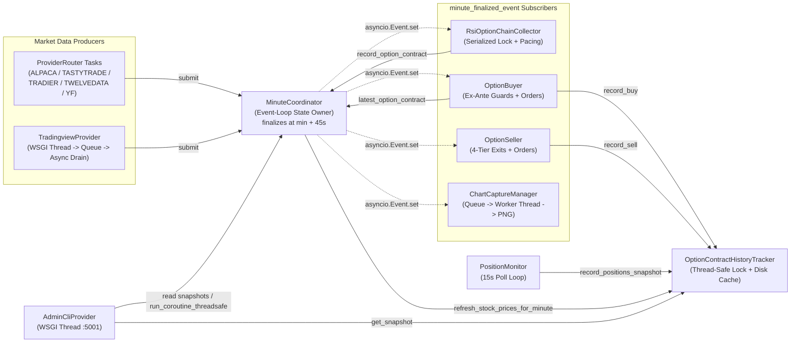
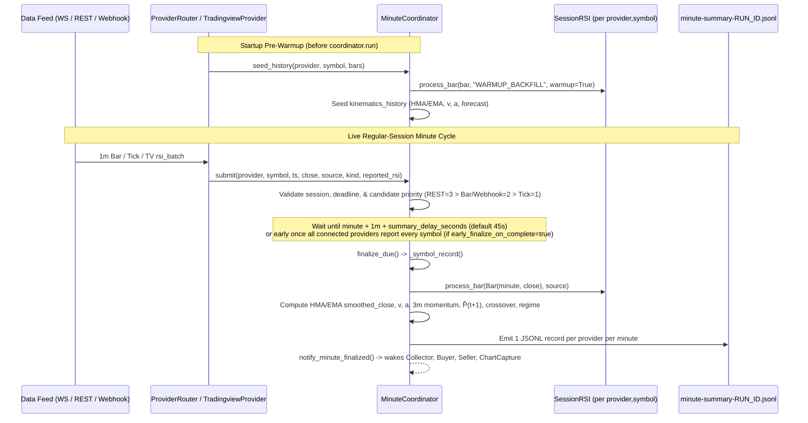
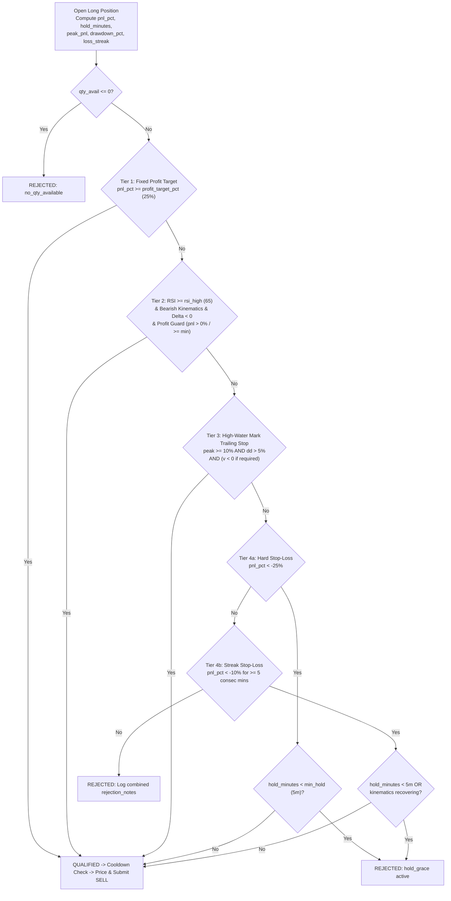

<div align="center">

# JBOA-RSI: Trading Algorithms, Async Architecture & Ex-Ante Risk Engine

**Deep-Dive Quantitative & Systems Reference**

</div>

**Navigation:** [Overview (`README.md`)](../README.md) · [Changelog (`CHANGELOG.md`)](./CHANGELOG.md) · **Trading Algorithms & Risk** · [Option Buyer Guide](./OPTION_BUYER_GUIDE.md) · [Option Seller & Stop-Loss Guide](./OPTION_SELLER_AND_STOP_LOSS_GUIDE.md) · [Frontend Dashboard](./FRONTEND_DASHBOARD.md) · [Deployment & Operations](./DEPLOYMENT_AND_OPERATIONS.md) · [Configuration & API Reference](./CONFIGURATION_AND_API_REFERENCE.md)

---

## Table of Contents

1. [Python Codebase Inventory](#1-python-codebase-inventory)
2. [Async Task Graph and Concurrency Architecture](#2-async-task-graph-and-concurrency-architecture)
3. [Provider Architecture and Strict Broker Routing](#3-provider-architecture-and-strict-broker-routing)
4. [Information Gathering Flows, Data Contents and Downstream Usage](#4-information-gathering-flows-data-contents-and-downstream-usage)
5. [Mathematical Engine: RSI, Smoothing and Kinematics](#5-mathematical-engine-rsi-smoothing-and-kinematics)
6. [Ex-Ante Risk Filters and Exhaustive Rejection Matrix](#6-ex-ante-risk-filters-and-exhaustive-rejection-matrix)
   - [6.1 `OptionBuyer` Pre-Trade Rejection Matrix](#61-optionbuyer-pre-trade-rejection-matrix)
   - [6.2 `OptionSeller` Exit Waterfall and Rejection Matrix](#62-optionseller-exit-waterfall-and-rejection-matrix)
7. [Option Contract Selection, Position Sizing and Lifecycle](#7-option-contract-selection-position-sizing-and-lifecycle)
8. [Strike Selection and Post-Session Winner Analysis (`findthewinners.py` and Built-In Analyzer)](#8-strike-selection-and-post-session-winner-analysis-findthewinnerspy-and-built-in-analyzer)

---

## 1. Python Codebase Inventory

Every `.py` file present in this repository is documented below with its exact responsibilities and dependencies.

| File | Lines | Role & Primary Components | External / Project-Local Imports |
| :--- | :---: | :--- | :--- |
| `multiStreamRSI.py` | 27,233 | Core real-time engine: `SessionRSI`, `TastytradeClient`, `get_pruned_option_chain_tastytrade`, `OptionContractHistoryTracker`, `MinuteCoordinator`, `ProviderRouter`, `TradingviewProvider`, `RsiOptionChainCollector`, `PositionMonitor`, `OptionBuyer`, `OptionSeller`, `ChartCaptureManager` (with pure-Python PNG renderer `render_kinematics_chart_png`), `analyze_option_chain_strikes`, `AdminCliProvider`, `main()`, `handle_cli_command()`. | `aiohttp`, `alpaca-py`, `Flask`, `werkzeug`, `yfinance`, `pandas`, `pandas_market_calendars`, `tzdata`, `lib.utils.JsonIniParser` (`[Not Found in Codebase]`), `lib.getOptionsContracts.get_pruned_option_chain` (`[Not Found in Codebase]`), optional `cryptography` for TLS cert generation. |
| `findthewinners.py` | 4,171 | Standalone CLI post-session option strike evaluator. Parses `logs/optionchains/`, `logs/minute-summary-*.jsonl`, `logs/option_buyer/*.log`, `logs/option_seller/*.log`, fetches 1m option bars from Alpaca or Tastytrade DXLink, evaluates strikes `-2 ITM` through `+4 OTM` across 10 hold-duration buckets (`5m`–`180m`) plus EOD and Peak, evaluates ex-ante selection rules, writes a formatted report to `logs/strike_analysis/winners_<timestamp>.txt`, and prints winning-contract, strategy, and entry-diagnostic summaries. | Stdlib (`argparse`, `configparser`, `urllib`, `zoneinfo`, etc.), optional `pandas_market_calendars`, optional `alpaca-py`, optional `aiohttp` (for Tastytrade DXLink historical bars). |
| `public/assets/aistudio/getOptionsContracts_87f349cc.py` | 216 | Reference implementation of Alpaca's pruned option chain fetcher (`get_pruned_option_chain`, `get_one_contract`). Queries `https://data.alpaca.markets/v1beta1/options/snapshots/{ticker}` with `feed=indicative`, paginates up to 1,000 contracts/page, computes `mid` and `spread_pct`, sorts by proximity to spot ask price, keeps up to 1,000 closest strikes sorted ascending, and returns the **2nd OTM contract** (`otm == 2`) plus JSON snapshot. | Stdlib + `lib.utils` (`extract_strike_price`, `get_current_ask_price`, `get_three_fridays_away` — `[Not Found in Codebase]`). |

> **Runtime Dependency Note:** `multiStreamRSI.py` imports `lib.utils.JsonIniParser` (line 81), `lib.utils.get_three_fridays_away` (line 1030, with an inline fallback if missing), and `lib.getOptionsContracts.get_pruned_option_chain` (line 82). Both `lib/utils.py` and `lib/getOptionsContracts.py` are `[Not Found in Codebase]` in this workspace (the reference copy of `getOptionsContracts` is stored at `public/assets/aistudio/getOptionsContracts_87f349cc.py`).

---

## 2. Async Task Graph and Concurrency Architecture

`multiStreamRSI.py :: main()` (`L26778–27036`) runs a single `asyncio` event loop that owns all shared mutable state (`MinuteCoordinator`) while offloading blocking HTTP/SDK I/O and WSGI servers to threads via `asyncio.to_thread()` or dedicated daemon threads.

### Startup Sequence & Pre-Warmup Barrier

1. **`load_settings()` (`L9657`)** reads `lib/parms.ini` via standard `configparser` (`_apply_ini_feature_settings()` at `L8806`) and a sanitized temporary copy via `JsonIniParser`, populating `selected`, `required`, `symbols`, and `keys`. If `selected` is empty, `main()` exits with code `0`.
2. **`MinuteCoordinator(selected, symbols)` (`L5905`)** initializes per-`(provider, symbol)` `SessionRSI` trackers (excluding `TRADINGVIEW`), `OptionContractHistoryTracker`, pending buffers, and the JSONL summary logger.
3. **`AdminCliProvider(coordinator, host=DASHBOARD_HOST, port=DASHBOARD_PORT)` (`L25475`)** is instantiated before providers so the dashboard can attach to the event loop immediately.
4. **Provider instantiation (`L26800–26814`):** A single `shared_option_chain_client = build_option_chain_client(keys)` is shared across `TradingviewProvider`, `RsiOptionChainCollector`, `OptionBuyer`, and `OptionSeller` so Tastytrade OAuth tokens and nested option-chain caches are reused.
5. **Pre-Warmup Barrier (`L26818–26840`):** Before launching `coordinator.run()`, `main()` executes `await asyncio.gather(*(r.warmup() for r in warmup_routers), return_exceptions=True)` whenever `RSI_WARMUP_SESSIONS > 0`. This guarantees local Wilder RSI averages are converged before the first minute finalization (preventing startup race conditions).
6. **Task Launch & Isolation (`L26843–26952`):** All long-lived tasks are created via `asyncio.create_task()` and awaited with `await asyncio.gather(*tasks)`. Provider and trading tasks are wrapped in `run_provider_isolated(router, coordinator)` (`L26750`), which catches `FatalProviderError` (e.g., HTTP 401/403) or unexpected exceptions, marks the provider disconnected, logs `PROVIDER_DISABLED` / `PROVIDER_CRASHED`, and parks the task on `await asyncio.Event().wait()` so other providers and the dashboard continue running uninterrupted until a `/cli/reconnect` call restarts it.

### Complete Catalog of Async Tasks & OS Threads

| Task / Thread Name | Class & Entrypoint | Execution Model | Wake / Cadence | Primary Responsibility |
| :--- | :--- | :--- | :--- | :--- |
| `MINUTE_COORDINATOR` | `MinuteCoordinator.run()` (`L6839`) | Async task | Sleeps until `next_minute + 1m + SUMMARY_DELAY_SECONDS` (default `+45s`) | Finalizes completed regular-session minutes, runs `SessionRSI`, computes HMA/EMA & kinematics, emits JSONL summary, syncs stock prices to `OptionContractHistoryTracker`, and wakes all `minute_finalized_listeners`. |
| `CLI_ADMIN_PANEL` | `AdminCliProvider.run()` (`L26656`) + daemon thread `ADMIN-CLI-http` | Async task + threaded Werkzeug WSGI server | Continuous HTTP/HTTPS (`0.0.0.0:5001`) | Serves Login/Dashboard HTML, `/api/*`, `/cli/*`, session auth, rate limiting, and TLS termination. Bridges blocking WSGI handlers onto the event loop via `asyncio.run_coroutine_threadsafe()`. |
| `TRADINGVIEW` *(if enabled)* | `TradingviewProvider.run()` (`L11451`) + daemon thread `TRADINGVIEW-webhook` | Async drain loop (`50ms` sleep, up to 100 events/tick) + threaded Werkzeug WSGI server | Continuous HTTP (`127.0.0.1:5000` default) | Validates `/webhook` JSON batches, enqueues to `queue.Queue(maxsize=2000)`, drains events into `coordinator.submit(..., kind="webhook")`. |
| `ALPACA` / `TASTYTRADE` / `TRADIER` / `TWELVEDATA` / `YAHOOFINANCE` *(1 task per enabled feed)* | `ProviderRouter.run()` (`L6925`) -> `run_alpaca` / `run_tastytrade` / `run_websocket` / `run_yfinance` + internal `consume()` task | Async tasks (Alpaca SDK stream runs in worker thread via `asyncio.to_thread` + `call_soon_threadsafe`) | Real-time WS/stream or `YAHOO_POLL_SECONDS` (`30s`) poll | Streams 1m bars/ticks, tracks outages, enqueues missing minutes for serialized REST/DXLink recovery (`consume()`), submits candidates to `MinuteCoordinator`. |
| `POSITION_MONITOR` | `PositionMonitor.run()` (`L12065`) | Async task using `asyncio.to_thread(self.poll)` | Polls every `OPTION_POSITION_POLL_SECONDS` (default `15s`, clamped `5–60s`) | Fetches open positions & account metrics from `transactionprovider`, feeds marks into `OptionContractHistoryTracker.record_positions_snapshot()`, and writes `logs/positions/` snapshots once per minute (or on signature change). |
| `OPTION_BUYER` | `OptionBuyer.run()` (`L13632`) | Async task subscribed to `minute_finalized_event` | Wakes on minute finalization (timeout fallback `minute + 1m + delay + 1s`) | Evaluates every configured symbol's kinematics & ex-ante risk rules; fetches/reads cached 2nd-OTM Call contract; validates spread; executes Dry-Run or Live/Paper Buy order. |
| `OPTION_SELLER` | `OptionSeller.run()` (`L15305`) | Async task subscribed to `minute_finalized_event` | Wakes on minute finalization (timeout fallback `minute + 1m + delay + 1s`) | Fetches all open broker positions; updates high-water mark & stop-loss streak trackers; evaluates 4-tier exit waterfall; submits Dry-Run or Live/Paper Sell order; spawns background exit option-chain capture. |
| `OPTION_CHAIN_COLLECTOR` | `RsiOptionChainCollector.run()` (`L11866`) | Async task subscribed to `minute_finalized_event` | Wakes on minute finalization; serialized via `asyncio.Lock` + `chain_pacing_seconds` (`0.20s`) | Checks every symbol's highest-priority provider RSI against `<= OPTION_CHAIN_RSI_LOW` (BUY) or `>= OPTION_CHAIN_RSI_HIGH` (SELL); enforces cooldown & HTTP 429 backoff; writes `logs/optionchains/*.json` and populates `coordinator.option_chain_cache`. |
| `OPTION_HISTORY_BACKFILL` | `OptionContractHistoryTracker.startup_backfill()` (`L4922`) | One-shot startup async task (`asyncio.to_thread`) | Runs once at startup (also re-triggerable via `POST /api/option-history/refresh`) | Reconstructs open/closed option trade histories from broker positions/orders, historical 1m option/stock bars, disk caches, and local log replay. |
| `CHART_CAPTURE` | `ChartCaptureManager.run()` (`L18198`) + daemon thread `CHART_CAPTURE-worker` | Async coordinator + dedicated OS worker thread (`queue.Queue(maxsize=32)`) | Wakes on minute finalization or CLI start/stop signal | Renders pure-Python RGBA 3-panel PNGs (`1440×860` default) to `logs/charts/<SYMBOL>/` atomically when live data is fresh (`<= 180s`) and updated. |
| `TTY-CLI` *(only when `sys.stdin.isatty()`)* | `_tty_cli_reader()` (`L26961`) | Daemon thread | Blocking `sys.stdin.readline()` | Interactive console commands (`chart-capture start|stop|status`, `status`, `help`). Disabled under systemd/daemons. |

### Async Task Coordination Diagram



---

## 3. Provider Architecture and Strict Broker Routing

### Market-Signal Providers (`[market_signal_providers]` in `lib/parms.ini`)

Provider startup is controlled exclusively by `[market_signal_providers] <NAME>.enabled` (`load_settings()` `L9693–9708`). Disabled providers are never instantiated. When multiple providers report for the same symbol, `[market_signal_providers] priority` determines the preferred kinematics source (`_select_best_kinematics_entry()`). Default priority (`L113`):

```
TRADINGVIEW > ALPACA > TASTYTRADE > TRADIER > TWELVEDATA > YAHOOFINANCE
```

| Provider | Transport & Endpoints | Warmup / History Mechanism | Live Bar / Tick Handling |
| :--- | :--- | :--- | :--- |
| **`TRADINGVIEW`** | Dedicated Flask WSGI server (`WEBHOOK_HOST:WEBHOOK_PORT`, default `127.0.0.1:5000`) accepting `POST /webhook`. | Never locally warmed (`rsi_source="webhook_reported"`). Uses TradingView-computed RSI directly. | `validate_tradingview_payload()` (`L10314`) parses `rsi_batch` envelopes (`data`/`symbols`/`items`/`records`/`bars`), single-symbol objects, or arrays. Validates `timeframe == "1m"`, `bar_closed == true`, regular session, and `0 <= rsi <= 100`. |
| **`ALPACA`** | `StockDataStream` (`DataFeed.IEX` or `DataFeed.SIP`) + `StockHistoricalDataClient` (`Adjustment.SPLIT`). | `alpaca_history()` (`L6985`) fetches 1m bars via `StockBarsRequest(timeframe=TimeFrame.Minute, feed=FEED, adjustment=Adjustment.SPLIT)`. | Subscribes to 1m bars via `subscribe_bars(on_bar, *symbols)` inside `asyncio.to_thread(stream.run)` (`L7495`), marshaling bars onto the main loop with `call_soon_threadsafe`. |
| **`TASTYTRADE`** | Dual-client Prod DXLink architecture (`ProviderRouter.run_tastytrade()` `L8173` & `_dxlink_fetch_candles_batch()` `L8015`) using Prod OAuth2 (`/oauth/token`) and `GET /api-quote-tokens`. | **DXLink Client #1 (Historical):** Opens fresh WebSocket(s) in **10-symbol chunks**, sends `FEED_SETUP` with `acceptAggregationPeriod: 0.0` (critical so DXLink streams historical ticks without throttling), subscribes to `Candle{=1m}` with `fromTime` spanning prior sessions, and waits until `SNAPSHOT_END` or `idle_timeout=4.0s`. Logs `DXLINK_HISTORY_INCOMPLETE` if chunk returns fewer bars than expected. | **DXLink Client #2 (Live):** Persistent WebSocket subscribing to `Candle{=1m}` (`fromTime = now - 5m`). Sends `KEEPALIVE` every 30s (`_dxlink_keepalive`). Normalizes `Candle` timestamps, skips `REMOVE_EVENT`/`SNAPSHOT_END` flags, and submits closed 1m bars to `MinuteCoordinator`. |
| **`TRADIER`** | REST `https://api.tradier.com/v1/markets/timesales` + Session `POST https://api.tradier.com/v1/markets/events/session` + WS `wss://ws.tradier.com/v1/markets/events`. | `fetch_history()` (`L7115`) queries 1m `timesales` per symbol with `session_filter="all"` (extended) or `"open"` (regular). | Streams trade ticks (`type == "trade"`), maps `date` ms epoch to minute, submits as `kind="tick"`. |
| **`TWELVEDATA`** | REST `https://api.twelvedata.com/time_series` + WS `wss://ws.twelvedata.com/v1/quotes/price`. | `fetch_history()` (`L7096`) fetches `interval=1min`, `outputsize=5000`, `prepost=true` (extended). | Streams price ticks (`event == "price"`), sends heartbeat every 10s (`td_heartbeat()` `L7590`), submits as `kind="tick"`. |
| **`YAHOOFINANCE`** | `yfinance.download(..., interval="1m", prepost=...)` (`_yf_history()` `L6999`). | Fetches 1m history in chunks (`<= 7` calendar days per call due to Yahoo 1m window limit). | Polls every `YAHOO_POLL_SECONDS` (default `30s`) inside `run_yfinance()` (`L7555`), submitting latest completed bars. |

### Strict Zero-Fallback Option & Execution Broker Routing

Option chain retrieval and order/position execution are decoupled via `[option_trading]`:

* **`optionchainprovider` (`alpaca` | `tastytrade`):** Determines which API fetches pruned option chains for `RsiOptionChainCollector`, `OptionBuyer`, and `OptionSeller` exit captures.
* **`transactionprovider` (`alpaca` | `tastytrade`):** Determines which broker manages accounts, positions, live option quotes, and order submission (`PositionMonitor`, `OptionBuyer`, `OptionSeller`, `OptionContractHistoryTracker`).
* **Smart Default Inference (`L8869–8881`):** If neither `[option_trading]` nor env vars explicitly pin a provider and `TASTYTRADE.enabled=true` while `ALPACA.enabled=false`, both default to `"tastytrade"`; otherwise `"alpaca"`.
* **Tastytrade Dual-Environment Split (`TastytradeClient` `L1042`):**
  * **Market Data & Quotes:** **ALWAYS** execute against **Production** (`https://api.tastyworks.com`) using `prod_client_secret` + `prod_refresh_token` (`/market-data/by-type`, `/option-chains/{sym}/nested`, `/api-quote-tokens`, DXLink Greeks/Candles).
  * **Transactions (Accounts, Positions, Orders, Dry-Runs):** Execute strictly against `transaction_env` (`sandbox` -> `https://api.cert.tastyworks.com` OR `prod` -> `https://api.tastyworks.com`), with **zero fallback** between sandbox, prod, or Alpaca.
  * **Credential Validation (`L9871–9908`):** `load_settings()` fails fast at startup if required Prod/Sandbox credentials for the selected `optionchainprovider` or `transactionprovider` are missing.

---

## 4. Information Gathering Flows, Data Contents and Downstream Usage

### 4.1 Equity 1-Minute Bar & RSI Flow



* **Candidate Deduplication Priority (`MinuteCoordinator.submit()` `L6265`):** Within an unfinalized minute bucket `(provider, symbol, minute)`:
  * `REST_BACKFILL` (`priority = 3`) > `bar` / `webhook` (`priority = 2`) > `tick` (`priority = 1`).
  * Among equal priorities, later `event_time` wins.
  * **Configurable Finalization Deadline & Optional Early Finalization:** `[kinematics] summary_delay_seconds` (default `45.0`s, env `SUMMARY_DELAY_SECONDS`) sets the hard safety deadline (`minute + 1m + delay`). When `[kinematics] early_finalize_on_complete = true`, `MinuteCoordinator._can_finalize_early()` finalizes immediately once `early_finalize_min_delay_seconds` (default `2.0`s) has elapsed after `:00` **and** every currently connected provider (excluding `TRADINGVIEW` outside RTH) has a closed `bar`/`webhook` (or subsequent-minute rollover tick for streaming feeds like Tastytrade DXLink) for every configured symbol. Any record arriving after finalization (or past the safety deadline) is counted in `late_counts[provider]` and **rejected** — finalized minutes are strictly immutable.
* **Contents of `minute-summary-<RUN_ID>.jsonl`:** One compact JSON object per `(provider, minute)` containing `minute_utc`, `provider`, `finalized_early`, `connected`, `late_count`, and a `symbols` map where each symbol includes `close`, `rsi`, `rsi_source`, `rsi_session_mode`, `rsi_converged`, `rsi_total_changes`, `rsi_warmup_bars`, `observed_closes`, `expected_minutes`, `missing_minutes`, `status` (`ok`, `warming_up`, `missing`, `partial`, `rsi_unavailable`), `signal` (`buy`/`sell`/`null`), `smoothed_close`, `smoothed_velocity`, `smoothed_acceleration`, `price_velocity`, `price_velocity_pct`, `price_acceleration`, `price_acceleration_pct`, `rsi_velocity`, `rsi_acceleration`, `momentum_3m_pct`, `projected_price_next`, `projected_delta`, `projected_delta_pct`, `rsi_zone`, `forecast_direction`, `trading_action`, `crossover_signal`, and `regime`.
* **Downstream Usage:** Feeds the live dashboard (`/api/kinematics`, `/api/minute-summaries`), drives `RsiOptionChainCollector`, `OptionBuyer`, `OptionSeller`, `ChartCaptureManager`, and serves as the historical kinematics index for `findthewinners.py`.

### 4.2 Option Chain Snapshot Collection Flow

* **Collectors:**
  1. `RsiOptionChainCollector` (`L11529`) on every finalized minute when highest-priority provider RSI triggers `rsi <= OPTION_CHAIN_RSI_LOW` (`35.0`) or `rsi >= OPTION_CHAIN_RSI_HIGH` (`65.0`).
  2. `OptionBuyer` fallback fetch (`L13030`) when `fetch_if_missing=true` and `coordinator.latest_option_contract(symbol, max_age_seconds=180)` is empty/stale.
  3. `OptionSeller._capture_exit_option_chain_sync()` (`L13776`) asynchronously on every sell execution (and once per symbol in dry-run) for the exact held contract's expiration and right, tagged with `exit_contract`, `exit_trigger`, and `sell_utc_timestamp`.
* **Contents Collected (`logs/optionchains/optionchain-*.json`):**
  * Envelope: `underlying`, `provider`, `expiration_date`, `option_type` (`call`/`put`), `spot_ask_price`, `timestamp`, `utc_timestamp`, `chain_snapshot` (array of strikes sorted ascending).
  * Per-strike record: `contract` (compact OCC), `strike`, `bid`, `ask`, `mid`, `spread_pct`, `last_price`, `delta`, `gamma`, `theta`, `vega`, `iv`, `volume`, `open_interest`, `distance_from_spot`.
* **Downstream Usage:** Cached in `MinuteCoordinator.option_chain_cache` for `OptionBuyer` order contract resolution; persisted to disk for `analyze_option_chain_strikes()` (`/api/strike-analysis`) and `findthewinners.py`.

### 4.3 Position, Order & Option Mark History Flow

* **Collectors:**
  1. `OptionContractHistoryTracker.startup_backfill()` (`L4922`) on startup (and manual `POST /api/option-history/refresh`) merges broker open positions, closed filled orders, 1m historical option bars (Alpaca OptionHistoricalDataClient / REST or Tastytrade Prod DXLink), 1m underlying stock bars, persisted JSON caches (`logs/option_history_state_<scope>.json`, `logs/option_history_prices_<scope>.json`), and local log replay (`logs/positions/*.log`, `logs/option_seller/*.log`).
  2. `PositionMonitor.poll()` (`L11991`) runs every `OPTION_POSITION_POLL_SECONDS` (default `15s`), fetching broker account & positions and invoking `option_history.record_positions_snapshot()`.
  3. `OptionBuyer` & `OptionSeller` record fills via `record_buy()`, `record_sell()`, and `schedule_order_fill_refresh()` (polling broker order status until `filled_avg_price` settles).
* **Downstream Usage:** Powers the Option Buyer/Seller cards and interactive Open/Closed Contract Drill-Down Modal (`/api/option-history`), supplies entry timestamps (`first_seen_at_by_symbol`) for `min_hold_minutes`, and persists across restarts scoped by `<provider>_<env>` (e.g., `alpaca_paper`, `tastytrade_sandbox`).

---

## 5. Mathematical Engine: RSI, Smoothing and Kinematics

All formulas below are cited directly from `multiStreamRSI.py`.

### 5.1 Session RSI (`multiStreamRSI.py :: SessionRSI.process_bar()`, `L640–709`)

Default configuration: `MODE = "wilder"`, `RSI_PERIOD = 14`, `cross_session = True`, `RSI_SESSION_MODE = "extended"` (`04:00–20:00 ET`) or `"regular"` (`09:30–16:00 ET`).

For each minute-aligned close $C_t > 0$ after the first close $C_0$:

$$\Delta C_t = C_t - C_{t-1}, \qquad G_t = \max(\Delta C_t, 0), \qquad L_t = \max(-\Delta C_t, 0)$$

* **Wilder Initialization** (at change count $n = P = 14$):
  $$\overline{G}_{14} = \frac{1}{P} \sum_{i=1}^{P} G_i, \qquad \overline{L}_{14} = \frac{1}{P} \sum_{i=1}^{P} L_i$$
* **Wilder Recursion** (for $n > P$):
  $$\overline{G}_t = \frac{\overline{G}_{t-1} \cdot (P - 1) + G_t}{P}, \qquad \overline{L}_t = \frac{\overline{L}_{t-1} \cdot (P - 1) + L_t}{P}$$
* **RSI Mapping** (`L702–708`):
  $$\text{RSI}_t = \begin{cases} 50.0 & \text{if } \overline{G}_t = 0 \text{ and } \overline{L}_t = 0 \\ 100.0 & \text{if } \overline{L}_t = 0 \\ 100.0 - \dfrac{100.0}{1.0 + \overline{G}_t / \overline{L}_t} & \text{otherwise} \end{cases}$$
* **Cross-Session Rollover (`begin_session()`, `L615–639`):** When `cross_session=True` and `average_gain is not None`, entering a new NYSE trading day preserves `previous_close`, `average_gain`, `average_loss`, and `changes` so the first bar captures the overnight gap identically to TradingView's continuous series.

### 5.2 Price Smoothing (`multiStreamRSI.py :: compute_wma / compute_ema / compute_hma / compute_smoothed_series`, `L356–408`)

Applied over the trailing 120 closes plus current close (`MinuteCoordinator._symbol_record()` `L6593`) with configurable `KINEMATICS_SMOOTH_METHOD` (`hma` default, `ema`, or `none`) and `KINEMATICS_SMOOTH_PERIOD` ($n = 14$ default, $\ge 2$):

* **Weighted Moving Average (`compute_wma`, `L356`):** Over window of length $k = \min(n, i+1)$:
  $$\text{WMA}_t(x, n) = \frac{\sum_{j=1}^{k} j \cdot x_{t-k+j}}{k(k+1)/2}$$
* **Exponential Moving Average (`compute_ema`, `L371`):** With $\alpha = \frac{2}{n+1}$, $\text{EMA}_0 = x_0$:
  $$\text{EMA}_t = \alpha \cdot x_t + (1 - \alpha)\cdot \text{EMA}_{t-1}$$
* **Hull Moving Average (`compute_hma`, `L383`):** With $n_{\text{half}} = \max(1, \lfloor n/2 \rfloor)$ and $n_{\sqrt{}} = \max(1, \text{round}(\sqrt{n}))$:
  $$\text{HMA}_t(x, n) = \text{WMA}\!\left(2 \cdot \text{WMA}(x, n_{\text{half}}) - \text{WMA}(x, n),\; n_{\sqrt{}}\right)$$

### 5.3 Velocity, Acceleration & Multi-Period Momentum (`MinuteCoordinator._symbol_record()`, `L6541–6606`)

Let $S_t = \text{smoothed\_close}_t$ (rounded to 4 decimals):

* **Smoothed Price Kinematics (Primary input to Forecast, Buyer, and Seller):**
  $$v^{\text{smooth}}_t = S_t - S_{t-1}, \qquad a^{\text{smooth}}_t = v^{\text{smooth}}_t - (S_{t-1} - S_{t-2})$$
* **Raw Price Kinematics (Fallback when smoothed unavailable):**
  $$v^{\text{price}}_t = C_t - C_{t-1}, \qquad v^{\text{price}\%}_t = \frac{C_t - C_{t-1}}{C_{t-1}} \times 100, \qquad a^{\text{price}}_t = v^{\text{price}}_t - v^{\text{price}}_{t-1}$$
* **RSI Kinematics (Primary input to 4-Quadrant Phase Matrix):**
  $$v^{\text{rsi}}_t = \text{RSI}_t - \text{RSI}_{t-1}, \qquad a^{\text{rsi}}_t = v^{\text{rsi}}_t - v^{\text{rsi}}_{t-1}$$
* **3-Minute Momentum:**
  $$v^{\text{price, 3m}\%}_t = \frac{C_t - C_{t-3}}{C_{t-3}} \times 100, \qquad v^{\text{rsi, 3m}}_t = \text{RSI}_t - \text{RSI}_{t-3}$$

### 5.4 Next-Step Projection, Crossovers & Forecast Matrix (`compute_kinematic_forecast()`, `L429–528`)

Using active velocity $v_t = v^{\text{smooth}}_t$ (fallback $v^{\text{price}}_t$) and active acceleration $a_t = a^{\text{smooth}}_t$ (fallback $a^{\text{price}}_t$, or $0$ if unavailable):

* **Second-Order Taylor / Kinematic Projection (`L460–464`):**
  $$\Delta \hat{P}_t = v_t + \frac{1}{2} a_t, \qquad \hat{P}_{t+1} = C_t + \Delta \hat{P}_t, \qquad \Delta \hat{P}\%_t = \frac{\Delta \hat{P}_t}{C_t} \times 100$$
* **Zero-Line Crossover Detection (`L466–488`):**
  * `confirmed_bearish`: $v_{t-1} \ge 0 \;\land\; v_t < 0$
  * `confirmed_bullish`: $v_{t-1} \le 0 \;\land\; v_t > 0$
  * `leading_bearish` *(if no velocity crossover)*: $a_{t-1} \ge 0 \;\land\; a_t < 0 \;\land\; (v_t \text{ is None} \lor v_t > 0)$
  * `leading_bullish` *(if no velocity crossover)*: $a_{t-1} \le 0 \;\land\; a_t > 0 \;\land\; (v_t \text{ is None} \lor v_t < 0)$
* **RSI Boundary Zones (`classify_rsi_zone()`, `L410–426`):**
  * `overbought` ($\text{RSI} \ge 70$), `upper_expansion` ($60 < \text{RSI} < 70$), `neutral_band` ($40 \le \text{RSI} \le 60$), `lower_expansion` ($30 < \text{RSI} < 40$), `oversold` ($\text{RSI} \le 30$).
* **Forecast Direction & Trading Action Matrix (`L494–518`):**

| Condition ($v_t$, $a_t$, $\text{RSI}_t$) | `forecast_direction` | `trading_action` |
| :--- | :--- | :--- |
| $v > 0 \;\land\; a < 0 \;\land\; \text{RSI} \ge \text{OB}$ (`70`) | `bearish_reversal` | `Prepare to Short / Exit Longs` |
| $v < 0 \;\land\; a > 0 \;\land\; \text{RSI} \le \text{OS}$ (`30`) | `bullish_reversal` | `Prepare to Buy / Exit Shorts` |
| $v > 0 \;\land\; a > 0 \;\land\; 40 \le \text{RSI} \le 60$ | `bullish_continuation` | `Hold Long / Trend Follow` |
| $v < 0 \;\land\; a < 0 \;\land\; 40 \le \text{RSI} \le 60$ | `bearish_continuation` | `Hold Short / Trend Follow` |
| $v > 0 \;\land\; a > 0 \;\land\; 60 < \text{RSI} < \text{OB}$ | `bullish_momentum` | `Trail Long / Watch 70 Friction` |
| $v < 0 \;\land\; a < 0 \;\land\; \text{OS} < \text{RSI} < 40$ | `bearish_momentum` | `Trail Short / Watch 30 Support` |
| $v > 0 \;\land\; a < 0$ (other RSI) | `bullish_decelerating` | `Tighten Stops / Watch Crossover` |
| $v < 0 \;\land\; a > 0$ (other RSI) | `bearish_decelerating` | `Watch for Bottom Crossover` |
| Otherwise | `neutral` | `Hold / Monitor` |

### 5.5 4-Quadrant Phase Regime Classifier (`classify_kinematic_regime()`, `L531–561`)

Prioritizes RSI velocity/acceleration (`rsi_velocity`, `rsi_acceleration`) and falls back to price velocity/acceleration when `rsi_velocity` is `None`:

* `accelerating_bullish`: $v > 0 \;\land\; a > 0$
* `decelerating_bullish`: $v > 0 \;\land\; (a \le 0 \lor a \text{ is None})$
* `accelerating_bearish`: $v < 0 \;\land\; a < 0$
* `decelerating_bearish`: $v < 0 \;\land\; (a \ge 0 \lor a \text{ is None})$
* `neutral`: $v = 0$ or unavailable.

### 5.6 Indicators Explicitly Absent from Codebase

* **MACD / Signal Line / Histogram:** `[Not Found in Codebase]` (zero references in `multiStreamRSI.py` and `findthewinners.py`).
* **Swing High / Swing Low Peak-Trough Pivot Detection:** `[Not Found in Codebase]` (inflections are detected via zero-line crossovers of $v_t$ and $a_t$, while position peak tracking uses session high-water-mark P/L% in `OptionSeller._update_peak_profit_state()`).

---

## 6. Ex-Ante Risk Filters and Exhaustive Rejection Matrix

Every pre-trade guardrail in `OptionBuyer` and every exit/hold guardrail in `OptionSeller` is logged to `logs/option_buyer/*.log` (`OPTION_BUY_ANALYSIS`) and `logs/option_seller/*.log` (`OPTION_SELL_ANALYSIS`).

### 6.1 `OptionBuyer` Pre-Trade Rejection Matrix

**Qualifying Buy Condition (`_evaluate_kinematics()`):**
A symbol qualifies for a `CALL` buy only after passing the optional US/Eastern time window (`entry_window_start_et`..`entry_window_end_et`), passing the RSI / oversold bounce-lookback gate, and satisfying the configured `[option_buyer] entry_mode`:

* **Default Mode (`entry_mode = kinematics_forecast`):** Requires at least one positive kinematic trigger plus optional Taylor projection alignment ($\Delta\hat{P} > 0$):
  1. `vel > 0 and acc > 0` (`bullish_thrust`), OR
  2. `not require_pos_vel and vel < 0 and acc > 0` (`oversold_decel_bottom` / allowed forecast), OR
  3. `crossover in {"leading_bullish", "confirmed_bullish"} and acc >= 0 and (not require_pos_vel or vel > 0)`, OR
  4. `forecast in OPTION_BUY_ALLOWED_FORECASTS and acc > 0 and (not require_pos_vel or vel > 0)`.
  *(Where `require_pos_vel = OPTION_BUY_REQUIRE_POSITIVE_VELOCITY or used_lookback`.)*
* **Forecast-Independent Ex-Ante Mode (`entry_mode = rsi_ex_ante`):** Eliminates dependence on the 1-minute Taylor forecast (`forecast_direction` and `projected_delta > 0`). Qualifies whenever RSI is oversold (`rsi <= rsi_low`) or in a confirmed oversold bounce lookback (`used_lookback` with `vel > 0`), while still respecting `require_positive_velocity` (when `true`) and blocking accelerating freefalls (`vel < 0 and acc <= 0`) when `require_positive_velocity = false`.

| Rejection Code / Reason | Exact Boolean Condition in Code | Source File & Function | Trading Rationale |
| :--- | :--- | :--- | :--- |
| `max_buys_per_minute_reached(X/Y)` | `OPTION_BUY_MAX_BUYS_PER_MINUTE > 0 and buys_this_cycle >= OPTION_BUY_MAX_BUYS_PER_MINUTE` | `multiStreamRSI.py :: OptionBuyer.evaluate_and_buy()` (`L12883`) | Prevents simultaneous correlated entries during market-wide dips (default `1` buy/min). |
| `already_attempted_minute` *(SKIPPED)* | `(symbol, minute_key) in self.attempted_minutes` | `multiStreamRSI.py :: OptionBuyer.evaluate_and_buy()` (`L12906`) | Idempotency guard preventing duplicate evaluation/orders for the same symbol in the same finalized minute. |
| `no_kinematics_entry` | `not entry` | `multiStreamRSI.py :: OptionBuyer.evaluate_and_buy()` | Blocks trading when no provider has finalized bar data for the symbol. |
| `outside_entry_window_et(et=HH:MM,window=START-END)` | `entry_window_start_et` or `entry_window_end_et` is configured and bar ET clock time falls outside `[start, end]` | `multiStreamRSI.py :: _is_within_entry_window_et()` & `OptionBuyer._evaluate_kinematics()` | Optional time-of-day guardrail to avoid opening-bell whipsaws or late-day theta crush. |
| `no_entry` / `rsi_unavailable(...)` / `rsi_invalid` / `rsi_nonfinite` | `raw_rsi is None or isinstance(raw_rsi, bool)` or non-finite float | `multiStreamRSI.py :: OptionBuyer._evaluate_kinematics()` | Prevents buying before RSI(14) has warmed up or when feed data is malformed. |
| `rsi_above_buy_threshold(rsi=X>LOW,no_oversold_in_Nm)` | `rsi > OPTION_CHAIN_RSI_LOW` and (`OPTION_BUY_OVERSOLD_LOOKBACK_MINUTES > 0` and `rsi <= bounce_rsi_cap` but `_find_recent_oversold_entry()` is `None`) | `multiStreamRSI.py :: OptionBuyer._evaluate_kinematics()` (`L12609–12622`) | Rejects neutral/overbought entries unless an oversold bar (`<= 35`) occurred within the last `3m` bounce lookback window. |
| `rsi_above_buy_threshold(rsi=X>LOW)` | `rsi > OPTION_CHAIN_RSI_LOW` and (`lookback == 0` or `rsi > max(OPTION_CHAIN_RSI_LOW, OPTION_BUY_BOUNCE_RSI_MAX)`) | `multiStreamRSI.py :: OptionBuyer._evaluate_kinematics()` (`L12629–12634`) | Hard cap (`bounce_rsi_max`, default `45.0`) prevents chasing bounces that have already moved too far off oversold levels. |
| `kinematics_unavailable(no_v_or_a)` / `kinematics_warming(v=...,a=n/a)` / `kinematics_unavailable(v=n/a)` / `kinematics_invalid` / `kinematics_nonfinite` | `raw_vel is None` or `raw_acc is None` or non-finite | `multiStreamRSI.py :: OptionBuyer._evaluate_kinematics()` (`L12646–12664`) | Ensures both 1st derivative ($v$) and 2nd derivative ($a$) are computed before evaluating entry timing. |
| `bounce_velocity_not_positive(...)` | `used_lookback and vel <= 0` | `multiStreamRSI.py :: OptionBuyer._evaluate_kinematics()` (`L12670`) | Confirmed bounce entries after an oversold lookback ALWAYS require positive upward velocity ($v > 0$). |
| `velocity_not_positive(...)` | `OPTION_BUY_REQUIRE_POSITIVE_VELOCITY and vel <= 0` | `multiStreamRSI.py :: OptionBuyer._evaluate_kinematics()` (`L12678`) | Avoids catching a falling knife while smoothed price velocity is still downward (default `true`). |
| `kinematics_unfavorable[v<=0, a<=0(no_upward_accel), cross=..., forecast=...]` | None of the 4 bullish kinematic trigger branches matched (`reason is None`) | `multiStreamRSI.py :: OptionBuyer._evaluate_kinematics()` (`L12709–12725`) | Requires positive upward acceleration ($a > 0$) or a bullish zero-line crossover so entries align with upward inflection rather than fading momentum. |
| `projection_misaligned(CALL,delta=X)` | `OPTION_BUY_REQUIRE_PROJECTION_ALIGNMENT and proj_delta is not None and float(proj_delta) <= 0` | `multiStreamRSI.py :: OptionBuyer._evaluate_kinematics()` (`L12727–12735`) | Verifies next-step Taylor projection $\Delta\hat{P} = v + \frac{1}{2}a > 0$ agrees with long Call direction. |
| `cooldown_active` | `last_buy is not None and OPTION_BUY_COOLDOWN_MINUTES > 0 and (now - last_buy) < cooldown * 60` | `multiStreamRSI.py :: OptionBuyer.evaluate_and_buy()` (`L12952`) | Prevents rapid re-entry churn on the same underlying (default `15` minutes). |
| `positions_check_failed(Exc)` | Exception from `client.get_all_positions()` | `multiStreamRSI.py :: OptionBuyer.evaluate_and_buy()` (`L12972–12989`) | Fails closed: never buys if current broker exposure cannot be verified. |
| `max_open_contracts(N/MAX)` | `open_option_count >= OPTION_BUY_MAX_OPEN_CONTRACTS` | `multiStreamRSI.py :: OptionBuyer.evaluate_and_buy()` (`L12991`) | Portfolio-level cap on concurrent open option positions (default `5`). |
| `underlying_option_already_held` | `not OPTION_BUY_ALLOW_DUPLICATE_UNDERLYING and symbol in open_underlyings` | `multiStreamRSI.py :: OptionBuyer.evaluate_and_buy()` (`L13008`) | Prevents doubling down on the same underlying ticker (default `false`). |
| `missing_tastytrade_prod_credentials` / `missing_alpaca_credentials` / `option_chain_failed(...)` | Fallback chain fetch fails or credentials absent | `multiStreamRSI.py :: OptionBuyer.evaluate_and_buy()` (`L13038–13141`) | Strict zero-fallback protection: refuses to guess a contract if the configured chain provider fails. |
| `no_option_contract(...)` / `no_contract_from_collect_option_chain` / `unparseable_contract(...)` | `contract is None` or no valid OCC symbol extracted | `multiStreamRSI.py :: OptionBuyer.evaluate_and_buy()` | Blocks malformed or missing OCC symbols before order construction. |
| `no_candidate_matched(mode=...,...)` | `OPTION_BUY_CONTRACT_SELECTION_MODE != "plus2_otm"` and zero contracts in `chain_snapshot` pass hard spread, liquidity (OI/volume), budget, and mode criteria | `multiStreamRSI.py :: _select_ex_ante_option_contract()` & `OptionBuyer.evaluate_and_buy()` | Prevents forcing an entry when no strike in the live chain satisfies the configured ex-ante strike, spread, liquidity, or capital constraints. |
| `right_mismatch(expected=CALL,got=PUT)` | `OPTION_BUY_REQUIRE_RIGHT_MATCH and inferred_right is not None and inferred_right != desired_right` | `multiStreamRSI.py :: OptionBuyer.evaluate_and_buy()` | Guarantees a bullish signal never accidentally buys a PUT contract. |
| `contract_already_held` | `contract_symbol in open_contracts` | `multiStreamRSI.py :: OptionBuyer.evaluate_and_buy()` (`L13217`) | Blocks duplicate orders for an already-held exact OCC contract. |
| `spread_too_wide(X%>MAX%)` | `OPTION_BUY_MAX_SPREAD_PCT > 0 and ((ask - bid) / mid) * 100 > OPTION_BUY_MAX_SPREAD_PCT` | `multiStreamRSI.py :: OptionBuyer.evaluate_and_buy()` (`L13265–13288`) | Liquidity & slippage guard: rejects illiquid options whose bid/ask spread exceeds `5.0%` (default). |
| `missing_quote_for_spread_check(bid=...,ask=...)` | `OPTION_BUY_MAX_SPREAD_PCT > 0` and valid positive `bid <= ask` unavailable | `multiStreamRSI.py :: OptionBuyer.evaluate_and_buy()` (`L13289–13306`) | Fails closed when live bid/ask cannot be verified for spread protection. |
| `exceeds_max_single_trade` / `insufficient_investable_budget` / `budget_price_unavailable` | `_calculate_budget_scaled_qty()` yields `effective_qty < 1` because even `1` contract (`unit_price × 100`) exceeds `[option_buyer] max_single_trade_dollars` (default `$8,000`) or the remaining buffer-withheld investable budget (`max(0, min(raw_available, (raw_available + invested) × (1 - withhold_pct/100) - invested)) - spent_this_cycle`) | `multiStreamRSI.py :: _calculate_budget_scaled_qty()` & `OptionBuyer.evaluate_and_buy()` | Enforces single-trade dollar ceiling and reserve cash buffer (default `10%`). When `desired_qty > 1` exceeds either limit, automatically scales down to the largest whole integer `qty >= 1` that fits instead of rejecting. |

---

### 6.2 `OptionSeller` Exit Waterfall and Rejection Matrix

On each finalized minute, `OptionSeller.evaluate_and_sell()` (`L14514`) evaluates every open long position through a **strict 4-tier priority waterfall** (the first tier that qualifies triggers the exit):



#### Exhaustive Seller Guardrails & Rejection Codes

| Rejection / Hold / Skip Code | Exact Boolean Condition in Code | Source File & Function | Trading Rationale |
| :--- | :--- | :--- | :--- |
| `no_open_positions` *(SKIPPED)* | `not positions` | `multiStreamRSI.py :: OptionSeller.evaluate_and_sell()` (`L14563`) | Nothing to liquidate; clears stale stop-loss and peak-profit trackers. |
| `non_long_position(side=...,qty=...)` *(SKIPPED)* | `raw_qty <= 0 or side == "short"` | `multiStreamRSI.py :: OptionSeller.evaluate_and_sell()` (`L14603`) | Seller only exits long positions; ignores short legs or zero-qty rows. |
| `options_only_equity_ignored` *(SKIPPED)* | `OPTION_SELL_OPTIONS_ONLY and not is_option` | `multiStreamRSI.py :: OptionSeller.evaluate_and_sell()` (`L14618`) | Optional filter to prevent selling equity holdings in mixed accounts. |
| `already_attempted_minute` *(SKIPPED)* | `(pos_sym, minute_key) in self.attempted_minutes` | `multiStreamRSI.py :: OptionSeller.evaluate_and_sell()` (`L14670`) | Prevents duplicate sell submissions within the same minute. |
| `no_qty_available(qty_avail=X)` | `qty_avail is not None and qty_avail <= 0` | `multiStreamRSI.py :: OptionSeller.evaluate_and_sell()` (`L14687`) | Avoids broker rejection when contracts are already locked by a pending open sell order. |
| `pt=X%<TARGET%` *(Tier 1 note)* | `pnl_pct < OPTION_SELL_PROFIT_TARGET_PCT` (default `25.0%`) | `multiStreamRSI.py :: OptionSeller.evaluate_and_sell()` (`L14712–14731`) | Profit target not yet reached; falls through to Tier 2. |
| `rsi_below_sell_threshold(rsi=X<HIGH)` *(Tier 2)* | `rsi < OPTION_CHAIN_RSI_HIGH` (default `65.0`) | `multiStreamRSI.py :: OptionSeller._evaluate_sell_kinematics()` (`L13943`) | Does not take kinematic profit before underlying reaches overbought threshold. |
| `kinematics_unfavorable[still_accelerating_up \| downside_decelerating \| flat_or_rising_accel, ...]` *(Tier 2)* | None of: (`vel < 0 and acc < 0`), (`vel > 0 and acc < 0`), (`crossover in {leading_bearish, confirmed_bearish} and acc <= 0`), (`forecast in OPTION_SELL_ALLOWED_FORECASTS and acc < 0`) | `multiStreamRSI.py :: OptionSeller._evaluate_sell_kinematics()` (`L13984–14021`) | Lets winners run while underlying is still accelerating upward ($v > 0, a \ge 0$). |
| `projection_misaligned(SELL,delta=X)` *(Tier 2)* | `OPTION_SELL_REQUIRE_PROJECTION_ALIGNMENT and proj_delta is not None and float(proj_delta) >= 0` | `multiStreamRSI.py :: OptionSeller._evaluate_sell_kinematics()` (`L14023–14030`) | Requires negative next-step projected price change ($\Delta\hat{P} < 0$) for kinematic sells. |
| `take_profit_no_profit(pnl=X%<=MIN%)` / `take_profit_pnl_unavailable(...)` *(Tier 2)* | `OPTION_SELL_TAKE_PROFIT_REQUIRE_PROFIT` (`true` default) AND (`pnl_pct is None` / non-finite, OR `pnl_pct <= 0.0` when `take_profit_min_pnl_pct == 0.0`, OR `pnl_pct < take_profit_min_pnl_pct` when `> 0.0`) | `multiStreamRSI.py :: OptionSeller.evaluate_and_sell()` | Ensures `kind=take_profit` never sells a losing or breakeven contract on an overbought underlying RSI rollover; falls through cleanly to Tier 3 (Trailing Stop) and Tier 4 (Stop Loss). |
| `ts_peak=X%<ACT%` / `ts_dd=X%<=DD%` / `ts_hold(dd=X%,v>=0)` *(Tier 3)* | `peak_pnl < 10.0%` OR `drawdown_pct <= 5.0%` OR (`trailing_require_negative_velocity` and `vel >= 0`) | `multiStreamRSI.py :: OptionSeller.evaluate_and_sell()` (`L14751–14791`) | Trailing stop activates only after `+10%` peak gain, triggers when relative drawdown from peak exceeds `5%` (`((1+peak)-(1+cur))/(1+peak)*100`), and confirms underlying $v < 0$ so brief option spread blips do not shake out a rising stock. |
| `hard_sl_hold_grace(Xm<MIN_HOLD)` *(Tier 4a)* | `pnl_pct < -hard_pct` (`-25%`) AND `hold_minutes < OPTION_SELL_MIN_HOLD_MINUTES` (`5m`) | `multiStreamRSI.py :: OptionSeller.evaluate_and_sell()` (`L14800–14818`) | Suppresses even hard stop-loss during initial 5-minute grace window to prevent immediate liquidation on wide entry Ask-to-Bid spreads. |
| `sl_hold_grace(Xm<MIN_HOLD,streak=N)` *(Tier 4b)* | `loss_streak >= 5` AND `hold_minutes < OPTION_SELL_MIN_HOLD_MINUTES` (`5m`) | `multiStreamRSI.py :: OptionSeller.evaluate_and_sell()` (`L14826–14843`) | Same initial hold-grace protection for consecutive-minute stop-loss. |
| `sl_hold(streak=N/5,kinematics_recovering_or_flat(...))` *(Tier 4b)* | `loss_streak >= 5` AND `stop_loss_require_kinematics=true` AND `_evaluate_stop_loss_kinematics()` is `False` (neither `v<0 & a<=0`, nor `v<0 & eff_proj<0`, nor `v<=0 & a<0 & bearish cross/forecast`) | `multiStreamRSI.py :: OptionSeller._evaluate_stop_loss_kinematics()` (`L14058–14125`, `L14845–14873`) | Avoids panic-selling at the exact bottom while the underlying is actively rebounding. |
| `sl_watch(streak=N/5)` *(Tier 4b)* | `0 < loss_streak < OPTION_SELL_STOP_LOSS_CONSECUTIVE_MINUTES` (consecutive 1m bars with gap $\le 95\text{s}$ where `pnl_pct < -10%`) | `multiStreamRSI.py :: OptionSeller._update_stop_loss_streak()` (`L14127–14162`, `L14874`) | Requires sustained loss across `5` consecutive minutes before stopping out. |
| `cooldown_active(trigger=...)` | `last_sell is not None and (now - last_sell) < OPTION_SELL_COOLDOWN_MINUTES * 60` (`15m`) | `multiStreamRSI.py :: OptionSeller.evaluate_and_sell()` (`L14909–14932`) | Prevents rapid-fire duplicate sell orders while an earlier sell is settling. |
| `zero_target_qty(trigger=...)` | `target_qty <= 0` | `multiStreamRSI.py :: OptionSeller.evaluate_and_sell()` (`L14939`) | Sanity guard on computed sell quantity. |

> **End-of-Day (EOD) Liquidation Note:** Automated clock-based EOD liquidation in `OptionSeller` is `[Not Found in Codebase]`. All Buy and Sell orders are submitted with `TimeInForce.DAY` (`"Day"` on Tastytrade), so unfilled resting orders expire automatically at market close.

---

## 7. Option Contract Selection, Position Sizing and Lifecycle

### 7.1 Expiration & Configurable Ex-Ante Contract Selection

Both Alpaca (`public/assets/aistudio/getOptionsContracts_87f349cc.py`) and Tastytrade (`multiStreamRSI.py :: get_pruned_option_chain_tastytrade()`) fetch the full pruned `chain_snapshot` around spot with quotes, spreads, volume, open interest, and Greeks (`delta`, `gamma`, `theta`, `vega`, `iv`), and cache `clean_payload` inside `MinuteCoordinator.option_chain_cache` with zero additional API calls:

1. **Target Expiration (`_three_fridays_away()`):** Computes the Friday **3 Fridays away** from the current US/Eastern date (`days_until_fri = (4 - weekday) % 7; if 0: 7; base + days_until_fri + 14`). On Tastytrade, if that exact date is absent, it selects the nearest expiration `>= target_friday`.
2. **Pruning Around Spot:** Fetches spot ask price (or finalized close hint when `prefer_spot_hint=True`), sorts strikes by `abs(strike - spot)`, keeps the closest `80` strikes (Tastytrade) or `1000` (Alpaca), and re-sorts ascending by strike.
3. **Zero-Hindsight Ex-Ante Strike Selection (`_assign_chain_otm_ranks()` & `_select_ex_ante_option_contract()`):** Controlled by `[option_buyer] contract_selection_mode` (default `plus2_otm` preserves legacy behavior identically):
   * **Hard Pre-Filters (all non-`plus2_otm` modes):** Valid right match, not already held, positive `bid <= ask`, `spread_pct <= max_spread_pct`, `open_interest >= contract_min_open_interest`, and `volume >= contract_min_volume`.
   * **Budget Step-Down (`contract_budget_stepdown = true`):** Pre-filters candidates against `min(max_single_trade_dollars, remaining_investable_budget)` using the exact limit/market 1-contract cost estimate. If an expensive ITM/ATM target strike exceeds budget, the selector automatically steps outward to the nearest affordable strike and tags the decision reason with `stepdown`.
   * **Supported Selection Modes:**
     * `plus2_otm` *(default)*: Legacy 2nd OTM strike (`otm_rank == +2`) from `get_one_contract()`.
     * `atm` / `itm1` / `itm2` / `otm1`: Fixed moneyness rank (`0`, `-1`, `-2`, `+1`) matching `findthewinners.py` rank indexing, with optional outward budget step-down.
     * `atm_itm_low_spread`: Mirrors `findthewinners.py` — chooses the tightest-spread strike in `{-1 ITM, 0 ATM}` (tie-broken by proximity to ATM), stepping outward to `+1..+4 OTM` only if both `-1` and `0` exceed budget.
     * `delta_mid`: Mirrors `findthewinners.py` — chooses the strike within `[contract_delta_min, contract_delta_max]` (default `0.45..0.70`) whose $|\Delta|$ is closest to `contract_target_delta` (default `0.55`), tie-broken by lowest spread.
     * `delta_itm_low_spread`: Mirrors `findthewinners.py` — chooses the tightest-spread ITM strike with $|\Delta| \in [\max(0.55, \text{delta\_min}), \max(0.85, \text{delta\_max})]$, stepping down to $|\Delta| \ge 0.35$ if ITM strikes exceed budget.
     * `composite_score`: Scores all qualifying `-2 ITM..+4 OTM` strikes purely on live buy-time features: `0.45 × spread_tightness + 0.35 × delta_proximity + 0.15 × log_liquidity(vol + 0.25·OI) + 0.05 × theta_efficiency`.
   * **Defense in Depth:** Regardless of selection mode, the final selected contract still passes live quote verification (`_extract_contract_quote`), `max_spread_pct`, and `_calculate_budget_scaled_qty()` prior to order submission.

### 7.2 Position Sizing & Limit Order Pricing

* **Buy Sizing & Capital Guardrails:** Starts from configured `OPTION_BUY_QTY` (default `1` contract), capped globally by `OPTION_BUY_MAX_OPEN_CONTRACTS` (default `5`), `OPTION_BUY_MAX_BUYS_PER_MINUTE` (default `1`), and `OPTION_BUY_ALLOW_DUPLICATE_UNDERLYING` (default `false`). Before submission, `_calculate_budget_scaled_qty()` enforces both `[option_buyer] max_single_trade_dollars` (default `$8,000.00`) and `[option_buyer] invest_buffer_withhold_pct` (default `10.0%` reserve against `available + invested`), automatically scaling whole-number contract `qty` down (minimum `1`) or rejecting if even `1` contract exceeds either limit.
* **Buy Limit Price (`OptionBuyer.evaluate_and_buy()` `L13308–13328`):**
  $$P_{\text{buy\_limit}} = \text{round}\!\left(\text{clamp}\!\left(\text{bid} + (\text{ask} - \text{bid}) \cdot \text{limit\_aggression},\; \text{bid},\; \text{ask}\right),\; 2\right)$$
  Default `limit_aggression = 0.25` (bids 25% of the way from Bid toward Ask). If a Market buy is rejected by the broker with a "no available quote" error (`_is_no_quote_market_rejection`), it automatically falls back to a Limit order using available quote/mark prices (`L13440–13482`).
* **Sell Sizing:** Closes the full held quantity when `OPTION_SELL_CLOSE_FULL_POSITION=true` (default), otherwise `min(OPTION_SELL_QTY, raw_qty)`.
* **Sell Limit Price (`OptionSeller._resolve_sell_order_params()` `L14428–14467`):**
  * **Profit / Kinematic / Trailing Exits:** Prices from Mid discounted by `limit_discount_pct` (default `0.5%`), **floored at Live Bid** so exits never needlessly undercut the Bid:
    $$P_{\text{sell\_limit}} = \text{round}\!\left(\max\!\left(0.01,\; \max\!\left(\text{bid},\; \min\!\left(\text{ask},\; \text{mid} \cdot \left(1 - \frac{d_{\text{profit}}}{100}\right)\right)\right)\right),\; 2\right)$$
  * **Stop-Loss Exits:** If `stop_loss_force_market=true`, submits a `Market` order. Otherwise prices below `min(live_bid, current_price)` by `stop_loss_limit_discount_pct` (default `3.0%`) to prioritize immediate fills (`_compute_discounted_limit_price()` `L14415`).
* **Dry-Run Behavior (`dry_run=true`):**
  * **Alpaca:** Simulates locally (logs `OPTION_BUY_DRY_RUN` / `OPTION_SELL_DRY_RUN`, increments `dry_run_orders`, updates cooldowns, sends zero orders to broker).
  * **Tastytrade:** Calls Tastytrade's server-side validation endpoint `POST /accounts/{acct}/orders/dry-run` (`dry_run_order()` `L2496`) and logs `dry_mode=server_<status>` without routing a live order.
  * **Important Operational Nuance:** Because dry-run buys do not open real positions at the broker, `OptionSeller` only evaluates positions actually returned by `client.get_all_positions()` (existing real/paper/sandbox holdings).

---

## 8. Strike Selection and Post-Session Winner Analysis (`findthewinners.py` and Built-In Analyzer)

Both the embedded dashboard analyzer (`multiStreamRSI.py :: analyze_option_chain_strikes()`, `L25003`, gated by `[dashboard] strike_analyzer_enabled`) and the standalone CLI (`findthewinners.py`) answer two core quantitative questions:
1. **Did we buy the optimal strike?** Compares 7 surrounding strikes per BUY signal: `-2 ITM`, `-1 ITM`, `0 ATM`, `+1 OTM`, `+2 OTM` *(default bought)*, `+3 OTM`, and `+4 OTM`.
2. **What is the optimal hold duration before selling?** Evaluates every candidate strike across `HOLD_DURATION_BUCKETS` (`5m`, `10m`, `15m`, `20m`, `30m`, `45m`, `60m`, `90m`, `120m`, `180m`), **Actual Exit**, **Intraday Peak**, and **End of Session (EOD)**.

### `findthewinners.py` Data Pipeline & Ex-Ante Rule Testing

1. **Inputs:** Reads `logs/optionchains/optionchain-*-BUY-*.json` (and optional `SELL` chains), `logs/minute-summary-*.jsonl` (kinematics at buy minute), and `logs/option_buyer/*.log` + `logs/option_seller/*.log` (executed/dry-run trades).
2. **Historical 1m Option Bars:** Fetches 1-minute option bars from buy time through NYSE session close via Alpaca (`_fetch_option_bars_alpaca`, `L970`) or Tastytrade Prod DXLink (`_fetch_option_bars_tastytrade`, `L1176`), unless `--no-bars` is passed.
3. **Zero-Hindsight Ex-Ante Rules (`_pick_ex_ante_candidate()`, `L3087`):** Backtests candidate strike selection rules using strictly buy-time data (spread, delta, IV, moneyness) against actual realized returns across symbols, RSI buckets, spreads, deltas, and time-of-day windows.
4. **Outputs:** Writes full report to `<logs-dir>/strike_analysis/winners_<YYYYMMDD-HHMMSS>.txt` and prints three stdout summaries: (1) Winning-Contract-Only per symbol, (2) Overall Strategy Summary (Optimal Strike & Hold Duration), and (3) Entry Diagnostics.
